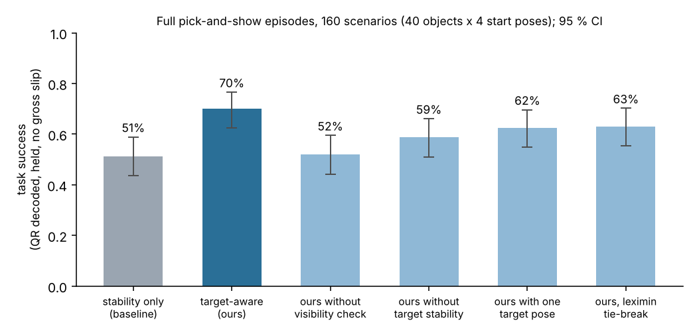

# Grasp-to-Show

[](https://github.com/AghyadA1/grasp-to-show/actions/workflows/tests.yml)

**Target-aware grasp selection: pick an object so that a QR patch on it can be shown to a camera.**

Standard grasp planners pick the most *stable* grasp and ignore what happens next. When the robot
must present a label to a scanner (a routine step in logistics), that is not enough: the fingers
may cover the label, the arm may not reach the presentation pose with that grasp, or the object may
rotate in the hand once gravity acts in a new direction. This project scores grasps by
**whether the whole task succeeds**, and visualises the result as a goal-conditioned heatmap on
the object surface.

**Result: in 160 simulated pick-and-show scenarios (40 scanned products x 4 start poses),
target-aware grasp selection raises task success from 51–52 % to 68–70 %** over a
stability-plus-motion-planning baseline, reproduced on two machines (paired: 41–42 scenarios
won vs 12–16 lost, sign test p ≤ 0.001). Removing the QR-visibility check removes almost all of
the gain.

**Week 2: a learned scorer** (PointNet over the object cloud in the gripper frame, trained on
14,502 simulated episodes) picks grasps on **10 unseen objects** with **85 % task success**
(76 % from geometry alone) vs 65 % for the analytic checks and 55 % for the baseline, in 80
full pick-and-show episodes (vs the checks: 18 scenarios won, 2 lost, p = 4e-4). It mostly fixes
what the static checks cannot see: slip during the motion.


*Same box, same start pose. Left: the most stable grasp holds the box near one end; turned towards
the scanner, gravity twists it 19° in the hand. Right: the target-aware grasp, QR decoded.*




*Left: fingers on the side faces, QR decoded by the scanner. Right: an equally stable grasp whose
finger covers the QR, so decoding fails. A stability-only planner cannot tell these apart.*

> **Status: week 2 of a 3-week plan.** Week 1: scene and scripted pick-and-show, 40 scanned
> products, grasp sampler and simulated lift labels, five analytic checks, C++ kernels, validation
> against 865 full episodes and the policy comparison. Week 2 so far: a 20,902-sample dataset of
> full-episode outcomes, a learned scorer, and its evaluation as a policy on unseen objects.
> Next: goal-conditioned heatmaps on the object surface.

## Quickstart

Linux / macOS:

```bash
git clone https://github.com/AghyadA1/grasp-to-show.git && cd grasp-to-show
python -m venv .venv && source .venv/bin/activate
pip install -e ".[dev]"
python scripts/get_menagerie.py               # Franka Panda model (sparse checkout)

python scripts/get_objects.py                 # 40 scanned products (~55 MB, no git needed)

python scripts/demo_pick_and_show.py          # runs both grasps, writes media/
python scripts/demo_pick_and_show.py --viewer # interactive MuJoCo viewer
python scripts/generate_grasps.py             # grasp candidates + lift labels -> data/grasps/
python scripts/validate_stability.py          # analytic model vs simulated labels
python scripts/evaluate_targets.py            # checks 2-5 on every labelled grasp -> data/feasibility/
python scripts/run_experiments.py             # full episodes: validation + policy comparison
python scripts/demo_comparison.py             # side-by-side video: baseline vs target-aware
pip install ./cpp                             # optional C++ kernels (needs a C++17 compiler)

# learned scorer (week 2)
pip install -e ".[learn]"                     # PyTorch (CPU); for a GPU build see pytorch.org
python scripts/generate_dataset.py            # 20,902 samples, 14,502 simulated episodes (30 min, 11 cores)
python scripts/train_scorer.py                # geometry only -> data/models/scorer.pt
python scripts/train_scorer.py --with-checks --tag scorer_checks
python scripts/eval_learned_policy.py         # the scorers as policies, 80 episodes per policy
pytest -q                                      # ~20 s
```

Windows (PowerShell):

```powershell
git clone https://github.com/AghyadA1/grasp-to-show.git; cd grasp-to-show
python -m venv .venv; .venv\Scripts\Activate.ps1
pip install -e ".[dev]"
python scripts\get_menagerie.py
python scripts\get_objects.py
python scripts\demo_pick_and_show.py
python scripts\generate_grasps.py
python scripts\validate_stability.py
python scripts\evaluate_targets.py
python scripts\run_experiments.py
python scripts\demo_comparison.py
pip install .\cpp                             # optional; needs Visual Studio Build Tools (C++)
pip install -e ".[learn]"
python scripts\generate_dataset.py
python scripts\train_scorer.py
python scripts\train_scorer.py --with-checks --tag scorer_checks
python scripts\eval_learned_policy.py
pytest -q
```

On a headless Linux machine set `MUJOCO_GL=egl` (GPU) or `MUJOCO_GL=osmesa` (CPU).

Expected output:

```
[SUCCESS] grasp=clear_qr_flipped: decoded 'G2S-0001', held=True, slip=0.7 mm / 0.3 deg
[FAIL] grasp=covers_qr_flipped: QR NOT decoded, held=True, slip=0.2 mm / 0.0 deg
```

## How a grasp is judged (ground truth, "check 6")

An episode is a **success** only if, after pick → transit → hold at the target:

1. the scanner camera image decodes to the right QR payload (OpenCV),
2. both fingers still touch the object,
3. the object moved less than 20 mm / 15° *relative to the gripper* since the lift (gross slip; see
   the design notes for why not tighter),
4. no unexpected contact occurred (robot–table, or the held object touching anything but the fingers).

The analytic checks 1–5 and the learned scorer predict this outcome much faster. This simulation is the
reference they are validated against.

## Objects and grasp labels (check 1: lift stability)

**Objects.** All 1,030 [Google Scanned Objects](https://github.com/kevinzakka/mujoco_scanned_objects)
were filtered by written-down criteria (`scripts/select_objects.py`): smallest side 2–7 cm (the
Franka Hand opens to 8 cm), largest side ≤ 25 cm, box-like (convex-hull volume / bounding-box
volume ≥ 0.85, since labels go on flat faces), and a QR of at least 3 cm fits on a flat face.
117 pass; 40 were drawn at random (seeded), split 30 train / 10 *unseen* test objects:
ink cartridges, game cases, cosmetics and food packages. Scans are surfaces, not solids, so mass
and inertia come from the convex hull at 300 kg/m³ (a package is mostly cardboard and air).

**QR placement.** Scanned faces are never exactly flat. Each face of the oriented bounding box is
a candidate plane; a 7×7 grid of rays measures the real surface under the patch, and the face is
accepted only if every ray hits and the heights vary by < 2 mm. The largest accepted QR wins,
side faces preferred, never the bottom.

**Candidates.** Antipodal sampling as in Dex-Net/ACRONYM: a ray from a surface point into the
object finds the opposite contact; the pair is kept if the ray is within 30° of both surface
normals. That is deliberately wider than the true friction cone (atan 0.5 = 26.6°), so some
candidates fail, as with any real sampler. Each pair gets 8 approach directions and a random
depth; candidates where the open gripper intersects the object are dropped.

**Labels.** A floating Franka Hand (same force-limited actuator as the robot) closes on the
object, lifts 10 cm, shakes ±2 cm along the approach and rocks ±0.25 rad about the finger axis.
A grasp succeeds if both fingers still touch the object and it moved < 2 cm in the hand. This
is ACRONYM's labelling recipe, rebuilt in MuJoCo so that labels and the final evaluation share
one physics engine.

**What the labels show.** 5,225 labelled grasps on 40 objects (3 min on an 11-worker laptop),
80 % hold. Light packages hold almost everywhere; heavier ones fail mostly by *rotating about the
finger axis* (a 0.6 kg box: 13 %). A controlled test confirms the mechanism
(0.8 kg bar, 20 N per finger, μ = 0.5, torsional coefficient 5 mm):

| Grasp offset from centre of mass | Gravity torque about finger axis | Held? | Rotation in hand |
|---|---|---|---|
| 0 cm | 0.00 N·m | yes | 0° |
| 2.5 cm | 0.20 N·m | yes | 10° |
| 5 cm | 0.39 N·m | **no** | 46° |
| 10 cm | 0.78 N·m | **no** | 54° |

The threshold sits at the soft-finger torsional limit 2·μ_t·F = 0.20 N·m. That limit is what
check 2 evaluates analytically at the *target* pose, where gravity points in a different
direction in the object frame.

## Checks 1–2: analytic stability, validated against simulation

The analytic model (`grasp2show/stability.py`, derivation in **[docs/physics.md](docs/physics.md)**)
finds the friction utilisation `u` of a grasp: the fraction of the two soft-finger contacts'
friction budget needed to cancel gravity (and, for the shake test, the d'Alembert inertial
loads), with gravity expressed in the object frame. `u ≤ 1`: the grasp holds. Check 1 evaluates
it at the start orientation, check 2 at the target orientation.


With **no fitted parameters** (the simulator's own μ = 0.5, μ_t = 5 mm, 20 N), the simulated
success rate is ~99 % at low `u`, falls steadily, and crosses 50 % just below `u = 1`. On the 10
unseen objects the model ranks grasps with **AUC 0.92–0.94**. Getting there required validating
the simulator first: with MuJoCo's default contact softness, held objects *crept* (a 150 g box
slid 13 mm in a gentle 2.5 s transit) and the model's AUC was only 0.79–0.82; see
[docs/physics.md](docs/physics.md).

## Checks 3–5 and the first result

For every grasp *and its 180° twin* (a different arm configuration; the robot cannot change
twin between picking and showing):

- **Check 3 (start)**: the grasp and the pre-grasp 10 cm back along the approach have an IK
  solution within joint limits, with the open gripper and arm free of collision with the table
  and the object.
- **Check 4 (target)**: for each of 12 target poses (rotations about the camera's viewing axis),
  an IK solution exists with the object in the hand and no contact except fingers–object.
- **Check 2 (target)**: the friction margin with gravity in the target orientation.
- **Check 5 (QR visible)**: rays from the camera to a 7×7 grid on the QR and its four corner
  zones (where the finder patterns are) reach the QR before any finger, hand or arm link; plus
  viewing angle ≤ 45° and ≥ 50 px. On the day-1 box this reproduces the simulation exactly: the
  side grasp sees 100 % of the QR, the face grasp 76 % (blocked by the finger).

IK is an **analytic solver** (He & Liu 2021), ported to vectorised numpy and to C++ from the
Apache-2.0 [frantik](https://github.com/CoMMALab/frantik) implementation, with two fixes found
by testing: the reference's shoulder-singularity shortcut returned poses up to metres off within
2.6° of the singularity, so it now applies only at the exact singularity, and every solution is
verified by forward kinematics (max error 3e-12). Known limit: the almost-straight elbow
(q4 > −0.47 rad) is not covered, which makes reachability slightly conservative at the edge of
the workspace. Collision: MuJoCo kinematics + collision, 7 µs per query.

**Result on 40 objects, 5,225 grasps** (`scripts/evaluate_targets.py`, 40 s):

| | grasps |
|---|---|
| hold when lifted (check 1, simulated) | 4,194 |
| …and reachable at the start (what a stability-only planner accepts) | 1,401 |
| …and pass checks 2, 4, 5 for some target pose: **feasible** | 1,139 |

**19 % of the grasps a stability-only planner would accept fail the task** (21 % with a single
target pose instead of 12). The first failing check is QR visibility for 237 of them and target
stability for 25; target reachability never decides alone. Small packages suffer most (cosmetics,
pill boxes), where a fingertip covers a large share of the face. The full episodes below test
these predictions.

## Results: full pick-and-show episodes

Every number here comes from complete simulated episodes: approach, grasp, lift, transit, present
to the scanner, hold, then OpenCV decodes the scanner image. **Success** = QR decoded, both
fingers still on the object, no gross slip in the hand (< 20 mm, < 15°), no collision.
`scripts/run_experiments.py` reproduces all of it (13 min on 2 CPU cores, 4.5 min on an
11-core laptop).

**Reproducibility.** The whole pipeline (labels, checks, episodes) was run independently on Linux
(GCC) and Windows (MSVC). Contact simulation amplifies floating-point differences in borderline
grasps (1 of 5,225 lift labels differs), so the numbers move slightly:

| | Linux | Windows |
|---|---|---|
| baseline / target-aware success | 51.2 % / 70.0 % | 51.9 % / 67.5 % |
| paired wins (ours / baseline), p | 42 / 12, 5e-5 | 41 / 16, 1.3e-3 |
| success if predicted feasible / infeasible | 72.7 % / 20.8 % | 72.2 % / 21.7 % |
| check 5 vs decoder | 92.4 % | 91.3 % |

The tables below are from the Linux run.

**Policies.** Each policy ranks its choices; the first one whose motion can be planned is
executed (a real system also falls back to its next grasp when motion planning fails).

| Policy | What it knows | Success (160 scenarios) |
|---|---|---|
| stability only (baseline) | most stable grasp (analytic lift margin) that is reachable at start *and* target | 51 % [44, 59] |
| **target-aware (ours)** | all checks; best smallest normalised margin | **70 % [62, 77]** |
| ours without check 5 | no QR visibility | 52 % |
| ours without check 2 | no stability at the target orientation | 59 % |
| ours with one target pose | no target set (roll 0 only) | 62 % |
| ours, leximin tie-break *(post hoc)* | ties broken by the next-smallest margin | 63 % (61 % on Windows) |

[95 % Wilson intervals.] **A lesson in honest evaluation:** after the main experiment I changed
the tie-break among equally ranked grasps because of one demo case, and success *fell* from 70 %
to 61–63 % on both machines. In the 60 scenarios where the two rules chose differently, the
original won 14 and the new one 3; the new choices had the *same* static target-stability margin
(0.78 vs 0.76) but slipped far more during the motion (20 vs 7). Static margins cannot rank grasps
by dynamic slip, which is the learned scorer's job. The rule fixed before the experiment stays the
primary result; the change is reported as a sensitivity test.

The baseline already checks kinematics, so the gap isolates the two new checks: **where ours won, the baseline failed by an unreadable QR (20) or by slipping once the
object was turned (21)**. In 8 scenarios (2 heavy objects) no grasp survives the lift test, which
counts as a failure for every policy.

**Validation of the checks** (865 episodes on random grasps that a stability-only planner would
accept, executed with the checks' best twin and target):

| | |
|---|---|
| success rate when the checks say *feasible* | **73 %** |
| success rate when they say *infeasible* | **21 %** |
| successes the checks find (recall) | 95 % |
| check 5 vs the decoder (episodes where the object stayed in hand) | 92 % agreement |
| success vs target stability margin 0.3–0.6 / 0.6–0.8 / 0.8–1 | 51 % / 65 % / 79 % |

152 of the 865 episodes could not be executed because the simple motion planner found no path
between two feasible end configurations; they are excluded above. **What the checks miss**, in
the 166 predicted-feasible failures: slip during the motion (92: the checks are static),
collisions along the path (41: they check end configurations only) and decoding failures (33).
These are the targets for the learned scorer, which is trained on full-episode outcomes (next).

## Learned scorer: trained on full-episode outcomes

**Question.** The analytic checks are static: they cannot see slip during the motion, which is
their main miss. Can a network trained on what actually happens in complete episodes choose
better grasps, on objects it has never seen?

**Dataset** (`scripts/generate_dataset.py`, 30 min on 11 cores). For each of the 40 objects at 4
start rotations, every lift-stable grasp goes through the checks (both twins, 12 target poses).
Then 100 kinematically feasible (grasp, twin, target) tuples per scenario are drawn *uniformly*
(not by the checks' ranking, so the labels are not biased towards what the checks like) and
executed in the full simulation; cheap negatives (dropped in the lift test, unreachable) are
added. **20,902 samples, 14,502 full episodes, 40 % success.** Each sample also stores the checks'
outputs, so the network and the checks are compared on exactly the same cases.

**Model** (`grasp2show/learn/`). A PointNet over 512 surface points of the object *expressed in
the gripper frame* (position, normal, and a flag for points on the QR patch), plus 32 global
features: gravity in the gripper frame at the start and at the target, the QR normal, the gripper
pose at start and target, opening width, mass and centre of mass. Two heads: P(success), and the
failure reason (8 classes) as an auxiliary loss. 161k parameters. A second variant also receives
the 9 outputs of the analytic checks. Split **by object**: the 10 test objects are never seen in
training; 5 training objects are held out for model selection.

**Offline, on the 10 unseen objects** (`scripts/train_scorer.py`):

| | analytic checks | learned (geometry) | learned + checks' outputs |
|---|---|---|---|
| AUC, simulated tuples (the hard cases) | 0.72 | 0.77 | **0.81** |
| top-1: best-ranked tuple per scenario succeeds | 68 % | 86 % | **92 %** |

(Random pick: 44 %. Oracle: 100 %.)


**As a policy, in full episodes** (`scripts/eval_learned_policy.py`). The 10 unseen objects × 8
start rotations (4 of which never appear in the dataset). All policies keep the exact analytic
IK/collision checks at the start and the target; they differ only in how they rank the
kinematically feasible tuples. Each runs its choice (with the same fallback when the motion can't
be planned) through a complete episode.


| Policy (80 scenarios, unseen objects) | Success [95 % CI] | slip | QR | collision | no grasp holds |
|---|---|---|---|---|---|
| stability only (baseline) | 55 % [44, 65] | 23 | 3 | 2 | 8 |
| analytic checks (ours, week 1) | 65 % [54, 75] | 18 | 1 | 1 | 8 |
| learned, geometry only | 76 % [66, 84] | 10 | 1 | 0 | 8 |
| **learned + checks' outputs** | **85 % [76, 91]** | **2** | 2 | 0 | 8 |

Paired, vs the analytic checks: learned + checks wins 18 scenarios and loses 2 (sign test
p = 4e-4); geometry only wins 14 and loses 5 (p = 0.06). Vs the baseline: 25/1 and 21/4. In 8
scenarios no grasp survives the lift test, so 90 % is the ceiling. **The gain is almost all
slip** (18 → 2): the network learned which grasps stay put while the arm swings the object, which
the static friction margin cannot tell.

**Speed.** Scoring costs about 1.2 ms per tuple on one CPU thread (1.4 s for the 1,206 feasible
tuples of the largest scenario). It does not replace the exact IK/collision checks, which run
first, so on a CPU the network buys accuracy, not speed.

**Caveats.** The network is trained and tested in the same simulator, so part of what it learned
is this simulator's contact behaviour; a real robot would need real or domain-randomised data.
Test objects are unseen but come from the same filtered pool (box-like packages). One training
seed; the two learned variants' intervals overlap. The training scenarios used yaws 0/90/180/270,
so half of the evaluation poses are new for the start pose but not the object.

## C++ kernels

`cpp/` is an optional C++17 package (nanobind bindings, no other dependencies) with the two hot
loops: the soft-finger stability solver and the analytic IK. Python uses it automatically when
installed (`pip install ./cpp`) and falls back to numpy otherwise; tests check both give the same
answers, and CI runs the suite both ways.

| Kernel | numpy | C++ | speed-up |
|---|---|---|---|
| stability, per evaluation (100k batch) | 1.08 µs | 0.44 µs | 2.4× |
| IK, per pose (16 q7 × 4 branches, 5k batch) | 91 µs | 14 µs | 6.7× (2.7× with MSVC on Windows) |
| IK, one grasp's 28 poses (per call) | 2.24 ms | 0.31 ms | 7.2× |
| whole check 2–5 pipeline, 6 objects | 10.1 s | 8.8 s | 1.15× |

Honest reading: numpy was already vectorised, so the kernels are 2–7× faster, but the pipeline
is dominated by MuJoCo collision queries and Python loops. The kernels matter where they would
in a robot: a dependency-free C++ core that can run inside a controller.

## Design notes (and the bugs that motivated them)

| Choice | Why |
|---|---|
| **Force-limited gripper** (`ctrl` = finger gap in m, tendon force clamped) | While the fingers are blocked by the object the servo saturates, so each finger pushes with a known force (20 N). The friction checks need the normal force; the Menagerie default (stiffness 100 N/m) squeezes with only ~1 N. |
| **Elliptic friction cones, `impratio = 10`** | MuJoCo contacts are soft, so "static" friction lets a held object creep. With the defaults the box crept ~1 mm/s in a 20 N grip. |
| **Torsional friction, `condim = 4`** | Lets a two-finger grasp resist torque about the finger axis (the soft-finger model). With `condim = 3` that torque cannot be resisted at all. |
| **Grasp twin (180° about the approach axis)** | A parallel gripper touches the same points either way, but the wrist (joint 7) differs by π. The first version drove joint 7 into its limit, the IK lost track, and the arm knocked the box into the palm. The planner now tries both twins and keeps the one with the larger joint-limit margin. |
| **Cartesian paths + one min-jerk profile per segment** | A joint-space interpolation between far-apart configurations swept the held box through the table. Paths are now straight TCP lines solved by IK at evenly spaced points. |
| **Arm gravity compensation** | As on the real Franka. The payload's weight is not compensated. |
| **TCP site 0.1034 m from the hand frame** | Midway between the fingertip pads, on the approach axis. Grasp poses are poses of this frame. |
| **QR patch as a separate visual geom (group 1)** | Lets the visibility check ray-cast against the label alone. |
| **Labelling hand welded to a mocap target** (not a mocap body itself) | A mocap body teleports with zero velocity, so MuJoCo's velocity-level friction cannot drag the held object along: the first version dropped every object. Welding a dynamic hand to the mocap target gives it a real velocity. |
| **Friction μ = 0.5** | Plastic fingertips on cardboard. With μ = 1 almost every candidate held, which made the labels uninformative. |
| **Stiffer finger/object contacts (5 ms instead of 20 ms)** | MuJoCo's regularised friction made held objects creep: 13 mm in a gentle 2.5 s transit, inversely proportional to its duration. 5 ms (still ≥ 2 × timestep) cut it 5× and lifted the stability model's AUC from 0.8 to 0.92–0.94. |
| **Two QR decoders** | OpenCV's classic detector missed a fully visible 90-px code on busy packaging; its ArUco-based detector read it. Real scanners are robust, so the judge tries both. |
| **Gross-slip threshold 20 mm / 15°** | A 70 g box with 96 % friction reserve still creeps a few mm; a 5 mm limit would score the simulator, not the grasp. Exact slip is always recorded. |
| **Target configuration closest to the start one** | The checker first picked the target configuration with the most joint-limit margin; the arm then spun its wrist 265° while carrying the object. |
| **Collision-checked joint-space segments with detours** | The transit swung held objects into the table; the planner now checks the path and detours via a raised pose. |

## Repository layout

```
grasp2show/
  config.py      scene, object, camera, gripper parameters (dataclasses)
  scene.py       builds the MuJoCo model with MjSpec from the unmodified Menagerie Panda
  qr.py          QR texture generation and decoding
  ik.py          differential IK (mink, QP with joint limits) for the TCP
  motion.py      min-jerk timing, Cartesian line interpolation
  task.py        grasp representation (T_obj_tcp), grasp twins, show (target) pose
  episode.py     scripted pick -> show episode and ground-truth evaluation
  objects.py     primitive box and scanned objects: mesh, mass, inertia, QR, MuJoCo geoms
  object_set.json  the 40 selected objects, train/test split, cached QR placements
  qr_placement.py  flat-face search for the QR patch (bounding box + ray casting)
  grasp_sampler.py antipodal candidates -> 6-DoF grasps
  gripper_sim.py   floating-hand shake test (labels for check 1, ground truth for check 2)
  stability.py     analytic soft-finger stability model (checks 1-2)
  franka_ik.py     analytic Franka IK, vectorised (port of He & Liu / frantik)
  feasibility.py   checks 2-5: target stability, reachability + collision, QR visibility
  _accel.py        uses the C++ kernels when installed
  experiment.py    grasp-selection policies, scenario setup, episode execution and judging
  learn/           learned scorer: dataset loading and features (data.py), PointNet model
                   (model.py), the scorer as a grasp-selection policy (policy.py)
cpp/               optional C++17 kernels + nanobind bindings (stability, IK)
docs/physics.md    derivation of the stability model and its validation
scripts/
  demo_pick_and_show.py   get_menagerie.py   get_objects.py
  select_objects.py       generate_grasps.py      validate_stability.py
  evaluate_targets.py     bench_cpp.py            run_experiments.py      demo_comparison.py
  generate_dataset.py     train_scorer.py         eval_learned_policy.py
tests/
```

Frames: `world` (z up, robot base at origin, table top at z = 0), `obj` (box centre, or the
scan's own frame with z up and the base at z = 0), `qr` (x = outward normal of the patch),
`tcp` (z = approach, y = finger closing axis). A grasp is the constant transform `T_obj_tcp`;
at any object pose the gripper must be at `T_world_obj @ T_obj_tcp`. That single equation is
why the choice of grasp at the start fixes the arm configuration at the target.

## Roadmap

- [x] Scene, QR object, scanner camera, scripted pick → move → show, ground-truth evaluation
- [x] Real objects (40 scanned products), automatic QR placement, grasp sampler, simulated lift labels
- [x] Analytic stability (checks 1–2): soft-finger model, validated on 5,225 simulated grasps
- [x] Reachability at start and target (checks 3–4) · QR visibility by ray casting (check 5)
- [x] C++ kernels (stability, analytic IK) with Python bindings and speed comparison
- [x] Validate checks 1–5 against full pick-and-show episodes (QR decoded by OpenCV)
- [x] Target *set* (12 rotations about the viewing axis)
- [ ] Robust labels under object-pose noise
- [x] Baseline (most stable grasp) vs target-aware selection, ablations: success-rate table
- [x] Learned scorer (point cloud + grasp + target → success), trained on full-episode outcomes; speed and unseen-object test
- [ ] Goal-conditioned grasp heatmaps on the object surface
- [ ] v2: dexterous hand · v3: regrasp · v4: unknown shape · v5: explore, then show

## Related work

- Target-pose-conditioned grasp feasibility has been learned before: Liu et al. predict IK and
  collision feasibility of a grasp for a given start and target pose
  ([arXiv:2512.18922](https://arxiv.org/abs/2512.18922)); Qin et al. learn an energy-based
  model of grasp feasibility across poses for pick-and-place
  ([arXiv:2506.15920](https://arxiv.org/abs/2506.15920)); ReorientBot learns grasp/placement
  feasibility for specific-pose placement ([arXiv:2202.11092](https://arxiv.org/abs/2202.11092)).
  None of them model **visibility of a surface region** or **grasp stability under the rotated
  gravity at the target**, and none output a **dense goal-conditioned heatmap**: those are the
  focus here.
- Grasp quality maps: GG-CNN, Contact-GraspNet, Graspness. Intent-dependent contact maps: ContactDB.
- Labelling recipe: ACRONYM (Eppner et al., 2021), here rebuilt in MuJoCo on open objects.

## License

Code: MIT. The Franka Panda model is fetched from MuJoCo Menagerie under its own license.
Objects: Google Scanned Objects (Google Research, CC-BY 4.0), MuJoCo conversion by
[kevinzakka/mujoco_scanned_objects](https://github.com/kevinzakka/mujoco_scanned_objects).
The analytic IK (`grasp2show/franka_ik.py`, `cpp/src/franka_ik.hpp`) is adapted from
[frantik](https://github.com/CoMMALab/frantik), Apache-2.0 (`licenses/frantik-Apache-2.0.txt`).
