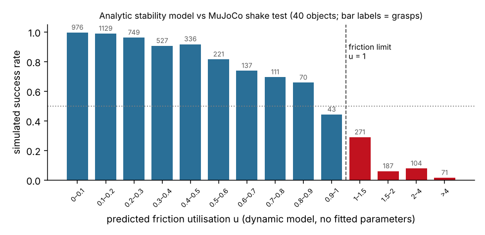
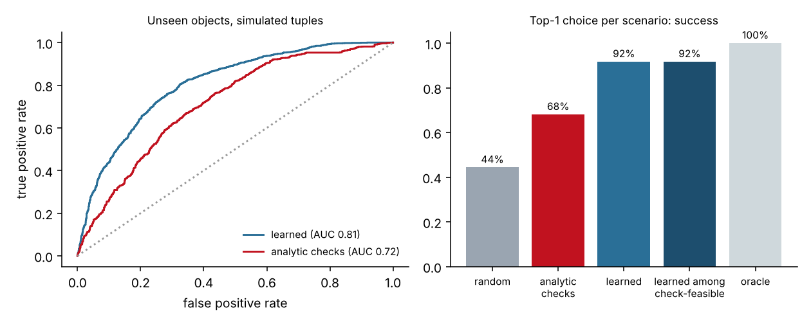
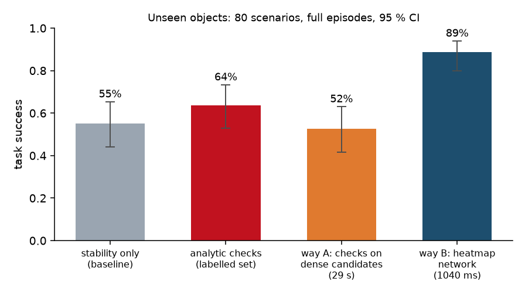
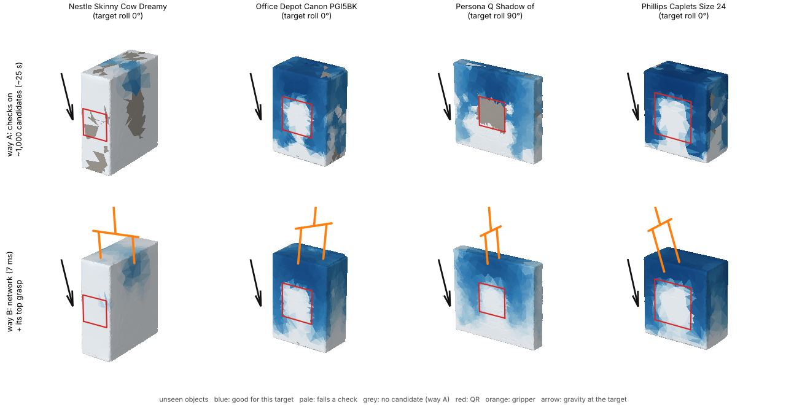
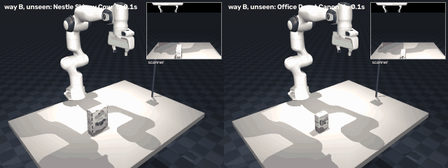
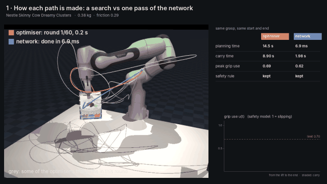
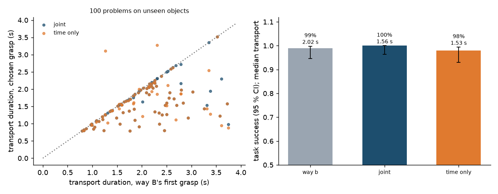
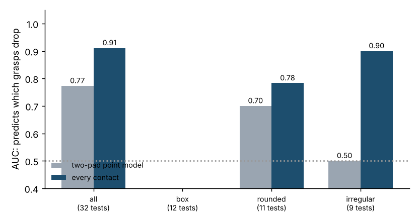
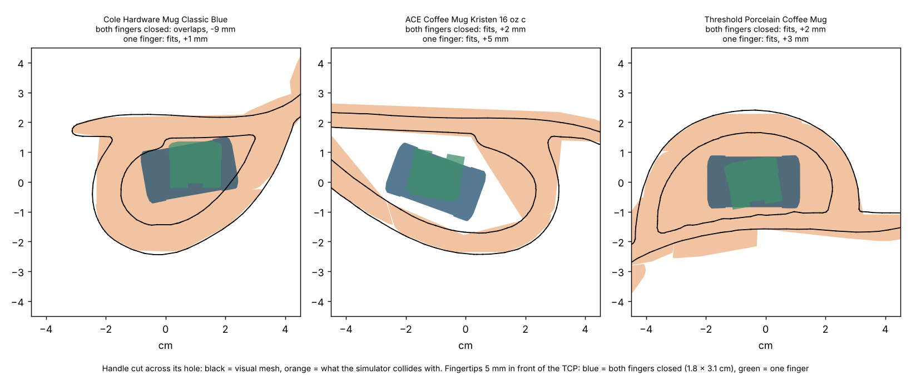
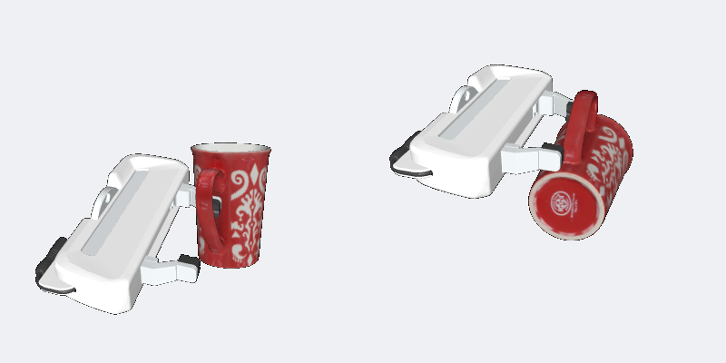

# Grasp-to-Show

[](https://github.com/AghyadA1/grasp-to-show/actions/workflows/tests.yml)

**Target-aware grasp selection: pick an object so that a QR patch on it can be shown to a camera.**

Standard grasp planners pick the most *stable* grasp and ignore what happens next. When the robot
must present a label to a scanner (a routine step in logistics), that is not enough: the fingers
may cover the label, the arm may not reach the presentation pose with that grasp, or the object may
rotate in the hand once gravity acts in a new direction. This project scores grasps by
**whether the whole task succeeds**, and visualises the result as a goal-conditioned heatmap on
the object surface.

**Result: in 160 simulated pick-and-show scenarios (40 scanned products x 4 start poses),
target-aware grasp selection raises task success from 51–52 % to 68–70 %** over a
stability-plus-motion-planning baseline, reproduced on two machines (paired: 41–42 scenarios
won vs 12–16 lost, sign test p ≤ 0.001). Removing the QR-visibility check removes almost all of
the gain.

**Week 2: a learned scorer** (PointNet over the object cloud in the gripper frame, trained on
14,502 simulated episodes) picks grasps on **10 unseen objects** with **85 % task success**
(76 % from geometry alone) vs 65 % for the analytic checks and 55 % for the baseline, in 80
full pick-and-show episodes (vs the checks: 18 scenarios won, 2 lost, p = 4e-4). It mostly fixes
what the static checks cannot see: slip during the motion.

**Week 3: a goal-conditioned heatmap network** (way B) predicts, from the object's point cloud
and the task, a grasp score and a grasp at every surface point in 7 ms on a laptop GPU. Its
grasps succeed in **89–94 %** (3 seeds) of 80 full episodes on unseen objects (baseline 55 %,
analytic checks 64 %; paired vs the checks: 27 won, 7 lost, p = 8e-4). It even beats the slow
search it imitates (51 %); a controlled test shows why: it prefers regions where many grasps
work over the single best-scoring one.

**One-page summary:** [docs/grasp-to-show-summary.pdf](docs/grasp-to-show-summary.pdf)


*Same box of crayons, same start pose. Left: the baseline takes the most stable grasp; at the
scanner a finger covers part of the QR and it cannot be read (inset: the scanner's view). Right:
the target-aware grasp was chosen knowing where the fingers will be at the scanner, so the QR is
unobstructed and decoded.*


*The same two episodes in one view (orange: baseline, blue: ours, each at half opacity), with
the path of each gripper drawn in 3D. The two grasps send the arm on visibly different paths to
the same scanner; insets: what the scanner sees. (`scripts/demo_overlay.py`)*


*Left: fingers on the side faces, QR decoded by the scanner. Right: an equally stable grasp whose
finger covers the QR, so decoding fails. A stability-only planner cannot tell these apart.*

> **Status: week 3 of a 3-week plan.** Week 1: scene and scripted pick-and-show, 40 scanned
> products, grasp sampler and simulated lift labels, five analytic checks, C++ kernels, validation
> against 865 full episodes and the policy comparison. Week 2: a 20,902-sample dataset of
> full-episode outcomes, a learned scorer and its evaluation as a policy on unseen objects, and
> goal-conditioned heatmaps (way A), robustness to pose error, one-page summary. Week 3: way B,
> the heatmap network (done, results below).

## Quickstart

Linux / macOS:

```bash
git clone https://github.com/AghyadA1/grasp-to-show.git && cd grasp-to-show
python -m venv .venv && source .venv/bin/activate
pip install -e ".[dev]"
python scripts/get_menagerie.py               # Franka Panda model (sparse checkout)

python scripts/get_objects.py                 # 40 scanned products (~55 MB, no git needed)

python scripts/demo_pick_and_show.py          # runs both grasps, writes media/
python scripts/demo_pick_and_show.py --viewer # interactive MuJoCo viewer
python scripts/generate_grasps.py             # grasp candidates + lift labels -> data/grasps/
python scripts/validate_stability.py          # analytic model vs simulated labels
python scripts/evaluate_targets.py            # checks 2-5 on every labelled grasp -> data/feasibility/
python scripts/run_experiments.py             # full episodes: validation + policy comparison
python scripts/demo_comparison.py             # side-by-side video: baseline vs target-aware
pip install ./cpp                             # optional C++ kernels (needs a C++17 compiler)

# learned scorer (week 2)
pip install -e ".[learn]"                     # PyTorch (CPU); for a GPU build see pytorch.org
python scripts/generate_dataset.py            # 20,902 samples, 14,502 simulated episodes (30 min, 11 cores)
python scripts/train_scorer.py                # geometry only -> data/models/scorer.pt
python scripts/train_scorer.py --with-checks --tag scorer_checks
python scripts/eval_learned_policy.py         # the scorers as policies, 80 episodes per policy
pytest -q                                      # ~20 s
```

Windows (PowerShell):

```powershell
git clone https://github.com/AghyadA1/grasp-to-show.git; cd grasp-to-show
python -m venv .venv; .venv\Scripts\Activate.ps1
pip install -e ".[dev]"
python scripts\get_menagerie.py
python scripts\get_objects.py
python scripts\demo_pick_and_show.py
python scripts\generate_grasps.py
python scripts\validate_stability.py
python scripts\evaluate_targets.py
python scripts\run_experiments.py
python scripts\demo_comparison.py
pip install .\cpp                             # optional; needs Visual Studio Build Tools (C++)
pip install -e ".[learn]"
python scripts\generate_dataset.py
python scripts\train_scorer.py
python scripts\train_scorer.py --with-checks --tag scorer_checks
python scripts\eval_learned_policy.py
pytest -q
```

**Skip the long runs:** the data and trained models behind every number here are on the
[`data` branch](https://github.com/AghyadA1/grasp-to-show/tree/data) (`data-linux.tgz`,
`data-windows.tgz`); extract one in the repository root.

On a headless Linux machine set `MUJOCO_GL=egl` (GPU) or `MUJOCO_GL=osmesa` (CPU).

Expected output:

```
[SUCCESS] grasp=clear_qr_flipped: decoded 'G2S-0001', held=True, slip=0.7 mm / 0.3 deg
[FAIL] grasp=covers_qr_flipped: QR NOT decoded, held=True, slip=0.2 mm / 0.0 deg
```

## How a grasp is judged (ground truth, "check 6")

An episode is a **success** only if, after pick → transit → hold at the target:

1. the scanner camera image decodes to the right QR payload (OpenCV),
2. both fingers still touch the object,
3. the object moved less than 20 mm / 15° *relative to the gripper* since the lift (gross slip; see
   the design notes for why not tighter),
4. no unexpected contact occurred (robot–table, or the held object touching anything but the fingers).

The analytic checks 1–5 and the learned scorer predict this outcome much faster. This simulation is the
reference they are validated against.

## Objects and grasp labels (check 1: lift stability)

**Objects.** All 1,030 [Google Scanned Objects](https://github.com/kevinzakka/mujoco_scanned_objects)
were filtered by written-down criteria (`scripts/select_objects.py`): smallest side 2–7 cm (the
Franka Hand opens to 8 cm), largest side ≤ 25 cm, box-like (convex-hull volume / bounding-box
volume ≥ 0.85, since labels go on flat faces), and a QR of at least 3 cm fits on a flat face.
117 pass; 40 were drawn at random (seeded), split 30 train / 10 *unseen* test objects:
ink cartridges, game cases, cosmetics and food packages. Scans are surfaces, not solids, so mass
and inertia come from the convex hull at 300 kg/m³ (a package is mostly cardboard and air).

**QR placement.** Scanned faces are never exactly flat. Each face of the oriented bounding box is
a candidate plane; a 7×7 grid of rays measures the real surface under the patch, and the face is
accepted only if every ray hits and the heights vary by < 2 mm. The largest accepted QR wins,
side faces preferred, never the bottom.

**Candidates.** Antipodal sampling as in Dex-Net/ACRONYM: a ray from a surface point into the
object finds the opposite contact; the pair is kept if the ray is within 30° of both surface
normals. That is deliberately wider than the true friction cone (atan 0.5 = 26.6°), so some
candidates fail, as with any real sampler. Each pair gets 8 approach directions and a random
depth; candidates where the open gripper intersects the object are dropped.

**Labels.** A floating Franka Hand (same force-limited actuator as the robot) closes on the
object, lifts 10 cm, shakes ±2 cm along the approach and rocks ±0.25 rad about the finger axis.
A grasp succeeds if both fingers still touch the object and it moved < 2 cm in the hand. This
is ACRONYM's labelling recipe, rebuilt in MuJoCo so that labels and the final evaluation share
one physics engine.

**What the labels show.** 5,225 labelled grasps on 40 objects (3 min on an 11-worker laptop),
80 % hold. Light packages hold almost everywhere; heavier ones fail mostly by *rotating about the
finger axis* (a 0.6 kg box: 13 %). A controlled test confirms the mechanism
(0.8 kg bar, 20 N per finger, μ = 0.5, torsional coefficient 5 mm):

| Grasp offset from centre of mass | Gravity torque about finger axis | Held? | Rotation in hand |
|---|---|---|---|
| 0 cm | 0.00 N·m | yes | 0° |
| 2.5 cm | 0.20 N·m | yes | 10° |
| 5 cm | 0.39 N·m | **no** | 46° |
| 10 cm | 0.78 N·m | **no** | 54° |

The threshold sits at the soft-finger torsional limit 2·μ_t·F = 0.20 N·m. That limit is what
check 2 evaluates analytically at the *target* pose, where gravity points in a different
direction in the object frame.

## Checks 1–2: analytic stability, validated against simulation

The analytic model (`grasp2show/stability.py`, derivation in **[docs/physics.md](docs/physics.md)**)
finds the friction utilisation `u` of a grasp: the fraction of the two soft-finger contacts'
friction budget needed to cancel gravity (and, for the shake test, the d'Alembert inertial
loads), with gravity expressed in the object frame. `u ≤ 1`: the grasp holds. Check 1 evaluates
it at the start orientation, check 2 at the target orientation.



With **no fitted parameters** (the simulator's own μ = 0.5, μ_t = 5 mm, 20 N), the simulated
success rate is ~99 % at low `u`, falls steadily, and crosses 50 % just below `u = 1`. On the 10
unseen objects the model ranks grasps with **AUC 0.92–0.94**. Getting there required validating
the simulator first: with MuJoCo's default contact softness, held objects *crept* (a 150 g box
slid 13 mm in a gentle 2.5 s transit) and the model's AUC was only 0.79–0.82; see
[docs/physics.md](docs/physics.md).

## Checks 3–5 and the first result

For every grasp *and its 180° twin* (a different arm configuration; the robot cannot change
twin between picking and showing):

- **Check 3 (start)**: the grasp and the pre-grasp 10 cm back along the approach have an IK
  solution within joint limits, with the open gripper and arm free of collision with the table
  and the object.
- **Check 4 (target)**: for each of 12 target poses (rotations about the camera's viewing axis),
  an IK solution exists with the object in the hand and no contact except fingers–object.
- **Check 2 (target)**: the friction margin with gravity in the target orientation.
- **Check 5 (QR visible)**: rays from the camera to a 7×7 grid on the QR and its four corner
  zones (where the finder patterns are) reach the QR before any finger, hand or arm link; plus
  viewing angle ≤ 45° and ≥ 50 px. On the day-1 box this reproduces the simulation exactly: the
  side grasp sees 100 % of the QR, the face grasp 76 % (blocked by the finger).

IK is an **analytic solver** (He & Liu 2021), ported to vectorised numpy and to C++ from the
Apache-2.0 [frantik](https://github.com/CoMMALab/frantik) implementation, with two fixes found
by testing: the reference's shoulder-singularity shortcut returned poses up to metres off within
2.6° of the singularity, so it now applies only at the exact singularity, and every solution is
verified by forward kinematics (max error 3e-12). Known limit: the almost-straight elbow
(q4 > −0.47 rad) is not covered, which makes reachability slightly conservative at the edge of
the workspace. Collision: MuJoCo kinematics + collision, 7 µs per query.

**Result on 40 objects, 5,225 grasps** (`scripts/evaluate_targets.py`, 40 s):

| | grasps |
|---|---|
| hold when lifted (check 1, simulated) | 4,194 |
| …and reachable at the start (what a stability-only planner accepts) | 1,401 |
| …and pass checks 2, 4, 5 for some target pose: **feasible** | 1,139 |

**19 % of the grasps a stability-only planner would accept fail the task** (21 % with a single
target pose instead of 12). The first failing check is QR visibility for 237 of them and target
stability for 25; target reachability never decides alone. Small packages suffer most (cosmetics,
pill boxes), where a fingertip covers a large share of the face. The full episodes below test
these predictions.

## Results: full pick-and-show episodes

Every number here comes from complete simulated episodes: approach, grasp, lift, transit, present
to the scanner, hold, then OpenCV decodes the scanner image. **Success** = QR decoded, both
fingers still on the object, no gross slip in the hand (< 20 mm, < 15°), no collision.
`scripts/run_experiments.py` reproduces all of it (13 min on 2 CPU cores, 4.5 min on an
11-core laptop).

**Reproducibility.** The whole pipeline (labels, checks, episodes) was run independently on Linux
(GCC) and Windows (MSVC). Contact simulation amplifies floating-point differences in borderline
grasps (1 of 5,225 lift labels differs), so the numbers move slightly:

| | Linux | Windows |
|---|---|---|
| baseline / target-aware success | 51.2 % / 70.0 % | 51.9 % / 67.5 % |
| paired wins (ours / baseline), p | 42 / 12, 5e-5 | 41 / 16, 1.3e-3 |
| success if predicted feasible / infeasible | 72.7 % / 20.8 % | 72.2 % / 21.7 % |
| check 5 vs decoder | 92.4 % | 91.3 % |

The tables below are from the Linux run.

**Policies.** Each policy ranks its choices; the first one whose motion can be planned is
executed (a real system also falls back to its next grasp when motion planning fails).

| Policy | What it knows | Success (160 scenarios) |
|---|---|---|
| stability only (baseline) | most stable grasp (analytic lift margin) that is reachable at start *and* target | 51 % [44, 59] |
| **target-aware (ours)** | all checks; best smallest normalised margin | **70 % [62, 77]** |
| ours without check 5 | no QR visibility | 52 % |
| ours without check 2 | no stability at the target orientation | 59 % |
| ours with one target pose | no target set (roll 0 only) | 62 % |
| ours, leximin tie-break *(post hoc)* | ties broken by the next-smallest margin | 63 % (61 % on Windows) |

[95 % Wilson intervals.] **A lesson in honest evaluation:** after the main experiment I changed
the tie-break among equally ranked grasps because of one demo case, and success *fell* from 70 %
to 61–63 % on both machines. In the 60 scenarios where the two rules chose differently, the
original won 14 and the new one 3; the new choices had the *same* static target-stability margin
(0.78 vs 0.76) but slipped far more during the motion (20 vs 7). Static margins cannot rank grasps
by dynamic slip, which is the learned scorer's job. The rule fixed before the experiment stays the
primary result; the change is reported as a sensitivity test.

The baseline already checks kinematics, so the gap isolates the two new checks: **where ours won, the baseline failed by an unreadable QR (20) or by slipping once the
object was turned (21)**. In 8 scenarios (2 heavy objects) no grasp survives the lift test, which
counts as a failure for every policy.

**Validation of the checks** (865 episodes on random grasps that a stability-only planner would
accept, executed with the checks' best twin and target):

| | |
|---|---|
| success rate when the checks say *feasible* | **73 %** |
| success rate when they say *infeasible* | **21 %** |
| successes the checks find (recall) | 95 % |
| check 5 vs the decoder (episodes where the object stayed in hand) | 92 % agreement |
| success vs target stability margin 0.3–0.6 / 0.6–0.8 / 0.8–1 | 51 % / 65 % / 79 % |

152 of the 865 episodes could not be executed because the simple motion planner found no path
between two feasible end configurations; they are excluded above. **What the checks miss**, in
the 166 predicted-feasible failures: slip during the motion (92: the checks are static),
collisions along the path (41: they check end configurations only) and decoding failures (33).
These are the targets for the learned scorer, which is trained on full-episode outcomes (next).

## Learned scorer: trained on full-episode outcomes

**Question.** The analytic checks are static: they cannot see slip during the motion, which is
their main miss. Can a network trained on what actually happens in complete episodes choose
better grasps, on objects it has never seen?

**Dataset** (`scripts/generate_dataset.py`, 30 min on 11 cores). For each of the 40 objects at 4
start rotations, every lift-stable grasp goes through the checks (both twins, 12 target poses).
Then 100 kinematically feasible (grasp, twin, target) tuples per scenario are drawn *uniformly*
(not by the checks' ranking, so the labels are not biased towards what the checks like) and
executed in the full simulation; cheap negatives (dropped in the lift test, unreachable) are
added. **20,902 samples, 14,502 full episodes, 40 % success.** Each sample also stores the checks'
outputs, so the network and the checks are compared on exactly the same cases.

**Model** (`grasp2show/learn/`). A PointNet over 512 surface points of the object *expressed in
the gripper frame* (position, normal, and a flag for points on the QR patch), plus 32 global
features: gravity in the gripper frame at the start and at the target, the QR normal, the gripper
pose at start and target, opening width, mass and centre of mass. Two heads: P(success), and the
failure reason (8 classes) as an auxiliary loss. 161k parameters. A second variant also receives
the 9 outputs of the analytic checks. Split **by object**: the 10 test objects are never seen in
training; 5 training objects are held out for model selection.

**Offline, on the 10 unseen objects** (`scripts/train_scorer.py`; 5 training seeds, which also
change the validation objects; mean ± std, [min, max]):

| | analytic checks | learned (geometry) | learned + checks' outputs |
|---|---|---|---|
| AUC, simulated tuples (the hard cases) | 0.72 | 0.79 ± 0.01 [0.77, 0.80] | **0.82 ± 0.01** [0.81, 0.82] |
| top-1: best-ranked tuple per scenario succeeds (36 scenarios) | 68 % | 83 ± 7 % [72, 92] | **87 ± 4 %** [81, 92] |

(Random pick: 44 %. Oracle: 100 %.) The ranking quality (AUC) is stable across seeds; top-1 on 36
scenarios is noisy, especially for the geometry-only model (a GPU re-run of seed 0 gave 64 %).
The checks' outputs make the network both better and steadier. The episodes below use seed 0.



**As a policy, in full episodes** (`scripts/eval_learned_policy.py`). The 10 unseen objects × 8
start rotations (4 of which never appear in the dataset). All policies keep the exact analytic
IK/collision checks at the start and the target; they differ only in how they rank the
kinematically feasible tuples. Each runs its choice (with the same fallback when the motion can't
be planned) through a complete episode.


| Policy (80 scenarios, unseen objects) | Success [95 % CI] | slip | QR | collision | no grasp holds |
|---|---|---|---|---|---|
| stability only (baseline) | 55 % [44, 65] | 23 | 3 | 2 | 8 |
| analytic checks (ours, week 1) | 65 % [54, 75] | 18 | 1 | 1 | 8 |
| learned, geometry only | 76 % [66, 84] | 10 | 1 | 0 | 8 |
| **learned + checks' outputs** | **85 % [76, 91]** | **2** | 2 | 0 | 8 |

Paired, vs the analytic checks: learned + checks wins 18 scenarios and loses 2 (sign test
p = 4e-4); geometry only wins 14 and loses 5 (p = 0.06). Vs the baseline: 25/1 and 21/4. In 8
scenarios no grasp survives the lift test, so 90 % is the ceiling. **The gain is almost all
slip** (18 → 2): the network learned which grasps stay put while the arm swings the object, which
the static friction margin cannot tell.

**Speed.** Scoring costs 50 µs per tuple on a laptop GPU (RTX 3050, batches of 1,024), 26×
faster than the same laptop's CPU (1.3 ms); a whole scenario's 1,206 feasible tuples take 60 ms.
Training: 80 s on that GPU vs 9–11 min on 2 CPU cores. The network does not replace the exact
IK/collision checks, which run first: it buys accuracy more than speed.

**Caveats.** The network is trained and tested in the same simulator, so part of what it learned
is this simulator's contact behaviour; a real robot would need real or domain-randomised data.
Test objects are unseen but come from the same filtered pool (box-like packages). The episode
results use one training seed (see the seed spread above); the two learned variants' intervals
overlap. The training scenarios used yaws 0/90/180/270,
so half of the evaluation poses are new for the start pose but not the object.

## Robustness: the object is not exactly where the robot thinks

A real robot estimates the object's pose with some error. Here every policy chooses and plans its
grasp for the nominal pose, then the episode runs with the object actually shifted on the table by
a random offset it does not know about (dx, dy ~ N(0, σ), yaw ~ N(0, σ_yaw)); 3 offsets per level,
the same offsets for every policy (`scripts/robustness.py`, run on Windows).


| σ position / yaw | baseline | analytic checks | learned + checks | learned vs checks (paired wins / losses) |
|---|---|---|---|---|
| 0 | 55 % | 64 % | **82 %** | 17 / 2 |
| 2 mm / 2° | 53 % | 61 % | **83 %** | 60 / 8 |
| 5 mm / 5° | 48 % | 54 % | **76 %** | 66 / 12 |
| 10 mm / 10° | 40 % | 44 % | **50 %** | 47 / 31 (p = 0.09) |

The learned choice keeps its lead up to 5 mm / 5°. At 10 mm / 10° every policy collapses into
the same failure: the gripper, sent open-loop to where the object should be, hits it (65–79
collisions per policy). That is the limit of executing a plan without looking again, not of grasp
selection; closing the loop (re-detecting the object before the approach) is the fix. The
nominal row reproduces the Linux episodes on Windows (55 / 65 / 85 % there).

## Goal-conditioned grasp heatmaps (way A)


*Where to grasp the crayon box, for each target pose. Left: what a target-blind planner sees
(lift stability only), the same for every target. Right: the target-aware map: each surface point
shows the best score among the grasps whose finger touches within 8 mm of it, for **this**
target (0 = some check fails). The arrow is gravity at the target, in the object frame; as the
target rolls about the scanner's viewing axis, gravity, arm reach and finger visibility change,
and so does the map. The QR patch (red) is always cold: a finger there hides the code, and so is
the matching spot on the opposite face, which is only reachable by a pinch through the QR.*

`scripts/heatmap_way_a.py` samples ~3,200 candidates per object (1,193 collision-free here), runs
the checks for both twins and 24 target poses, and paints the scores onto the mesh: 19 s on 2
cores, no training (lift stability from the analytic model). The map answers "where can I grasp
this object *for this task*?", which a stability map cannot: on the 10 unseen objects, 2–48 %
of the collision-free candidates are feasible for at least one target pose. Way B learns this map
directly.

## Way B: a network that predicts the heatmap

**Labels** (`scripts/generate_dense_labels.py`, 7 min on 11 cores): way A for every object
(40) × start pose (4) × target pose (12): ~1,000 dense candidates each, scored by all the checks
(both twins). A surface point's label is the best candidate whose finger touches within 8 mm, plus
that candidate's approach direction, closing direction, TCP offset and width.

**Network** (`grasp2show/learn/dense.py`, 256k parameters). Per point: an edge convolution over the
16 nearest neighbours (local shape, as in DGCNN), then a PointNet with a global max-pool. The task
enters every point's features: gravity, the world x axis and the robot base position in the object
frame at the start and at the target, the camera direction at the target, mass and centre of mass.
Per-point outputs: P(feasible), score, approach, closing axis (sign-free: the two twins are one
grasp for the fingers), TCP offset, width, in the style of Contact-GraspNet. Loss on labelled
points only; the grasp terms only where a feasible grasp exists. Split by object, as everywhere.

**Offline, unseen objects** (480 object × start × target cases, `scripts/train_heatmap_net.py`,
5 min on an RTX 3050): point AUC **0.94**; on feasible points the predicted grasp is a median
22° (approach), 8 mm (TCP) and 4.5 mm (width) from the best label grasp. One forward pass (1,024
points, one target): **7 ms on the GPU**, 20 ms on the CPU, vs ~20–30 s for way A. A "is there a
feasible grasp at the top point" score is not informative here (half the labelled points have
one: the target-blind stability map scores as high as the network), so the test that counts is
the network's *own* grasp in a full episode:



**In full episodes** (`scripts/eval_way_b.py`; 10 unseen objects × 8 start poses, half of them
never in training). The network's best (point, target) pairs become grasps; the first 10 whose
open gripper clears the object (the filter every sampled candidate gets) go through the exact
start/target reach checks and the usual planning fallback, then a complete episode. All five
policies run on the same scenarios (paired; Windows run, `data/episodes_way_b_final`).

| Policy (80 scenarios, unseen objects) | Success [95 % CI] | slip | QR | collision | no grasp | way B wins / losses |
|---|---|---|---|---|---|---|
| stability only (baseline) | 55 % [44, 65] | 22 | 4 | 2 | 8 | 29 / 2 |
| analytic checks (labelled candidates) | 64 % [53, 73] | 19 | 1 | 1 | 8 | 27 / 7 |
| way A: all checks, ~1,000 dense candidates, best score | 51 % [41, 62] | 24 | 8 | 7 | 0 | 31 / 1 |
| way A, score averaged over neighbouring grasps | 84 % [74, 90] | 4 | 1 | 8 | 0 | 7 / 3 |
| **way B: heatmap network** | **89 % [80, 94]** | 8 | 1 | 0 | 0 | |

Three training seeds of way B: **89 %, 94 %, 93 %** (mean 92 %); offline point AUC 0.93–0.94.



*Four unseen objects. Top: way A, the checks run on ~1,000 candidates (~25 s). Bottom: the
network's map from one forward pass (7 ms) and its top grasp (orange), for the target it rates
best. Arrow: gravity at the target; red: the QR patch.*



*The network's grasps executed in full simulation on two unseen objects; left, the box for which
none of the labelled candidates was usable.*

**Why does the student beat its teacher?** Way B was trained to imitate way A, yet plain way A
is the worst policy here. The hypothesis was that way A takes the *maximum* of an imperfect score
over ~1,000 candidates, which favours candidates whose score is overestimated (the winner's
curse: lift stability here comes from the analytic model, not simulation), while the network
*averages* over neighbouring candidates and so prefers regions where many grasps work. The test,
decided before running it: rank way A's own feasible candidates by their score averaged over the
neighbouring grasps (TCP within 1 cm, axes within 30°). Result: **51 % → 84 %** (28 scenarios
won, 2 lost, p = 9e-7), with slip failures falling from 24 to 4, and the network is no longer
significantly better (7 / 3, p = 0.34). So most of way B's advantage comes from preferring
robust *regions* over the single best-scoring grasp, an effect that a cheap smoothing step
also gets; the network delivers it in 7 ms instead of 25 s, and with fewer collisions (0 vs 8),
because its proposed grasps sit centrally in such regions.

Caveats: labels from the analytic checks only (the simulator judges the episodes); 80
scenarios. An earlier run of the smoothed variant was corrupted by a rendering bug (see design
notes); every other result was re-run with the fix and reproduced exactly (80 / 80 identical).


## Part 2: carrying the object so the grasp holds (in progress)

Same grasp, same start, same presentation pose; only *how the arm moves in between* changes. A
two-finger grasp is anisotropic: a load along the finger axis is carried by the grip force itself
(up to 2F), a load across it only by friction (2μF), and a torque about the finger axis only by
torsional friction, the weakest of all. Leverage turns every load with a lever arm into torque.
So a motion that points the combined load of gravity and acceleration where the grasp is strong
can be faster without slipping (the tray version of this idea: [Heins & Schoellig, RA-L 2023](https://arxiv.org/pdf/2305.17484);
time-optimal retiming with grasp constraints: [Pham & Pham, ICRA 2019](https://arxiv.org/pdf/1809.03151);
learned constraints: [GOMP-ST](https://arxiv.org/pdf/2203.08359)).

**The load the motion asks of the grasp** (`grasp2show/transport.py`): from the object's
trajectory, the d'Alembert load m(g − a) and the inertial torque, fed to the soft-finger model,
give the friction utilisation u(t) at every instant. It is made *robust to leverage*: the grasp must
also hold with the centre of mass ±5 mm off along each gripper axis, because an object balanced on
the finger axis looks perfectly safe to the nominal model yet behaves like an inverted pendulum on
the lower finger. A hold test in simulation (`scripts/hold_tilt_test.py`) also showed the simulated
hand carries much less along its finger axis than the ideal 2F (a 1.5 kg box tilted vertical held
with 9 mm slip, 2 kg was lost), so that load is capped at 14 N.

**Today's planner, measured** (`scripts/transport_baseline.py`, 1,200 episodes: way B's grasp on
the 10 unseen objects × 8 start poses × 5 speeds × μ 0.2/0.3/0.5):


The model's peak utilisation predicts slip during the motion with **AUC 0.88** (the static end
pose alone: 0.77). Today's planner stops 2–3 times, and at 2× speed already reaches the Franka
joint-acceleration limit (1.9× at 3×); at μ = 0.2 its success falls from 95 % to 75 % as it speeds up.

**The optimiser** (`grasp2show/transport_opt.py`): one smooth joint trajectory from the lifted
pose to the presentation pose (minimum-jerk plus Chebyshev bumps that leave the ends at rest), its
shape and duration chosen together to minimise time and needless jerk, subject to: robust
utilisation ≤ 0.7, ≤ 60 % of the Franka velocity and acceleration limits, joint limits, no
collision. Baseline: *retime only*, the straight path made as fast as the same constraints allow.

**Result** (`scripts/transport_compare.py`, 160 problems: 80 unseen-object scenarios × μ 0.2/0.3):


| Method | Success [95 % CI] | Median duration | Slip > 5 mm / 5° |
|---|---|---|---|
| today's planner | 94 % [90, 97] | 5.0 s | 10 % |
| today's planner, 2× speed | 89 % [84, 93] | 2.5 s | 19 % |
| retime only (slow down to stay safe) | 95 % [90, 97] | 3.7 s | 18 % |
| **shape + time (move differently)** | **98 % [95, 99]** | **3.6 s** | 11 % |
| shape + time, run 25 % faster than planned | 95 % | 2.9 s | 9 % |

Paired, shape + time vs today's planner: 6 scenarios won, 0 lost (p = 0.03), 38 % faster; vs
today's planner at 2× speed: 15 won, 1 lost (p = 5e-4). **The effect the idea predicts shows
where the grasp is the bottleneck**: in the 43 problems where the slowed-down motion is limited by
the grasp (median object 0.38 kg, low friction), shaping the motion makes it **38 % shorter**
(median duration ratio 0.62, some cases 5× shorter) and lifts success from 86 % to 93 %; where
the robot's own limits bind (117 problems, light objects), the gain is 7 %.

Caveats: the optimiser is a sampling search (≈25 s per problem) and ends slightly outside the
constraints in 22 % of problems (they still ran in simulation); for 10 % of the problems even the
end poses at rest exceed the 0.7 limit under the robust model, and the limit is relaxed to that
need.

**A network that imitates the optimiser** (`grasp2show/learn/transport_net.py`, as
[DJ-GOMP](https://goldberg.berkeley.edu/pubs/SR-DJ-GOMP-Nov-2020.pdf) learns GOMP's solutions). Data
(`scripts/generate_transport_data.py`): 400 optimised motions on training objects and 100 on the
unseen test objects, each with a random start place and rotation, friction μ ∈ [0.15, 0.6] and way B's
grasp; every motion was also run in simulation (94 % / 98 % success). An MLP maps start and end
joint configurations, μ, and the object's mass, centre of mass and inertia *in the gripper frame*
(the leverage) to the path coefficients and the duration (`scripts/train_transport_net.py`,
73 s on the laptop).


| Held-out problems (no collision check yet) | 5 validation objects | 10 unseen objects |
|---|---|---|
| motion satisfies every constraint as predicted | 52 % | 46 % |
| usable after slowing it down | 100 % | 87 % |
| duration vs the optimiser (median, after slowing) | 1.08× | 1.07× |
| duration vs the slowed straight motion | 0.99× | 0.99× |
| time per motion | 0.01 ms (vs ≈25 s) | 0.01 ms |

Imitation alone is not good enough: the network recovers only a small part of the optimiser's
7–8 % gain, and in 13 % of the test problems its path turns the object through an orientation
where *the weight alone* already exceeds the grip, which no slowing down can fix. The labels are
the reason more than their number: the optimiser is a sampling search, and where several detours
are equally good it picks one at random, so the network learns their average, which can be worse
than any of them.

**Training on the constraints instead of on the optimiser's answers** (self-supervised). The
whole checker (forward kinematics, the d'Alembert load, the soft-finger model with the ±5 mm
leverage worst case, the axial cap, the robot limits) is rewritten in PyTorch
(`grasp2show/learn/transport_torch.py`): it agrees with the optimiser's checker to 1e-11 and is
differentiable (where the torque about the finger axis binds, the soft-finger utilisation is found
by bisection and differentiated with the implicit function theorem). The network is then trained
to do what the optimiser does, minimise log duration plus penalties on any violation (with a
margin, so that the raw output stays feasible on new problems), on any problem, without labels
(`scripts/train_transport_selfsup.py`). So the friction is drawn fresh for every problem in every
batch, and problems are cheap: 3,281 more were generated without the optimiser
(`scripts/generate_transport_problems.py`, 35 min). Starting from the imitation network, 500
epochs took 82 min on the laptop GPU.


Judged on the **raw** network output (no slowing down, no refinement, no fallback; collisions
checked later, in full episodes):

| | imitation | **self-supervised** |
|---|---|---|
| validation objects: feasible as predicted | 52 % | **100 %** |
| validation: duration vs the optimiser (median) | 1.11× | **0.99×** |
| validation: score (1 = always feasible and as fast as the optimiser) | 0.45 | **1.00** |
| unseen objects: feasible as predicted | 45 % | **84 %** |
| unseen: duration vs the optimiser (median) | 1.14× | **1.00×** |
| unseen: score | 0.41 | **0.96** |
| unseen: problems the straight motion cannot do at all (12; the optimiser finds 10) | 2 | 3 |
| time per motion | 0.01 ms | 0.01 ms |

Where it is feasible it is as fast as the optimiser, and on three of the hard problems it is 4–6×
faster than the optimiser's detour (right panel). Training also on heavier and lighter versions of
the same objects (mass and inertia × 0.6–2.5, `--mass-scale`, 300 more epochs) lifts the unseen
objects to 87 % feasible (92 % of the 92 problems whose end poses are not already overloaded at
rest; the optimiser: 98 %), 0.98× the optimiser's duration, and 5 of the 12 detour-only problems.

**In full episodes** (`scripts/transport_net_episodes.py`: the 100 unseen-object problems rebuilt in
simulation, collisions, slip and the QR read all real; the network's motion executed exactly as
predicted, no check, no slowing down, no fallback):


| | success [95 % CI] | median duration | planning time |
|---|---|---|---|
| slow down only (retime) | 93 % [86, 97] | 2.24 s | 80 ms |
| optimiser | 99 % [95, 100] | 2.09 s | 25 s |
| **network, raw** | **99 % [95, 100]** | **2.02 s** | **1 ms** |

The raw network succeeds as often as the optimiser, with motions 3 % shorter, planned about
20,000× faster. Its 13 motions that the conservative model calls infeasible all succeeded in
simulation (the ±5 mm leverage margin and the axial cap leave room); its one failure is a QR read
with 3 mm slip. Every failure of the slowed-down straight motion is a heavy object slipping in the
hand (up to 47 cm): moving differently matters exactly where the grasp is the limit.

### The network and the optimiser, case by case

Same grasp, same start and end; each video shows how each path is made (the optimiser's search:
60 rounds of 32 trial paths, ~15–25 s; the network: one pass, ~3–7 ms) and then both carries in
full simulation with the grip use of each (`scripts/demo_net_vs_optimiser.py`).

| case | object | carry: optimiser / network | video |
|---|---|---|---|
| about the same | Nestlé Nips box, 0.16 kg, μ 0.25 | 2.18 s / 2.14 s | [mp4](media/net_vs_opt_00089_Nestle_Nips_Hard_Can.mp4) |
| the network wins (the straight path is impossible; the optimiser's detour is slow) | Skinny Cow box, 0.38 kg, μ 0.29 | 8.90 s / 1.98 s | [mp4](media/net_vs_opt_00017_Nestle_Skinny_Cow_Dr.mp4) |
| the optimiser wins (grip far from its limit: the robot's limits bind, and the network keeps a margin) | Philips bulb box, 0.22 kg, μ 0.44 | 0.59 s / 0.83 s | [mp4](media/net_vs_opt_00058_Philips_EcoVantage_4.mp4) |



### Choosing the grasp together with the motion

Way B ranks grasps by how likely they are to show the code; the robot used to take the first one it
could plan and only then work out the carry. But grasps that are nearly as good for the task can
need very different carries. Because the network plans a carry in about a millisecond, every
candidate can be tried (`scripts/joint_grasp_motion.py`: way B's top 10, the plannable ones get a
network motion, the safety model and the collision check; 0.24 s in total per problem, against
~25 s per grasp with the optimiser). The joint choice takes, among the grasps whose way-B score is
at most 0.02 below the best, the one with the shortest safe carry.



| 100 unseen-object problems | success [95 % CI] | mean carry | median carry |
|---|---|---|---|
| way B's first grasp | 99 % [95, 100] | 2.03 s | 2.02 s |
| **grasp chosen with the motion** | **100 % [96, 100]** | **1.64 s (−19 %)** | **1.56 s** |
| shortest carry, way-B score ignored | 98 % [93, 99] | 1.57 s | 1.53 s |
| *at friction 0.2:* way B's first / joint / shortest | 93 % / 94 % / 92 % | 2.05 / 1.71 / 1.62 s | |

The joint choice picks another grasp in two problems out of three, and then the carry is 19 %
shorter (median), up to 3.8× shorter. Ignoring way B's score shortens it a little more but loses
successes (2 losses, 1 win; 3 losses at μ = 0.2): the score is what keeps the code readable.

The example in the video (a 0.37 kg jar): way B's #1 and #2 hold it at the same spot; #2 has the
hand flipped and shows the code the other way up, so the hand turns 44° on the way instead of 174°,
and the carry takes 0.98 s instead of 3.75 s (grip use stays far from the limit).


([mp4](media/joint_choice_Perricone_MD_The_Crease_.mp4): `scripts/demo_joint_choice.py`)

## Part 3: many shapes, a scanner that moves (in progress)

**Objects** (`scripts/select_objects_v2.py`, written-down criteria): from all 1030 scanned
objects, those the hand can close on somewhere (antipodal pairs of 0.8–7.5 cm, so a mug
qualifies by its handle or rim), portable (≤ 30 cm), with a spot for a 3 cm QR sticker (flat, or
gently curved: a mug's side; `qr_placement.find_qr_patch`); a stratified draw by shape: box-like,
rounded, irregular. Then the simulation decides: objects with no grasp that lifts
(`generate_grasps.py --prune`: 25, mostly heavy) or no workable grasp from the table in any of 8
scenes (`generate_dense_labels.py --prune`: 27, flat consoles and DVDs, big shoes) are dropped.
**112 objects** remain: 58 box-like, 27 rounded, 27 irregular, 6 with a handle or rim; 81 train,
31 unseen test.

**The scanner moves** (`config.random_camera`): every scene draws a new look-at point (±10 cm,
±8 cm in height) and viewing direction (±60° around, −10° to +35° in elevation, 24–36 cm away),
with a new start place and rotation. Way B already takes the camera direction as an input; it is
retrained on 893 such scenes (`train_heatmap_net.py`, 30 min). The analytic lift check was
validated on boxes and rejects every mug grasp (a finger pressing a curved rim touches along a
line and holds far more torque than the point-contact model allows), so check 1 now comes from
the simulated shake test (`--sim-lift`).

**Result** (`scripts/eval_way_b_v2.py`, full episodes, 124 scenes: the 31 unseen objects × 4
unseen start and scanner poses):


| | success [95 % CI] | box / rounded / irregular | of the 88 scenes any method solved |
|---|---|---|---|
| analytic checks | 47 % [38, 56] | 67 / 44 / 12 % | 58 |
| way B, trained on boxes, fixed scanner | 56 % [48, 65] | 78 / 47 / 25 % | 70 |
| **way B, retrained** | **61 % [53, 69]** | **87 / 53 / 22 %** | **76** |

The retrained way B beats the checks that labelled it (23 scenes won, 5 lost) and, less clearly,
its predecessor (16/10). Box-like objects shown to a moving scanner are nearly solved (87 %).
What is left is mostly not the choice but the absence of a working grasp: only 88 of the 124
scenes were solved by any method, and only 13 of the 32 irregular ones; a shoe or a toy rarely
offers a pinch that lifts it, survives the turn to the scanner and keeps the code visible. The
other weak link is the teacher: the stability check at the presentation pose is still the
point-contact model. Next: a grip model with every finger contact (pads, sides, tips, palm),
which also makes hooking a handle a strong grasp, then hanging grasps and swing-aware carries.

### A grip model with every contact

The point-contact model sees two finger pads touching at one point each. A finger closing on a
mug's rim touches along a line; an irregular object touches the side of a finger or the palm.
`grasp2show/grip_model.py` takes every contact the simulated gripper makes after closing
(`gripper_sim.close_contacts`: points, normals, MuJoCo's friction per contact) and solves a small
linear program: how many times the load (weight, or inertial loads during a carry) can contact
forces inside their friction cones hold, with the gripper's one motor pushing the two coupled
fingers with exactly 2 × 20 N along their closing directions, while the coupling, the finger
structure and the palm carry everything else for free. About 4 ms per grasp and load.

Validated against simulated hold tests (`scripts/validate_grip_model.py`: 1022 tests, 60 objects
evenly from the three shape classes, a random orientation per test, friction 0.15–0.6 and mass
× 0.5–4 to get both outcomes, no fitted parameters):



| AUC: which grasps drop | all | box | rounded | irregular |
|---|---|---|---|---|
| two-pad point model | 0.92 | 0.94 | 0.91 | 0.87 |
| **every contact** | **0.96** | **0.95** | **0.96** | **0.92** |

Calibration: of the grasps with u < 0.5, 99 % hold; 0.5–0.75: 77 %; 0.75–1: 47 %; above 1.5,
almost none. The model is somewhat optimistic near u = 1 (the simulator's soft contacts creep),
so the planning limit u ≤ 0.7 keeps its role. Only 1 % of the sampled grasps touched the palm:
the antipodal sampler proposes pinches.

**But it does not improve full episodes.** Labels from it (hold at the presentation pose if
u < 0.8) doubled the share of "workable" grasps and way B retrained on them got worse (51 % vs
62 %, twice the slips): near u = 1 the model is optimistic, and the episode adds the carry's
accelerations. With stricter thresholds the analytic checks policy is unchanged within noise
(u < 0.4: 45 %, < 0.55: 46 %, the point model: 47 %): in full episodes the hold check is not the
bottleneck; "no workable grasp at all" and collisions during the motion are. Way B keeps its
point-model labels (v2); the new model stays for what needs it (carrying curved objects).

**Hooking** (`grasp2show/hooks.py`): find the holes a fingertip can pass through (points the
object surrounds in a ring, with the line through them free on both sides, so not the inside of a
cup), cut each hole with a plane and place the fingertips' cross-section in it, from the
simulator's own finger geometry, turned for the most clearance. The fingers taper: 5 mm in front
of the TCP both closed fingertips are 1.8 × 3.1 cm (2.1 × 5.3 cm at the base); one finger alone
fits even a tight handle (the other stays outside, gripper open).



In simulation (`scripts/hook_strength.py`; same lift for every grasp: gravity on, lift 10 cm,
hold), hooks lift two of the three mugs (6 and 2 working hooks, mostly one finger through the
handle; the third mug's hole is too tight once the palm must also clear the body). The mug swings
until it hangs below the finger:



Then the mugs are made heavier (× 2 … × 16, up to 4 kg):


Every hook that lifts the mug as it is still lifts it at 2 kg (8 × its weight); pinches lose
their hold as the weight grows (on the porcelain mug 1 of 5 still holds at 2 kg). Not a clean
sweep: on the red mug the only pinch found held up to 4 kg, longer than the hooks, which let go
around the Franka's 3 kg payload. Next: hanging presentation (the object's orientation is set by
where it hangs, not commanded: the QR must face the scanner in that pose) and swing-aware carries.

## C++ kernels

`cpp/` is an optional C++17 package (nanobind bindings, no other dependencies) with the two hot
loops: the soft-finger stability solver and the analytic IK. Python uses it automatically when
installed (`pip install ./cpp`) and falls back to numpy otherwise; tests check both give the same
answers, and CI runs the suite both ways.

| Kernel | numpy | C++ | speed-up |
|---|---|---|---|
| stability, per evaluation (100k batch) | 1.08 µs | 0.44 µs | 2.4× |
| IK, per pose (16 q7 × 4 branches, 5k batch) | 91 µs | 14 µs | 6.7× (2.7× with MSVC on Windows) |
| IK, one grasp's 28 poses (per call) | 2.24 ms | 0.31 ms | 7.2× |
| whole check 2–5 pipeline, 6 objects | 10.1 s | 8.8 s | 1.15× |

Honest reading: numpy was already vectorised, so the kernels are 2–7× faster, but the pipeline
is dominated by MuJoCo collision queries and Python loops. The kernels matter where they would
in a robot: a dependency-free C++ core that can run inside a controller.

## Design notes (and the bugs that motivated them)

| Choice | Why |
|---|---|
| **Force-limited gripper** (`ctrl` = finger gap in m, tendon force clamped) | While the fingers are blocked by the object the servo saturates, so each finger pushes with a known force (20 N). The friction checks need the normal force; the Menagerie default (stiffness 100 N/m) squeezes with only ~1 N. |
| **Elliptic friction cones, `impratio = 10`** | MuJoCo contacts are soft, so "static" friction lets a held object creep. With the defaults the box crept ~1 mm/s in a 20 N grip. |
| **Torsional friction, `condim = 4`** | Lets a two-finger grasp resist torque about the finger axis (the soft-finger model). With `condim = 3` that torque cannot be resisted at all. |
| **Grasp twin (180° about the approach axis)** | A parallel gripper touches the same points either way, but the wrist (joint 7) differs by π. The first version drove joint 7 into its limit, the IK lost track, and the arm knocked the box into the palm. The planner now tries both twins and keeps the one with the larger joint-limit margin. |
| **Cartesian paths + one min-jerk profile per segment** | A joint-space interpolation between far-apart configurations swept the held box through the table. Paths are now straight TCP lines solved by IK at evenly spaced points. |
| **Arm gravity compensation** | As on the real Franka. The payload's weight is not compensated. |
| **TCP site 0.1034 m from the hand frame** | Midway between the fingertip pads, on the approach axis. Grasp poses are poses of this frame. |
| **QR patch as a separate visual geom (group 1)** | Lets the visibility check ray-cast against the label alone. |
| **Labelling hand welded to a mocap target** (not a mocap body itself) | A mocap body teleports with zero velocity, so MuJoCo's velocity-level friction cannot drag the held object along: the first version dropped every object. Welding a dynamic hand to the mocap target gives it a real velocity. |
| **Friction μ = 0.5** | Plastic fingertips on cardboard. With μ = 1 almost every candidate held, which made the labels uninformative. |
| **Stiffer finger/object contacts (5 ms instead of 20 ms)** | MuJoCo's regularised friction made held objects creep: 13 mm in a gentle 2.5 s transit, inversely proportional to its duration. 5 ms (still ≥ 2 × timestep) cut it 5× and lifted the stability model's AUC from 0.8 to 0.92–0.94. |
| **Two QR decoders** | OpenCV's classic detector missed a fully visible 90-px code on busy packaging; its ArUco-based detector read it. Real scanners are robust, so the judge tries both. |
| **Gross-slip threshold 20 mm / 15°** | A 70 g box with 96 % friction reserve still creeps a few mm; a 5 mm limit would score the simulator, not the grasp. Exact slip is always recorded. |
| **Target configuration closest to the start one** | The checker first picked the target configuration with the most joint-limit margin; the arm then spun its wrist 265° while carrying the object. |
| **One live offscreen renderer per process** | Freeing a MuJoCo renderer deletes GL objects in whichever context is current. When an old episode object was garbage-collected after a new one had made its renderer, the new scanner image became noise (Linux) or wrong (Windows) and counted as an unreadable QR. Found because one variant failed 68 times on "QR"; a guard now rejects noise images. |
| **Collision-checked joint-space segments with detours** | The transit swung held objects into the table; the planner now checks the path and detours via a raised pose. |

## Repository layout

```
grasp2show/
  config.py      scene, object, camera, gripper parameters (dataclasses)
  scene.py       builds the MuJoCo model with MjSpec from the unmodified Menagerie Panda
  qr.py          QR texture generation and decoding
  ik.py          differential IK (mink, QP with joint limits) for the TCP
  motion.py      min-jerk timing, Cartesian line interpolation
  task.py        grasp representation (T_obj_tcp), grasp twins, show (target) pose
  episode.py     scripted pick -> show episode and ground-truth evaluation
  objects.py     primitive box and scanned objects: mesh, mass, inertia, QR, MuJoCo geoms
  object_set.json  the 40 selected objects, train/test split, cached QR placements
  qr_placement.py  flat-face search for the QR patch (bounding box + ray casting)
  grasp_sampler.py antipodal candidates -> 6-DoF grasps
  gripper_sim.py   floating-hand shake test (labels for check 1, ground truth for check 2)
  stability.py     analytic soft-finger stability model (checks 1-2)
  franka_ik.py     analytic Franka IK, vectorised (port of He & Liu / frantik)
  feasibility.py   checks 2-5: target stability, reachability + collision, QR visibility
  _accel.py        uses the C++ kernels when installed
  experiment.py    grasp-selection policies, scenario setup, episode execution and judging
  heatmap.py       goal-conditioned heatmaps (way A): per-target grasp scores painted on the surface
  learn/           learned scorer: dataset loading and features (data.py), PointNet model
                   (model.py), the scorer as a grasp-selection policy (policy.py), the heatmap
                   network of way B (dense.py)
cpp/               optional C++17 kernels + nanobind bindings (stability, IK)
docs/physics.md    derivation of the stability model and its validation
scripts/
  demo_pick_and_show.py   get_menagerie.py   get_objects.py
  select_objects.py       generate_grasps.py      validate_stability.py
  evaluate_targets.py     bench_cpp.py            run_experiments.py      demo_comparison.py
  generate_dataset.py     train_scorer.py         eval_learned_policy.py
  heatmap_way_a.py        demo_overlay.py         robustness.py
  generate_dense_labels.py  train_heatmap_net.py    eval_way_b.py
tests/
```

Frames: `world` (z up, robot base at origin, table top at z = 0), `obj` (box centre, or the
scan's own frame with z up and the base at z = 0), `qr` (x = outward normal of the patch),
`tcp` (z = approach, y = finger closing axis). A grasp is the constant transform `T_obj_tcp`;
at any object pose the gripper must be at `T_world_obj @ T_obj_tcp`. That single equation is
why the choice of grasp at the start fixes the arm configuration at the target.

## Roadmap

- [x] Scene, QR object, scanner camera, scripted pick → move → show, ground-truth evaluation
- [x] Real objects (40 scanned products), automatic QR placement, grasp sampler, simulated lift labels
- [x] Analytic stability (checks 1–2): soft-finger model, validated on 5,225 simulated grasps
- [x] Reachability at start and target (checks 3–4) · QR visibility by ray casting (check 5)
- [x] C++ kernels (stability, analytic IK) with Python bindings and speed comparison
- [x] Validate checks 1–5 against full pick-and-show episodes (QR decoded by OpenCV)
- [x] Target *set* (12 rotations about the viewing axis)
- [x] Robustness to object-pose error (evaluation, 3 noise levels)
- [ ] Robust labels: train on outcomes under pose noise
- [x] Baseline (most stable grasp) vs target-aware selection, ablations: success-rate table
- [x] Learned scorer (point cloud + grasp + target → success), trained on full-episode outcomes; speed and unseen-object test
- [x] Goal-conditioned grasp heatmaps on the object surface (way A: checks painted on the mesh)
- [x] Way B: dense goal-conditioned heatmap network, tested in full episodes on unseen objects
- [x] Part 2: transport motion that keeps the grasp safe: dynamic grasp model (AUC 0.88), optimiser (38 % faster where the grasp limits)
- [x] Part 2: transport network: trained on the constraints, 99 % in full episodes (= optimiser), 3 % shorter, 1 ms vs 25 s
- [x] Part 2: grasp chosen together with the motion (19 % shorter carries, 100 % success)
- [x] Part 3: 112 objects of many shapes, random scanner poses; way B retrained: 61 % (87 % on boxes) vs 47 % for the checks
- [ ] Part 3: grip model with every finger contact; hanging grasps; swing-aware carries; fine-tuning in simulation
- [ ] v2: dexterous hand · v3: regrasp · v4: unknown shape · v5: explore, then show

## Related work

- Target-pose-conditioned grasp feasibility has been learned before: Liu et al. predict IK and
  collision feasibility of a grasp for a given start and target pose
  ([arXiv:2512.18922](https://arxiv.org/abs/2512.18922)); Qin et al. learn an energy-based
  model of grasp feasibility across poses for pick-and-place
  ([arXiv:2506.15920](https://arxiv.org/abs/2506.15920)); ReorientBot learns grasp/placement
  feasibility for specific-pose placement ([arXiv:2202.11092](https://arxiv.org/abs/2202.11092)).
  None of them model **visibility of a surface region** or **grasp stability under the rotated
  gravity at the target**, and none output a **dense goal-conditioned heatmap**: those are the
  focus here.
- Grasp quality maps: GG-CNN, Contact-GraspNet, Graspness. Intent-dependent contact maps: ContactDB.
- Labelling recipe: ACRONYM (Eppner et al., 2021), here rebuilt in MuJoCo on open objects.

## License

Code: MIT. The Franka Panda model is fetched from MuJoCo Menagerie under its own license.
Objects: Google Scanned Objects (Google Research, CC-BY 4.0), MuJoCo conversion by
[kevinzakka/mujoco_scanned_objects](https://github.com/kevinzakka/mujoco_scanned_objects).
The analytic IK (`grasp2show/franka_ik.py`, `cpp/src/franka_ik.hpp`) is adapted from
[frantik](https://github.com/CoMMALab/frantik), Apache-2.0 (`licenses/frantik-Apache-2.0.txt`).
