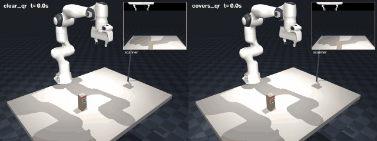

# Grasp-to-Show

[](https://github.com/AghyadA1/grasp-to-show/actions/workflows/tests.yml)

**Target-aware grasp selection: pick an object so that a QR patch on it can be shown to a camera.**

Standard grasp planners pick the most *stable* grasp and ignore what happens next. When the robot
must present a label to a scanner (a routine step in logistics), that is not enough: the fingers
may cover the label, the arm may not reach the presentation pose with that grasp, or the object may
rotate in the hand once gravity acts in a new direction. This project scores grasps by
**whether the whole task succeeds**, and visualises the result as a goal-conditioned heatmap on
the object surface.



*Left: fingers on the side faces, QR decoded by the scanner. Right: an equally stable grasp whose
finger covers the QR, so decoding fails. A stability-only planner cannot tell these apart.*

> **Status: day 4 of a 3-week plan.** Simulation scene and scripted pick → move → show with a
> ground-truth success test (days 1–2); 40 real scanned products, automatic QR placement, an
> antipodal grasp sampler and 5,225 simulated lift labels (day 3); all five analytic checks
> (stability validated against simulation with no fitted parameters, analytic IK, collision,
> QR visibility) and C++ kernels with Python bindings (day 4). **First result: 18 % of the grasps
> a stability-only planner would accept fail the task, nearly all because a finger hides the QR.**
> Next: validate the checks against full pick-and-show episodes, and the baseline comparison.

## Quickstart

Linux / macOS:

```bash
git clone https://github.com/AghyadA1/grasp-to-show.git && cd grasp-to-show
python -m venv .venv && source .venv/bin/activate
pip install -e ".[dev]"
python scripts/get_menagerie.py               # Franka Panda model (sparse checkout)

python scripts/get_objects.py                 # 40 scanned products (~55 MB, no git needed)

python scripts/demo_pick_and_show.py          # runs both grasps, writes media/
python scripts/demo_pick_and_show.py --viewer # interactive MuJoCo viewer
python scripts/generate_grasps.py             # grasp candidates + lift labels -> data/grasps/
python scripts/validate_stability.py          # analytic model vs simulated labels
python scripts/evaluate_targets.py            # checks 2-5 on every labelled grasp -> data/feasibility/
pip install ./cpp                             # optional C++ kernels (needs a C++17 compiler)
pytest -q                                      # 27 tests, ~15 s
```

Windows (PowerShell):

```powershell
git clone https://github.com/AghyadA1/grasp-to-show.git; cd grasp-to-show
python -m venv .venv; .venv\Scripts\Activate.ps1
pip install -e ".[dev]"
python scripts\get_menagerie.py
python scripts\get_objects.py
python scripts\demo_pick_and_show.py
python scripts\generate_grasps.py
python scripts\validate_stability.py
python scripts\evaluate_targets.py
pip install .\cpp                             # optional; needs Visual Studio Build Tools (C++)
pytest -q
```

On a headless Linux machine set `MUJOCO_GL=egl` (GPU) or `MUJOCO_GL=osmesa` (CPU).

Expected output:

```
[SUCCESS] grasp=clear_qr_flipped: decoded 'G2S-0001', held=True, slip=2.3 mm / 1.1 deg
[FAIL] grasp=covers_qr_flipped: QR NOT decoded, held=True, slip=1.1 mm / 0.5 deg
```

## How a grasp is judged (ground truth, "check 6")

An episode is a **success** only if, after pick → transit → hold at the target:

1. the scanner camera image decodes to the right QR payload (OpenCV),
2. both fingers still touch the object,
3. the object moved less than 5 mm / 5° *relative to the gripper* since the lift,
4. no unexpected contact occurred (robot–table, or the held object touching anything but the fingers).

The analytic checks 1–5 (to come) predict this outcome much faster. This simulation is the
reference they are validated against.

## Objects and grasp labels (check 1: lift stability)

**Objects.** All 1,030 [Google Scanned Objects](https://github.com/kevinzakka/mujoco_scanned_objects)
were filtered by written-down criteria (`scripts/select_objects.py`): smallest side 2–7 cm (the
Franka Hand opens to 8 cm), largest side ≤ 25 cm, box-like (convex-hull volume / bounding-box
volume ≥ 0.85, since labels go on flat faces), and a QR of at least 3 cm fits on a flat face.
117 pass; 40 were drawn at random (seeded), split 30 train / 10 *unseen* test objects:
ink cartridges, game cases, cosmetics and food packages. Scans are surfaces, not solids, so mass
and inertia come from the convex hull at 300 kg/m³ (a package is mostly cardboard and air).

**QR placement.** Scanned faces are never exactly flat. Each face of the oriented bounding box is
a candidate plane; a 7×7 grid of rays measures the real surface under the patch, and the face is
accepted only if every ray hits and the heights vary by < 2 mm. The largest accepted QR wins,
side faces preferred, never the bottom.

**Candidates.** Antipodal sampling as in Dex-Net/ACRONYM: a ray from a surface point into the
object finds the opposite contact; the pair is kept if the ray is within 30° of both surface
normals. That is deliberately wider than the true friction cone (atan 0.5 = 26.6°), so some
candidates fail, as with any real sampler. Each pair gets 8 approach directions and a random
depth; candidates where the open gripper intersects the object are dropped.

**Labels.** A floating Franka Hand (same force-limited actuator as the robot) closes on the
object, lifts 10 cm, shakes ±2 cm along the approach and rocks ±0.25 rad about the finger axis.
A grasp succeeds if both fingers still touch the object and it moved < 2 cm in the hand. This
is ACRONYM's labelling recipe, rebuilt in MuJoCo so that labels and the final evaluation share
one physics engine.

**What the labels show.** 5,225 labelled grasps on 40 objects (3 min on an 11-worker laptop),
75 % hold. Light packages hold almost everywhere (50–90 g items: ~80–90 %); heavier ones fail
mostly by *rotating about the finger axis* (0.5–0.75 kg items: 10–23 %). A controlled test confirms the mechanism
(0.8 kg bar, 20 N per finger, μ = 0.5, torsional coefficient 5 mm):

| Grasp offset from centre of mass | Gravity torque about finger axis | Held? | Rotation in hand |
|---|---|---|---|
| 0 cm | 0.00 N·m | yes | 0° |
| 2.5 cm | 0.20 N·m | yes | 10° |
| 5 cm | 0.39 N·m | **no** | 46° |
| 10 cm | 0.78 N·m | **no** | 54° |

The threshold sits at the soft-finger torsional limit 2·μ_t·F = 0.20 N·m. That limit is what
check 2 evaluates analytically at the *target* pose, where gravity points in a different
direction in the object frame.

## Checks 1–2: analytic stability, validated against simulation

The analytic model (`grasp2show/stability.py`, derivation in **[docs/physics.md](docs/physics.md)**)
finds the friction utilisation `u` of a grasp: the fraction of the two soft-finger contacts'
friction budget needed to cancel gravity (and, for the shake test, the d'Alembert inertial
loads), with gravity expressed in the object frame. `u ≤ 1`: the grasp holds. Check 1 evaluates
it at the start orientation, check 2 at the target orientation.


With **no fitted parameters** (the simulator's own μ = 0.5, μ_t = 5 mm, 20 N), the simulated
success rate falls monotonically with `u` and crosses 50 % exactly at `u = 1`. On the 10 unseen
objects the model ranks grasps with **AUC 0.79–0.82**. Its limit is a 6–11 % floor of
geometric failures that friction cannot explain: the learned scorer's job.

## Checks 3–5 and the first result

For every grasp *and its 180° twin* (a different arm configuration; the robot cannot change
twin between picking and showing):

- **Check 3 (start)**: the grasp and the pre-grasp 10 cm back along the approach have an IK
  solution within joint limits, with the open gripper and arm free of collision with the table
  and the object.
- **Check 4 (target)**: for each of 12 target poses (rotations about the camera's viewing axis),
  an IK solution exists with the object in the hand and no contact except fingers–object.
- **Check 2 (target)**: the friction margin with gravity in the target orientation.
- **Check 5 (QR visible)**: rays from the camera to a 7×7 grid on the QR and its four corner
  zones (where the finder patterns are) reach the QR before any finger, hand or arm link; plus
  viewing angle ≤ 45° and ≥ 50 px. On the day-1 box this reproduces the simulation exactly: the
  side grasp sees 100 % of the QR, the face grasp 76 % (blocked by the finger).

IK is an **analytic solver** (He & Liu 2021), ported to vectorised numpy and to C++ from the
Apache-2.0 [frantik](https://github.com/CoMMALab/frantik) implementation, with two fixes found
by testing: the reference's shoulder-singularity shortcut returned poses up to metres off within
2.6° of the singularity, so it now applies only at the exact singularity, and every solution is
verified by forward kinematics (max error 3e-12). Known limit: the almost-straight elbow
(q4 > −0.47 rad) is not covered, which makes reachability slightly conservative at the edge of
the workspace. Collision: MuJoCo kinematics + collision, 7 µs per query.

**Result on 40 objects, 5,225 grasps** (`scripts/evaluate_targets.py`, 34 s):

| | grasps |
|---|---|
| hold when lifted (check 1, simulated) | 3,934 |
| …and reachable at the start (what a stability-only planner accepts) | 1,299 |
| …and pass checks 2, 4, 5 for some target pose: **feasible** | 1,069 |

**18 % of the grasps a stability-only planner would accept fail the task** (22 % with a single
target pose instead of 12). The first failing check is QR visibility for 224 of them and target
stability for 6; target reachability never decides alone. Small packages suffer most (cosmetics,
pill boxes: 27–40 %), where a fingertip covers a large share of the face. These are analytic
predictions; validating them against full pick-and-show episodes is next.

## C++ kernels

`cpp/` is an optional C++17 package (nanobind bindings, no other dependencies) with the two hot
loops: the soft-finger stability solver and the analytic IK. Python uses it automatically when
installed (`pip install ./cpp`) and falls back to numpy otherwise; tests check both give the same
answers, and CI runs the suite both ways.

| Kernel | numpy | C++ | speed-up |
|---|---|---|---|
| stability, per evaluation (100k batch) | 1.08 µs | 0.44 µs | 2.4× |
| IK, per pose (16 q7 × 4 branches, 5k batch) | 91 µs | 14 µs | 6.7× |
| IK, one grasp's 28 poses (per call) | 2.24 ms | 0.31 ms | 7.2× |
| whole check 2–5 pipeline, 6 objects | 10.1 s | 8.8 s | 1.15× |

Honest reading: numpy was already vectorised, so the kernels are 2–7× faster, but the pipeline
is dominated by MuJoCo collision queries and Python loops. The kernels matter where they would
in a robot: a dependency-free C++ core that can run inside a controller.

## Design notes (and the bugs that motivated them)

| Choice | Why |
|---|---|
| **Force-limited gripper** (`ctrl` = finger gap in m, tendon force clamped) | While the fingers are blocked by the object the servo saturates, so each finger pushes with a known force (20 N). The friction checks need the normal force; the Menagerie default (stiffness 100 N/m) squeezes with only ~1 N. |
| **Elliptic friction cones, `impratio = 10`** | MuJoCo contacts are soft, so "static" friction lets a held object creep. With the defaults the box crept ~1 mm/s in a 20 N grip. |
| **Torsional friction, `condim = 4`** | Lets a two-finger grasp resist torque about the finger axis (the soft-finger model). With `condim = 3` that torque cannot be resisted at all. |
| **Grasp twin (180° about the approach axis)** | A parallel gripper touches the same points either way, but the wrist (joint 7) differs by π. The first version drove joint 7 into its limit, the IK lost track, and the arm knocked the box into the palm. The planner now tries both twins and keeps the one with the larger joint-limit margin. |
| **Cartesian paths + one min-jerk profile per segment** | A joint-space interpolation between far-apart configurations swept the held box through the table. Paths are now straight TCP lines solved by IK at evenly spaced points. |
| **Arm gravity compensation** | As on the real Franka. The payload's weight is not compensated. |
| **TCP site 0.1034 m from the hand frame** | Midway between the fingertip pads, on the approach axis. Grasp poses are poses of this frame. |
| **QR patch as a separate visual geom (group 1)** | Lets the visibility check ray-cast against the label alone. |
| **Labelling hand welded to a mocap target** (not a mocap body itself) | A mocap body teleports with zero velocity, so MuJoCo's velocity-level friction cannot drag the held object along: the first version dropped every object. Welding a dynamic hand to the mocap target gives it a real velocity. |
| **Friction μ = 0.5** | Plastic fingertips on cardboard. With μ = 1 almost every candidate held, which made the labels uninformative. |

## Repository layout

```
grasp2show/
  config.py      scene, object, camera, gripper parameters (dataclasses)
  scene.py       builds the MuJoCo model with MjSpec from the unmodified Menagerie Panda
  qr.py          QR texture generation and decoding
  ik.py          differential IK (mink, QP with joint limits) for the TCP
  motion.py      min-jerk timing, Cartesian line interpolation
  task.py        grasp representation (T_obj_tcp), grasp twins, show (target) pose
  episode.py     scripted pick -> show episode and ground-truth evaluation
  objects.py     primitive box and scanned objects: mesh, mass, inertia, QR, MuJoCo geoms
  object_set.json  the 40 selected objects, train/test split, cached QR placements
  qr_placement.py  flat-face search for the QR patch (bounding box + ray casting)
  grasp_sampler.py antipodal candidates -> 6-DoF grasps
  gripper_sim.py   floating-hand shake test (labels for check 1, ground truth for check 2)
  stability.py     analytic soft-finger stability model (checks 1-2)
  franka_ik.py     analytic Franka IK, vectorised (port of He & Liu / frantik)
  feasibility.py   checks 2-5: target stability, reachability + collision, QR visibility
  _accel.py        uses the C++ kernels when installed
cpp/               optional C++17 kernels + nanobind bindings (stability, IK)
docs/physics.md    derivation of the stability model and its validation
scripts/
  demo_pick_and_show.py   get_menagerie.py   get_objects.py
  select_objects.py       generate_grasps.py      validate_stability.py
  evaluate_targets.py     bench_cpp.py
tests/
```

Frames: `world` (z up, robot base at origin, table top at z = 0), `obj` (box centre, or the
scan's own frame with z up and the base at z = 0), `qr` (x = outward normal of the patch),
`tcp` (z = approach, y = finger closing axis). A grasp is the constant transform `T_obj_tcp`;
at any object pose the gripper must be at `T_world_obj @ T_obj_tcp`. That single equation is
why the choice of grasp at the start fixes the arm configuration at the target.

## Roadmap

- [x] Scene, QR object, scanner camera, scripted pick → move → show, ground-truth evaluation
- [x] Real objects (40 scanned products), automatic QR placement, grasp sampler, simulated lift labels
- [x] Analytic stability (checks 1–2): soft-finger model, validated on 5,225 simulated grasps
- [x] Reachability at start and target (checks 3–4) · QR visibility by ray casting (check 5)
- [x] C++ kernels (stability, analytic IK) with Python bindings and speed comparison
- [ ] Validate checks 1–5 against full pick-and-show episodes (QR decoded by OpenCV)
- [ ] Target *set* (rotations about the viewing axis) and robust labels under pose noise
- [ ] Baseline (most stable grasp) vs target-aware selection: success-rate table
- [ ] Learned scorer (point cloud + grasp + target → feasibility); speed and unseen-object test
- [ ] Goal-conditioned grasp heatmaps on the object surface
- [ ] v2: dexterous hand · v3: regrasp · v4: unknown shape · v5: explore, then show

## Related work

- Target-pose-conditioned grasp feasibility has been learned before: Liu et al. predict IK and
  collision feasibility of a grasp for a given start and target pose
  ([arXiv:2512.18922](https://arxiv.org/abs/2512.18922)); Qin et al. learn an energy-based
  model of grasp feasibility across poses for pick-and-place
  ([arXiv:2506.15920](https://arxiv.org/abs/2506.15920)); ReorientBot learns grasp/placement
  feasibility for specific-pose placement ([arXiv:2202.11092](https://arxiv.org/abs/2202.11092)).
  None of them model **visibility of a surface region** or **grasp stability under the rotated
  gravity at the target**, and none output a **dense goal-conditioned heatmap**: those are the
  focus here.
- Grasp quality maps: GG-CNN, Contact-GraspNet, Graspness. Intent-dependent contact maps: ContactDB.
- Labelling recipe: ACRONYM (Eppner et al., 2021), here rebuilt in MuJoCo on open objects.

## License

Code: MIT. The Franka Panda model is fetched from MuJoCo Menagerie under its own license.
Objects: Google Scanned Objects (Google Research, CC-BY 4.0), MuJoCo conversion by
[kevinzakka/mujoco_scanned_objects](https://github.com/kevinzakka/mujoco_scanned_objects).
The analytic IK (`grasp2show/franka_ik.py`, `cpp/src/franka_ik.hpp`) is adapted from
[frantik](https://github.com/CoMMALab/frantik), Apache-2.0 (`licenses/frantik-Apache-2.0.txt`).
