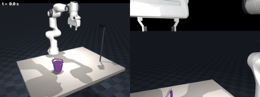

# Grasp-to-Show

[](https://github.com/AghyadA1/grasp-to-show/actions/workflows/tests.yml)

**A robot picks up an object and shows a QR code on it to a scanner.** Simulated in MuJoCo with a
Franka Panda, on scanned household products and generated shapes. Standard grasp planners pick
the most stable grasp and stop there; here every choice is made for the *whole task*: the label
must be visible at the scanner, the arm must reach it, and the object must not slip or fall on
the way. When a pinch cannot hold the object (heavy, slippery, too wide), the robot can hook it
by a handle instead and show it hanging.



## The pipeline

```python
from grasp2show.pipeline import Pipeline, Scene
pipe = Pipeline()
result = pipe.run(Scene.sample("ACE_Coffee_Mug_Kristen_16_oz_cup", k=1))
```

1. **Per object, once** (cached): pinch grasps, lift-tested in a floating gripper, and how robust
   each is (the share of its 3 mm / 6 deg shifts that still hold); the hook network's hooks, each
   pushed as deep through the handle as fits, lift-tested, with its robustness, the lowest
   friction it holds at, and whether the robot's lift from a table holds in rehearsal.
2. **Per scene** (object pose, scanner pose, weight, friction), both strategies run their checks:
   pinch (lift and in-hand stability at this friction and weight, reach, collisions, QR
   visibility) and hook (only hooks that hold at this friction; reach, collisions, where the
   object hangs, QR visibility). Each ranks its candidates by their smallest normalised margin,
   robustness included.
3. **The chooser** predicts each strategy's success from what its checks found and picks one.
4. **The robot** runs that strategy's best candidate whose motion can be planned.

`grasp2show/pipeline.py`; the chooser `grasp2show/chooser.py`; hooks `grasp2show/hanging.py`,
`grasp2show/hooks.py`, the hook network `grasp2show/learn/hooknet.py`.

## Results (part 3, latest)

1,410 held-out scenes (235 objects never trained on: 140 real scans, 95 generated; 6 scenes
each with a random start pose, scanner pose, friction 0.15-1.0 and weight x0.5-8 up to 3 kg, and
a small error in the object's pose the robot does not know):

| | all | real scans | generated |
|---|---|---|---|
| always pinch | 28 % | 39 % | 12 % |
| always hook | 13 % | 1 % | 29 % |
| **chooser (learned, cross-validated by object)** | **37 %** | **40 %** | **34 %** |
| best possible choice (oracle) | 39 % | 40 % | 37 % |

Hooks that run succeed 65 % of the time (36 % before the hook network was retrained with the
robot's real lift as the judge and the drop causes were fixed: 49 % drops then, 20 % now).
Ranking candidates by robustness beats ranking by the checks' margins alone, for both strategies
(pinch 75 % vs 68 %, hook 65 % vs 58 % where the two rankings disagree). Details and the history
of each step: [docs/part3_shapes_hooks.md](docs/part3_shapes_hooks.md).

Earlier parts (single-shape scanned boxes, a fixed scanner): target-aware grasp selection raised
task success from 51-52 % to 68-70 % over a stability-plus-motion-planning baseline; a learned
heatmap network (way B, frozen) reached 89-94 % on unseen objects
([docs/part1_grasp_choice.md](docs/part1_grasp_choice.md)); carrying the object with a motion
that keeps the grasp safe: [docs/part2_transport.md](docs/part2_transport.md).

## Quickstart

```bash
git clone https://github.com/AghyadA1/grasp-to-show.git && cd grasp-to-show
python -m venv .venv && source .venv/bin/activate      # Windows: .venv\Scripts\Activate.ps1
pip install -e ".[dev,learn]"
python scripts/get_menagerie.py                         # Franka Panda model
export G2S_OBJECT_SET=v2                                # Windows: $env:G2S_OBJECT_SET = "v2"
python scripts/get_objects.py                           # the scanned objects
python scripts/generate_hookable.py --count 800         # generated objects with handles
python scripts/fix_generated_qr.py                      # (objects generated before the sticker fix)

python scripts/run_scene.py ACE_Coffee_Mug_Kristen_16_oz_cup --scene 1     # one scene, filmed
python scripts/evaluate.py --workers 4                  # all held-out scenes -> data/runs/<date>_chooser/
python scripts/self_train_hooks.py --judge table --init data/models/hook_net_self.pt   # retrain the hook network
pytest -q
```

On a headless Linux machine set `MUJOCO_GL=egl` (GPU) or `MUJOCO_GL=osmesa` (CPU).

## Where things are

```
grasp2show/                 the library
  pipeline.py               the whole system: Scene, Pipeline.plan / run, per-object assets
  chooser.py                hook or pinch: scene conditions, features, robustness, rankings, the chooser
  hanging.py  hooks.py      hooks: hole finding, fitting, lift tests, hanging, carry, table rehearsal
  hookteach.py              the hook teacher (proposers + simulated tests) for self-training
  learn/hooknet.py          the hook network (DEFAULT_HOOK_NET)
  experiment.py feasibility.py episode.py   the pinch checks, planning and execution (parts 1-2)
  shapegen.py qr_placement.py objects.py    objects: generated shapes, QR stickers, scans
  parallel.py               a process pool that survives crashed workers
scripts/                    what is used now
  get_menagerie.py get_objects.py generate_hookable.py fix_generated_qr.py   setup
  self_train_hooks.py       train the hook network (the simulator is the teacher)
  evaluate.py               evaluate the pipeline, train the chooser (data/runs/<date>_<name>/)
  run_scene.py              run one scene and film it
  figure_hook_net.py        pictures of the hook network's choices
scripts/archive/            earlier studies, still runnable: part1_grasp_choice/, part2_transport/,
                            part3_early/ (their results are in docs/)
data/                       caches (objects, grasps, hooks, clouds), models/, runs/ (one folder per run)
docs/                       part1_grasp_choice.md  part2_transport.md  part3_shapes_hooks.md
                            design_notes.md (C++ kernels, design notes, related work, roadmap)  physics.md
```

Frozen: way B v2 (`data/models/heatmap_net_v4.pt`, `scripts/archive/part3_early/eval_way_b_v2.py`)
and the earlier hook networks (`hook_net.pt`: analytic labels; `hook_net_self.pt`: floating
lift test). Scanner: 1280 x 960 in the pipeline and every part 3 result
(`pipeline.SCANNER_SCALE`; `config.CameraConfig` keeps the 640 x 480 of parts 1-2).

## License

Code: MIT. The Franka Panda model is fetched from MuJoCo Menagerie under its own license.
Objects: Google Scanned Objects (Google Research, CC-BY 4.0), MuJoCo conversion by
[kevinzakka/mujoco_scanned_objects](https://github.com/kevinzakka/mujoco_scanned_objects).
