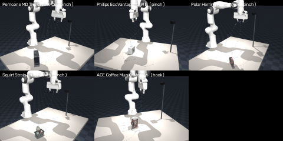
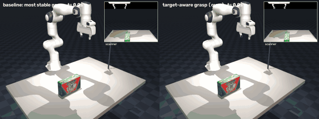
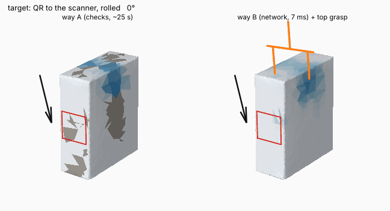
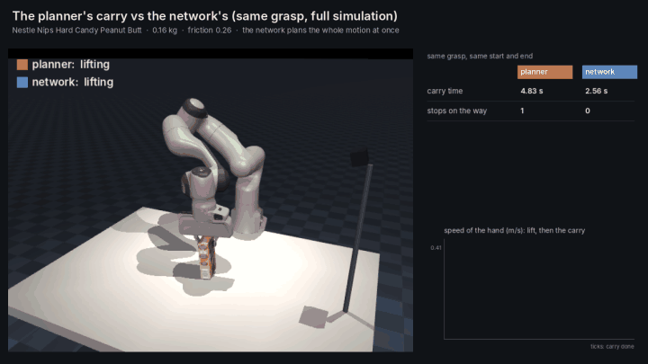
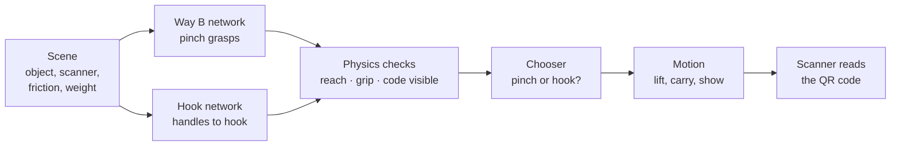

# Grasp-to-Show

[](https://github.com/AghyadA1/grasp-to-show/actions/workflows/tests.yml)

**A robot arm picks up objects it has never seen and shows their QR code to a scanner.**
Simulated in MuJoCo with a Franka Panda, on hundreds of scanned household products and generated shapes.

Most grasp planners stop at "hold the object firmly". Here the grasp and the motion are chosen for the
**whole task**: the fingers must not cover the code, the arm must be able to turn it towards the scanner,
and the object must not slip on the way. When a pinch cannot hold an object, the robot hooks it by its
handle instead.



## Highlights

### 1. Grasp for the task, not just for stability



The most stable grasp (left) covers the code, and the scanner cannot read it. Checking every candidate
for the whole task (reach, grip at the scanner pose, code visible) picks a grasp that works (right).
**Task success: 51 % → 70 %** on the same 160 scenes.

### 2. A network that sees where to grasp, in milliseconds



Checking ~1,000 grasp candidates takes ~25 s. "Way B" is a point-cloud network that, given the object and
how it must be presented, scores every point of its surface and proposes a grasp there, **in under 10 ms**
(left: the checks; right: the network and its best grasp, as the target pose turns). Trained only on the
checks' answers, it does **better than the checks themselves** on objects it has never seen (61 % vs 47 %
success): it prefers regions where many grasps work over a single best-scoring one, so small errors
matter less.

### 3. Carrying the object faster, without stopping



A second network plans the whole carry from the table to the scanner in **one pass (~1 ms)**, keeping the
grip's load where it is strong. It was trained without examples, through a differentiable model of the
arm and the grip. In full simulation it succeeds as often as the optimiser it replaces (99 %), which takes
~25 s per motion. Against the default planner, on the same grasps: **about half the carry time and no
stop on the way** (orange: move, stop, move; blue: one motion). The example is a typical one, not the
best: 4.8 s → 2.6 s, where the median is 0.48×.

### 4. Hook it when a pinch cannot hold it


Heavy or slippery objects slide out of a two-finger pinch. A hook carries the weight on the finger
itself, so it depends far less on friction. A hook network, trained by trial and error in simulation (the
simulator checks its proposals and the ones that work become its labels), finds a working hook on
**90 % of new shapes** and on 6 of 7 real objects with a handle. A learned chooser then decides per
scene: pinch or hook.

## How it works



```python
from grasp2show.pipeline import Pipeline, Scene

pipe = Pipeline()
result = pipe.run(Scene.sample("ACE_Coffee_Mug_Kristen_16_oz_cup", k=1))
print(result.method, result.success)        # the strategy that ran (a pinch or a hook) and whether the code was read
```

## Try it

```bash
git clone https://github.com/AghyadA1/grasp-to-show.git && cd grasp-to-show
python -m venv .venv && source .venv/bin/activate        # Windows: .venv\Scripts\Activate.ps1
pip install -e ".[dev,learn]"
python scripts/get_menagerie.py                           # the Franka Panda model
export G2S_OBJECT_SET=v2                                  # Windows: $env:G2S_OBJECT_SET = "v2"
python scripts/get_objects.py --names ACE_Coffee_Mug_Kristen_16_oz_cup
python scripts/run_scene.py ACE_Coffee_Mug_Kristen_16_oz_cup --scene 1   # -> media/run_ACE_..._1.mp4
```

The trained networks are in `data/models/`. The first run on an object prepares and caches its grasp
candidates (a few minutes); later runs take seconds. Headless Linux: `export MUJOCO_GL=egl`.
All objects: `python scripts/get_objects.py`; generated shapes: `python scripts/generate_hookable.py`.

## Results in detail

| What | Result | Where |
|---|---|---|
| Task-aware grasp choice vs most stable grasp | 70 % vs 51 % (160 scenes, 42 won / 12 lost) | [part 1](docs/part1_grasp_choice.md) |
| Way B on unseen boxes, fixed scanner | 89–94 % (3 training seeds) | [part 1](docs/part1_grasp_choice.md) |
| Way B on unseen objects of every shape, moving scanner | 61 % vs 47 % for the checks | [part 3](docs/part3_shapes_hooks.md) |
| Carry network vs optimiser, full simulation | 99 % vs 99 %, 2.0 s vs 2.1 s carries, 1 ms vs 25 s to plan | [part 2](docs/part2_transport.md) |
| Carry network vs default planner, same grasps (82 problems where both succeed) | carry time 0.48× (median), one stop fewer | [part 2](docs/part2_transport.md) |
| Hook network, held-out generated shapes / real handled objects | working hook found on 90 % / 6 of 7 | [part 3](docs/part3_shapes_hooks.md) |
| Pinch or hook, chosen per scene (hard scenes below) | 33 % vs 19 % for always-pinch or always-hook; best possible 35 % | [part 3](docs/part3_shapes_hooks.md) |

The last row is a deliberately hard test: 924 scenes on 154 held-out objects, friction from 0.15 (wet
glass) to 1.0 and weight up to 8× normal (at most 3 kg), with a small error in the object's position that
the robot does not know about. Many of these scenes have no grasp that can work at all, which is why the
best possible choice is 35 %. What is left: most failed pinches lose the object at the moment it leaves
the table, and a quarter of hook failures are drops during the carry. Training the carry for the full
pipeline (pinches and hooks, in simulation) is the work in progress.

## Repository

```
grasp2show/            the library
  pipeline.py          the whole system: Scene, Pipeline.plan / run
  chooser.py           pinch or hook: features, rankings, the chooser
  hanging.py hooks.py  hooks: finding handles, fitting the finger, lifting, carrying
  learn/               the networks: way B (dense.py), hooks (hooknet.py), carries (transport_net.py, carry_net.py)
  episode.py           planning and running an episode in MuJoCo
scripts/               run, evaluate and train (each script explains itself with --help)
scripts/archive/       the earlier studies of parts 1-3, still runnable
docs/                  the full write-ups: part1_grasp_choice.md, part2_transport.md, part3_shapes_hooks.md
data/models/           the trained networks
```

## License

Code: MIT. The Franka Panda model is fetched from MuJoCo Menagerie under its own license. Objects: Google
Scanned Objects (Google Research, CC-BY 4.0), MuJoCo conversion by
[kevinzakka/mujoco_scanned_objects](https://github.com/kevinzakka/mujoco_scanned_objects).
