# Part 1: choosing the grasp for the task

*Week 1-3: target-aware checks, a learned scorer, goal-conditioned heatmaps (way A, way B). Scripts: `scripts/archive/part1_grasp_choice/`.*

**Target-aware grasp selection: pick an object so that a QR patch on it can be shown to a camera.**

Standard grasp planners pick the most *stable* grasp and ignore what happens next. When the robot
must present a label to a scanner (a routine step in logistics), that is not enough: the fingers
may cover the label, the arm may not reach the presentation pose with that grasp, or the object may
rotate in the hand once gravity acts in a new direction. This project scores grasps by
**whether the whole task succeeds**, and visualises the result as a goal-conditioned heatmap on
the object surface.

**Result: in 160 simulated pick-and-show scenarios (40 scanned products x 4 start poses),
target-aware grasp selection raises task success from 51–52 % to 68–70 %** over a
stability-plus-motion-planning baseline, reproduced on two machines (paired: 41–42 scenarios
won vs 12–16 lost, sign test p ≤ 0.001). Removing the QR-visibility check removes almost all of
the gain.

**Week 2: a learned scorer** (PointNet over the object cloud in the gripper frame, trained on
14,502 simulated episodes) picks grasps on **10 unseen objects** with **85 % task success**
(76 % from geometry alone) vs 65 % for the analytic checks and 55 % for the baseline, in 80
full pick-and-show episodes (vs the checks: 18 scenarios won, 2 lost, p = 4e-4). It mostly fixes
what the static checks cannot see: slip during the motion.

**Week 3: a goal-conditioned heatmap network** (way B) predicts, from the object's point cloud
and the task, a grasp score and a grasp at every surface point in 7 ms on a laptop GPU. Its
grasps succeed in **89–94 %** (3 seeds) of 80 full episodes on unseen objects (baseline 55 %,
analytic checks 64 %; paired vs the checks: 27 won, 7 lost, p = 8e-4). It even beats the slow
search it imitates (51 %); a controlled test shows why: it prefers regions where many grasps
work over the single best-scoring one.

**One-page summary:** [docs/grasp-to-show-summary.pdf](grasp-to-show-summary.pdf)

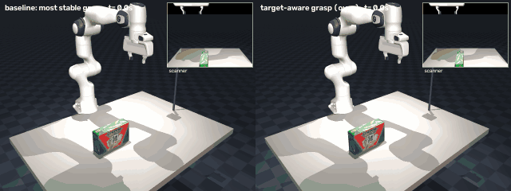

*Same box of crayons, same start pose. Left: the baseline takes the most stable grasp; at the
scanner a finger covers part of the QR and it cannot be read (inset: the scanner's view). Right:
the target-aware grasp was chosen knowing where the fingers will be at the scanner, so the QR is
unobstructed and decoded.*

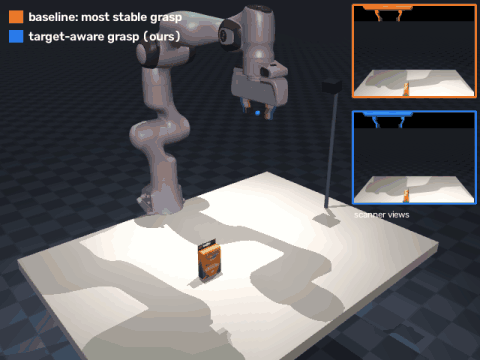

*The same two episodes in one view (orange: baseline, blue: ours, each at half opacity), with
the path of each gripper drawn in 3D. The two grasps send the arm on visibly different paths to
the same scanner; insets: what the scanner sees. (`scripts/archive/part1_grasp_choice/demo_overlay.py`)*

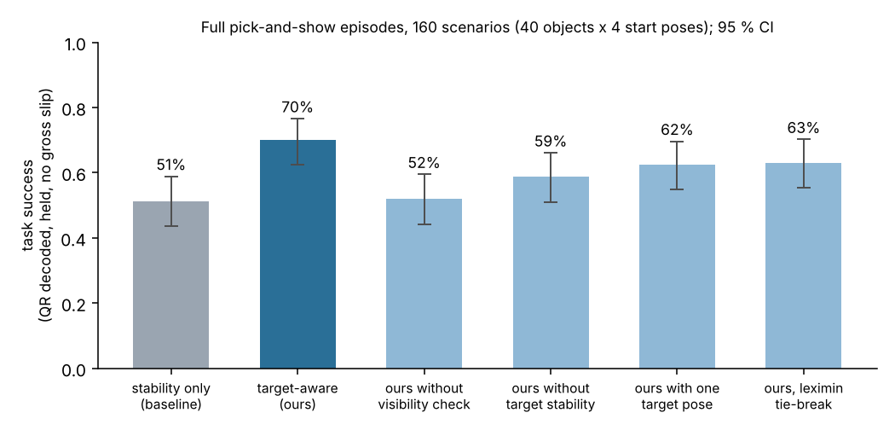

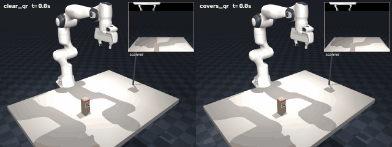

*Left: fingers on the side faces, QR decoded by the scanner. Right: an equally stable grasp whose
finger covers the QR, so decoding fails. A stability-only planner cannot tell these apart.*

> **Status: week 3 of a 3-week plan.** Week 1: scene and scripted pick-and-show, 40 scanned
> products, grasp sampler and simulated lift labels, five analytic checks, C++ kernels, validation
> against 865 full episodes and the policy comparison. Week 2: a 20,902-sample dataset of
> full-episode outcomes, a learned scorer and its evaluation as a policy on unseen objects, and
> goal-conditioned heatmaps (way A), robustness to pose error, one-page summary. Week 3: way B,
> the heatmap network (done, results below).

## How a grasp is judged (ground truth, "check 6")

An episode is a **success** only if, after pick → transit → hold at the target:

1. the scanner camera image decodes to the right QR payload (OpenCV),
2. both fingers still touch the object,
3. the object moved less than 20 mm / 15° *relative to the gripper* since the lift (gross slip; see
   the design notes for why not tighter),
4. no unexpected contact occurred (robot–table, or the held object touching anything but the fingers).

The analytic checks 1–5 and the learned scorer predict this outcome much faster. This simulation is the
reference they are validated against.

## Objects and grasp labels (check 1: lift stability)

**Objects.** All 1,030 [Google Scanned Objects](https://github.com/kevinzakka/mujoco_scanned_objects)
were filtered by written-down criteria (`scripts/archive/part1_grasp_choice/select_objects.py`): smallest side 2–7 cm (the
Franka Hand opens to 8 cm), largest side ≤ 25 cm, box-like (convex-hull volume / bounding-box
volume ≥ 0.85, since labels go on flat faces), and a QR of at least 3 cm fits on a flat face.
117 pass; 40 were drawn at random (seeded), split 30 train / 10 *unseen* test objects:
ink cartridges, game cases, cosmetics and food packages. Scans are surfaces, not solids, so mass
and inertia come from the convex hull at 300 kg/m³ (a package is mostly cardboard and air).

**QR placement.** Scanned faces are never exactly flat. Each face of the oriented bounding box is
a candidate plane; a 7×7 grid of rays measures the real surface under the patch, and the face is
accepted only if every ray hits and the heights vary by < 2 mm. The largest accepted QR wins,
side faces preferred, never the bottom.

**Candidates.** Antipodal sampling as in Dex-Net/ACRONYM: a ray from a surface point into the
object finds the opposite contact; the pair is kept if the ray is within 30° of both surface
normals. That is deliberately wider than the true friction cone (atan 0.5 = 26.6°), so some
candidates fail, as with any real sampler. Each pair gets 8 approach directions and a random
depth; candidates where the open gripper intersects the object are dropped.

**Labels.** A floating Franka Hand (same force-limited actuator as the robot) closes on the
object, lifts 10 cm, shakes ±2 cm along the approach and rocks ±0.25 rad about the finger axis.
A grasp succeeds if both fingers still touch the object and it moved < 2 cm in the hand. This
is ACRONYM's labelling recipe, rebuilt in MuJoCo so that labels and the final evaluation share
one physics engine.

**What the labels show.** 5,225 labelled grasps on 40 objects (3 min on an 11-worker laptop),
80 % hold. Light packages hold almost everywhere; heavier ones fail mostly by *rotating about the
finger axis* (a 0.6 kg box: 13 %). A controlled test confirms the mechanism
(0.8 kg bar, 20 N per finger, μ = 0.5, torsional coefficient 5 mm):

| Grasp offset from centre of mass | Gravity torque about finger axis | Held? | Rotation in hand |
|---|---|---|---|
| 0 cm | 0.00 N·m | yes | 0° |
| 2.5 cm | 0.20 N·m | yes | 10° |
| 5 cm | 0.39 N·m | **no** | 46° |
| 10 cm | 0.78 N·m | **no** | 54° |

The threshold sits at the soft-finger torsional limit 2·μ_t·F = 0.20 N·m. That limit is what
check 2 evaluates analytically at the *target* pose, where gravity points in a different
direction in the object frame.

## Checks 1–2: analytic stability, validated against simulation

The analytic model (`grasp2show/stability.py`, derivation in **[docs/physics.md](physics.md)**)
finds the friction utilisation `u` of a grasp: the fraction of the two soft-finger contacts'
friction budget needed to cancel gravity (and, for the shake test, the d'Alembert inertial
loads), with gravity expressed in the object frame. `u ≤ 1`: the grasp holds. Check 1 evaluates
it at the start orientation, check 2 at the target orientation.

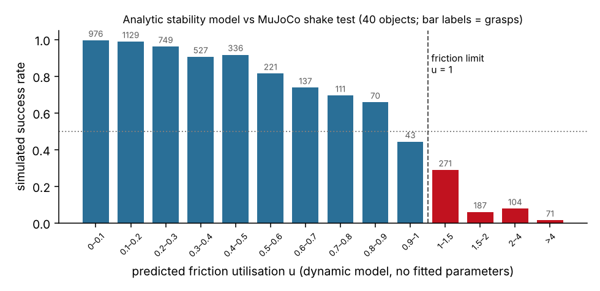

With **no fitted parameters** (the simulator's own μ = 0.5, μ_t = 5 mm, 20 N), the simulated
success rate is ~99 % at low `u`, falls steadily, and crosses 50 % just below `u = 1`. On the 10
unseen objects the model ranks grasps with **AUC 0.92–0.94**. Getting there required validating
the simulator first: with MuJoCo's default contact softness, held objects *crept* (a 150 g box
slid 13 mm in a gentle 2.5 s transit) and the model's AUC was only 0.79–0.82; see
[docs/physics.md](physics.md).

## Checks 3–5 and the first result

For every grasp *and its 180° twin* (a different arm configuration; the robot cannot change
twin between picking and showing):

- **Check 3 (start)**: the grasp and the pre-grasp 10 cm back along the approach have an IK
  solution within joint limits, with the open gripper and arm free of collision with the table
  and the object.
- **Check 4 (target)**: for each of 12 target poses (rotations about the camera's viewing axis),
  an IK solution exists with the object in the hand and no contact except fingers–object.
- **Check 2 (target)**: the friction margin with gravity in the target orientation.
- **Check 5 (QR visible)**: rays from the camera to a 7×7 grid on the QR and its four corner
  zones (where the finder patterns are) reach the QR before any finger, hand or arm link; plus
  viewing angle ≤ 45° and ≥ 50 px. On the day-1 box this reproduces the simulation exactly: the
  side grasp sees 100 % of the QR, the face grasp 76 % (blocked by the finger).

IK is an **analytic solver** (He & Liu 2021), ported to vectorised numpy and to C++ from the
Apache-2.0 [frantik](https://github.com/CoMMALab/frantik) implementation, with two fixes found
by testing: the reference's shoulder-singularity shortcut returned poses up to metres off within
2.6° of the singularity, so it now applies only at the exact singularity, and every solution is
verified by forward kinematics (max error 3e-12). Known limit: the almost-straight elbow
(q4 > −0.47 rad) is not covered, which makes reachability slightly conservative at the edge of
the workspace. Collision: MuJoCo kinematics + collision, 7 µs per query.

**Result on 40 objects, 5,225 grasps** (`scripts/archive/part1_grasp_choice/evaluate_targets.py`, 40 s):

| | grasps |
|---|---|
| hold when lifted (check 1, simulated) | 4,194 |
| …and reachable at the start (what a stability-only planner accepts) | 1,401 |
| …and pass checks 2, 4, 5 for some target pose: **feasible** | 1,139 |

**19 % of the grasps a stability-only planner would accept fail the task** (21 % with a single
target pose instead of 12). The first failing check is QR visibility for 237 of them and target
stability for 25; target reachability never decides alone. Small packages suffer most (cosmetics,
pill boxes), where a fingertip covers a large share of the face. The full episodes below test
these predictions.

## Results: full pick-and-show episodes

Every number here comes from complete simulated episodes: approach, grasp, lift, transit, present
to the scanner, hold, then OpenCV decodes the scanner image. **Success** = QR decoded, both
fingers still on the object, no gross slip in the hand (< 20 mm, < 15°), no collision.
`scripts/archive/part1_grasp_choice/run_experiments.py` reproduces all of it (13 min on 2 CPU cores, 4.5 min on an
11-core laptop).

**Reproducibility.** The whole pipeline (labels, checks, episodes) was run independently on Linux
(GCC) and Windows (MSVC). Contact simulation amplifies floating-point differences in borderline
grasps (1 of 5,225 lift labels differs), so the numbers move slightly:

| | Linux | Windows |
|---|---|---|
| baseline / target-aware success | 51.2 % / 70.0 % | 51.9 % / 67.5 % |
| paired wins (ours / baseline), p | 42 / 12, 5e-5 | 41 / 16, 1.3e-3 |
| success if predicted feasible / infeasible | 72.7 % / 20.8 % | 72.2 % / 21.7 % |
| check 5 vs decoder | 92.4 % | 91.3 % |

The tables below are from the Linux run.

**Policies.** Each policy ranks its choices; the first one whose motion can be planned is
executed (a real system also falls back to its next grasp when motion planning fails).

| Policy | What it knows | Success (160 scenarios) |
|---|---|---|
| stability only (baseline) | most stable grasp (analytic lift margin) that is reachable at start *and* target | 51 % [44, 59] |
| **target-aware (ours)** | all checks; best smallest normalised margin | **70 % [62, 77]** |
| ours without check 5 | no QR visibility | 52 % |
| ours without check 2 | no stability at the target orientation | 59 % |
| ours with one target pose | no target set (roll 0 only) | 62 % |
| ours, leximin tie-break *(post hoc)* | ties broken by the next-smallest margin | 63 % (61 % on Windows) |

[95 % Wilson intervals.] **A lesson in honest evaluation:** after the main experiment I changed
the tie-break among equally ranked grasps because of one demo case, and success *fell* from 70 %
to 61–63 % on both machines. In the 60 scenarios where the two rules chose differently, the
original won 14 and the new one 3; the new choices had the *same* static target-stability margin
(0.78 vs 0.76) but slipped far more during the motion (20 vs 7). Static margins cannot rank grasps
by dynamic slip, which is the learned scorer's job. The rule fixed before the experiment stays the
primary result; the change is reported as a sensitivity test.

The baseline already checks kinematics, so the gap isolates the two new checks: **where ours won, the baseline failed by an unreadable QR (20) or by slipping once the
object was turned (21)**. In 8 scenarios (2 heavy objects) no grasp survives the lift test, which
counts as a failure for every policy.

**Validation of the checks** (865 episodes on random grasps that a stability-only planner would
accept, executed with the checks' best twin and target):

| | |
|---|---|
| success rate when the checks say *feasible* | **73 %** |
| success rate when they say *infeasible* | **21 %** |
| successes the checks find (recall) | 95 % |
| check 5 vs the decoder (episodes where the object stayed in hand) | 92 % agreement |
| success vs target stability margin 0.3–0.6 / 0.6–0.8 / 0.8–1 | 51 % / 65 % / 79 % |

152 of the 865 episodes could not be executed because the simple motion planner found no path
between two feasible end configurations; they are excluded above. **What the checks miss**, in
the 166 predicted-feasible failures: slip during the motion (92: the checks are static),
collisions along the path (41: they check end configurations only) and decoding failures (33).
These are the targets for the learned scorer, which is trained on full-episode outcomes (next).

## Learned scorer: trained on full-episode outcomes

**Question.** The analytic checks are static: they cannot see slip during the motion, which is
their main miss. Can a network trained on what actually happens in complete episodes choose
better grasps, on objects it has never seen?

**Dataset** (`scripts/archive/part1_grasp_choice/generate_dataset.py`, 30 min on 11 cores). For each of the 40 objects at 4
start rotations, every lift-stable grasp goes through the checks (both twins, 12 target poses).
Then 100 kinematically feasible (grasp, twin, target) tuples per scenario are drawn *uniformly*
(not by the checks' ranking, so the labels are not biased towards what the checks like) and
executed in the full simulation; cheap negatives (dropped in the lift test, unreachable) are
added. **20,902 samples, 14,502 full episodes, 40 % success.** Each sample also stores the checks'
outputs, so the network and the checks are compared on exactly the same cases.

**Model** (`grasp2show/learn/`). A PointNet over 512 surface points of the object *expressed in
the gripper frame* (position, normal, and a flag for points on the QR patch), plus 32 global
features: gravity in the gripper frame at the start and at the target, the QR normal, the gripper
pose at start and target, opening width, mass and centre of mass. Two heads: P(success), and the
failure reason (8 classes) as an auxiliary loss. 161k parameters. A second variant also receives
the 9 outputs of the analytic checks. Split **by object**: the 10 test objects are never seen in
training; 5 training objects are held out for model selection.

**Offline, on the 10 unseen objects** (`scripts/archive/part1_grasp_choice/train_scorer.py`; 5 training seeds, which also
change the validation objects; mean ± std, [min, max]):

| | analytic checks | learned (geometry) | learned + checks' outputs |
|---|---|---|---|
| AUC, simulated tuples (the hard cases) | 0.72 | 0.79 ± 0.01 [0.77, 0.80] | **0.82 ± 0.01** [0.81, 0.82] |
| top-1: best-ranked tuple per scenario succeeds (36 scenarios) | 68 % | 83 ± 7 % [72, 92] | **87 ± 4 %** [81, 92] |

(Random pick: 44 %. Oracle: 100 %.) The ranking quality (AUC) is stable across seeds; top-1 on 36
scenarios is noisy, especially for the geometry-only model (a GPU re-run of seed 0 gave 64 %).
The checks' outputs make the network both better and steadier. The episodes below use seed 0.

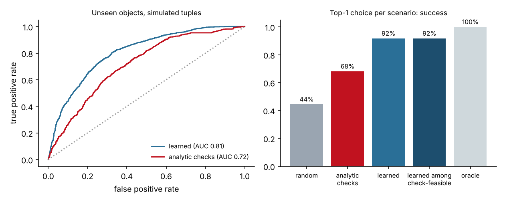

**As a policy, in full episodes** (`scripts/archive/part1_grasp_choice/eval_learned_policy.py`). The 10 unseen objects × 8
start rotations (4 of which never appear in the dataset). All policies keep the exact analytic
IK/collision checks at the start and the target; they differ only in how they rank the
kinematically feasible tuples. Each runs its choice (with the same fallback when the motion can't
be planned) through a complete episode.

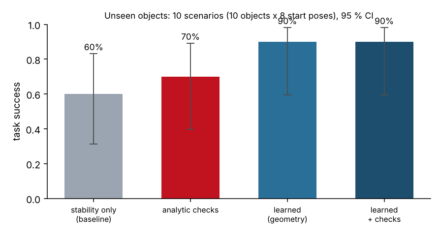

| Policy (80 scenarios, unseen objects) | Success [95 % CI] | slip | QR | collision | no grasp holds |
|---|---|---|---|---|---|
| stability only (baseline) | 55 % [44, 65] | 23 | 3 | 2 | 8 |
| analytic checks (ours, week 1) | 65 % [54, 75] | 18 | 1 | 1 | 8 |
| learned, geometry only | 76 % [66, 84] | 10 | 1 | 0 | 8 |
| **learned + checks' outputs** | **85 % [76, 91]** | **2** | 2 | 0 | 8 |

Paired, vs the analytic checks: learned + checks wins 18 scenarios and loses 2 (sign test
p = 4e-4); geometry only wins 14 and loses 5 (p = 0.06). Vs the baseline: 25/1 and 21/4. In 8
scenarios no grasp survives the lift test, so 90 % is the ceiling. **The gain is almost all
slip** (18 → 2): the network learned which grasps stay put while the arm swings the object, which
the static friction margin cannot tell.

**Speed.** Scoring costs 50 µs per tuple on a laptop GPU (RTX 3050, batches of 1,024), 26×
faster than the same laptop's CPU (1.3 ms); a whole scenario's 1,206 feasible tuples take 60 ms.
Training: 80 s on that GPU vs 9–11 min on 2 CPU cores. The network does not replace the exact
IK/collision checks, which run first: it buys accuracy more than speed.

**Caveats.** The network is trained and tested in the same simulator, so part of what it learned
is this simulator's contact behaviour; a real robot would need real or domain-randomised data.
Test objects are unseen but come from the same filtered pool (box-like packages). The episode
results use one training seed (see the seed spread above); the two learned variants' intervals
overlap. The training scenarios used yaws 0/90/180/270,
so half of the evaluation poses are new for the start pose but not the object.

## Robustness: the object is not exactly where the robot thinks

A real robot estimates the object's pose with some error. Here every policy chooses and plans its
grasp for the nominal pose, then the episode runs with the object actually shifted on the table by
a random offset it does not know about (dx, dy ~ N(0, σ), yaw ~ N(0, σ_yaw)); 3 offsets per level,
the same offsets for every policy (`scripts/archive/part1_grasp_choice/robustness.py`, run on Windows).

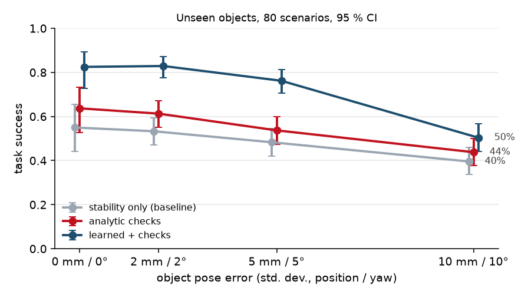

| σ position / yaw | baseline | analytic checks | learned + checks | learned vs checks (paired wins / losses) |
|---|---|---|---|---|
| 0 | 55 % | 64 % | **82 %** | 17 / 2 |
| 2 mm / 2° | 53 % | 61 % | **83 %** | 60 / 8 |
| 5 mm / 5° | 48 % | 54 % | **76 %** | 66 / 12 |
| 10 mm / 10° | 40 % | 44 % | **50 %** | 47 / 31 (p = 0.09) |

The learned choice keeps its lead up to 5 mm / 5°. At 10 mm / 10° every policy collapses into
the same failure: the gripper, sent open-loop to where the object should be, hits it (65–79
collisions per policy). That is the limit of executing a plan without looking again, not of grasp
selection; closing the loop (re-detecting the object before the approach) is the fix. The
nominal row reproduces the Linux episodes on Windows (55 / 65 / 85 % there).

## Goal-conditioned grasp heatmaps (way A)

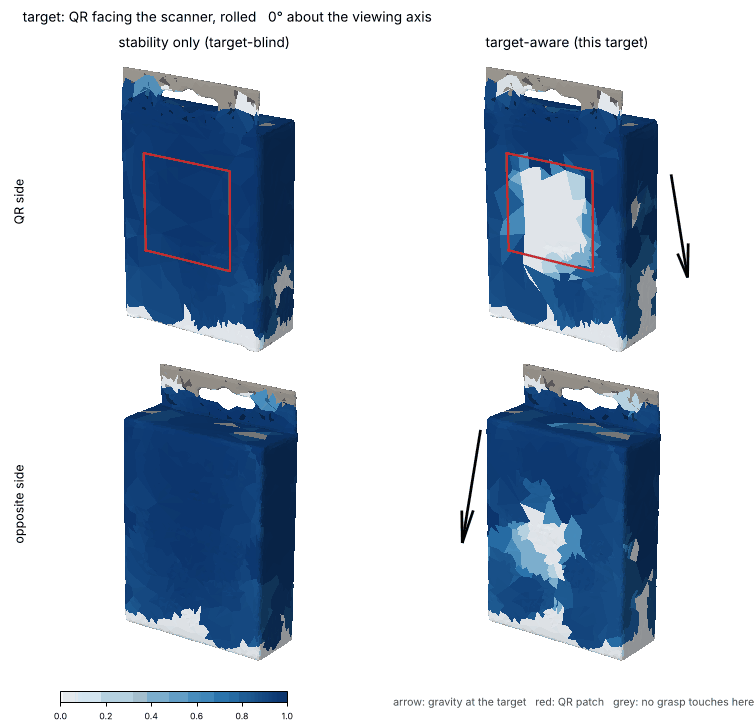

*Where to grasp the crayon box, for each target pose. Left: what a target-blind planner sees
(lift stability only), the same for every target. Right: the target-aware map: each surface point
shows the best score among the grasps whose finger touches within 8 mm of it, for **this**
target (0 = some check fails). The arrow is gravity at the target, in the object frame; as the
target rolls about the scanner's viewing axis, gravity, arm reach and finger visibility change,
and so does the map. The QR patch (red) is always cold: a finger there hides the code, and so is
the matching spot on the opposite face, which is only reachable by a pinch through the QR.*

`scripts/archive/part1_grasp_choice/heatmap_way_a.py` samples ~3,200 candidates per object (1,193 collision-free here), runs
the checks for both twins and 24 target poses, and paints the scores onto the mesh: 19 s on 2
cores, no training (lift stability from the analytic model). The map answers "where can I grasp
this object *for this task*?", which a stability map cannot: on the 10 unseen objects, 2–48 %
of the collision-free candidates are feasible for at least one target pose. Way B learns this map
directly.

## Way B: a network that predicts the heatmap

**Labels** (`scripts/archive/part1_grasp_choice/generate_dense_labels.py`, 7 min on 11 cores): way A for every object
(40) × start pose (4) × target pose (12): ~1,000 dense candidates each, scored by all the checks
(both twins). A surface point's label is the best candidate whose finger touches within 8 mm, plus
that candidate's approach direction, closing direction, TCP offset and width.

**Network** (`grasp2show/learn/dense.py`, 256k parameters). Per point: an edge convolution over the
16 nearest neighbours (local shape, as in DGCNN), then a PointNet with a global max-pool. The task
enters every point's features: gravity, the world x axis and the robot base position in the object
frame at the start and at the target, the camera direction at the target, mass and centre of mass.
Per-point outputs: P(feasible), score, approach, closing axis (sign-free: the two twins are one
grasp for the fingers), TCP offset, width, in the style of Contact-GraspNet. Loss on labelled
points only; the grasp terms only where a feasible grasp exists. Split by object, as everywhere.

**Offline, unseen objects** (480 object × start × target cases, `scripts/archive/part1_grasp_choice/train_heatmap_net.py`,
5 min on an RTX 3050): point AUC **0.94**; on feasible points the predicted grasp is a median
22° (approach), 8 mm (TCP) and 4.5 mm (width) from the best label grasp. One forward pass (1,024
points, one target): **7 ms on the GPU**, 20 ms on the CPU, vs ~20–30 s for way A. A "is there a
feasible grasp at the top point" score is not informative here (half the labelled points have
one: the target-blind stability map scores as high as the network), so the test that counts is
the network's *own* grasp in a full episode:

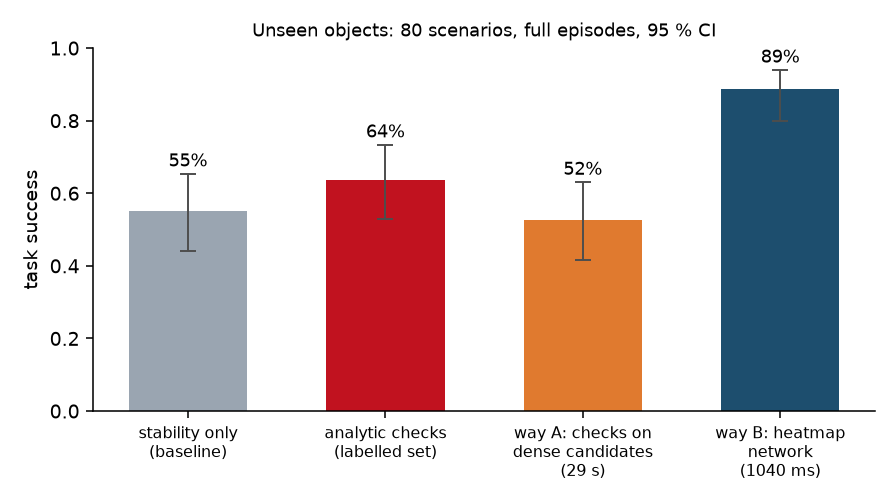

**In full episodes** (`scripts/archive/part1_grasp_choice/eval_way_b.py`; 10 unseen objects × 8 start poses, half of them
never in training). The network's best (point, target) pairs become grasps; the first 10 whose
open gripper clears the object (the filter every sampled candidate gets) go through the exact
start/target reach checks and the usual planning fallback, then a complete episode. All five
policies run on the same scenarios (paired; Windows run, `data/episodes_way_b_final`).

| Policy (80 scenarios, unseen objects) | Success [95 % CI] | slip | QR | collision | no grasp | way B wins / losses |
|---|---|---|---|---|---|---|
| stability only (baseline) | 55 % [44, 65] | 22 | 4 | 2 | 8 | 29 / 2 |
| analytic checks (labelled candidates) | 64 % [53, 73] | 19 | 1 | 1 | 8 | 27 / 7 |
| way A: all checks, ~1,000 dense candidates, best score | 51 % [41, 62] | 24 | 8 | 7 | 0 | 31 / 1 |
| way A, score averaged over neighbouring grasps | 84 % [74, 90] | 4 | 1 | 8 | 0 | 7 / 3 |
| **way B: heatmap network** | **89 % [80, 94]** | 8 | 1 | 0 | 0 | |

Three training seeds of way B: **89 %, 94 %, 93 %** (mean 92 %); offline point AUC 0.93–0.94.

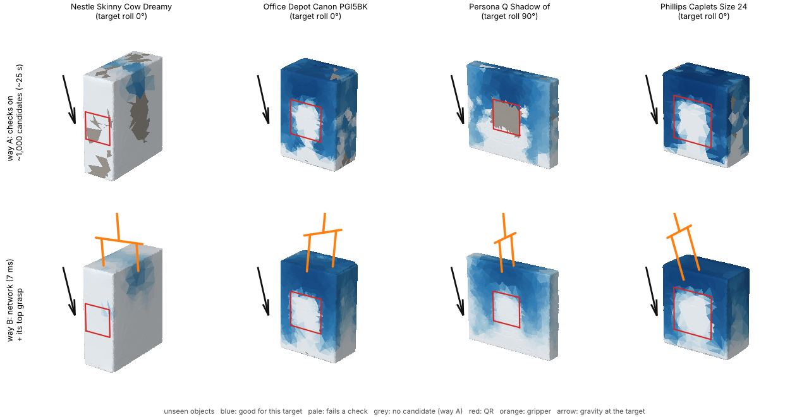

*Four unseen objects. Top: way A, the checks run on ~1,000 candidates (~25 s). Bottom: the
network's map from one forward pass (7 ms) and its top grasp (orange), for the target it rates
best. Arrow: gravity at the target; red: the QR patch.*

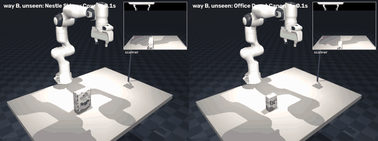

*The network's grasps executed in full simulation on two unseen objects; left, the box for which
none of the labelled candidates was usable.*

**Why does the student beat its teacher?** Way B was trained to imitate way A, yet plain way A
is the worst policy here. The hypothesis was that way A takes the *maximum* of an imperfect score
over ~1,000 candidates, which favours candidates whose score is overestimated (the winner's
curse: lift stability here comes from the analytic model, not simulation), while the network
*averages* over neighbouring candidates and so prefers regions where many grasps work. The test,
decided before running it: rank way A's own feasible candidates by their score averaged over the
neighbouring grasps (TCP within 1 cm, axes within 30°). Result: **51 % → 84 %** (28 scenarios
won, 2 lost, p = 9e-7), with slip failures falling from 24 to 4, and the network is no longer
significantly better (7 / 3, p = 0.34). So most of way B's advantage comes from preferring
robust *regions* over the single best-scoring grasp, an effect that a cheap smoothing step
also gets; the network delivers it in 7 ms instead of 25 s, and with fewer collisions (0 vs 8),
because its proposed grasps sit centrally in such regions.

Caveats: labels from the analytic checks only (the simulator judges the episodes); 80
scenarios. An earlier run of the smoothed variant was corrupted by a rendering bug (see design
notes); every other result was re-run with the fix and reproduced exactly (80 / 80 identical).

