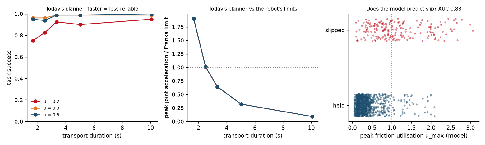
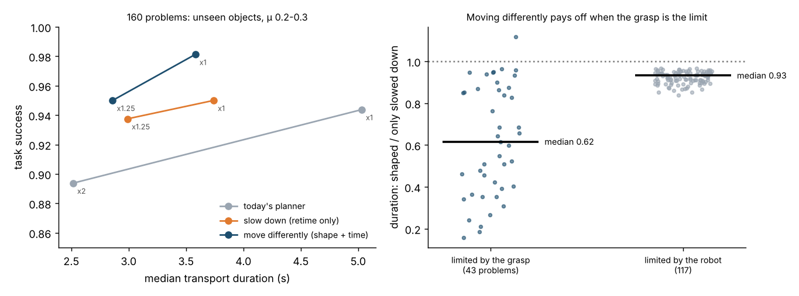
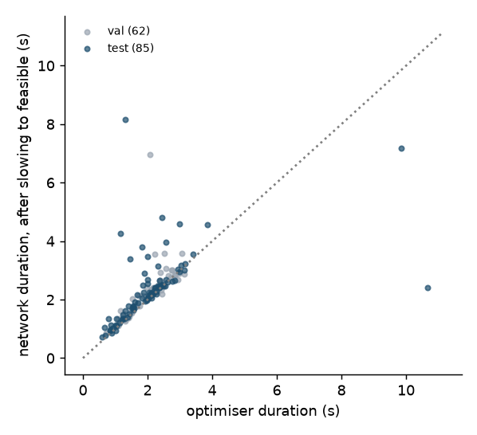
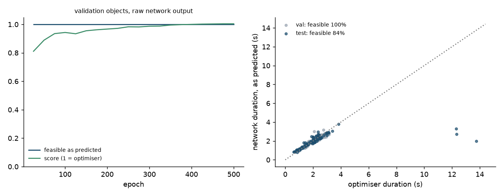
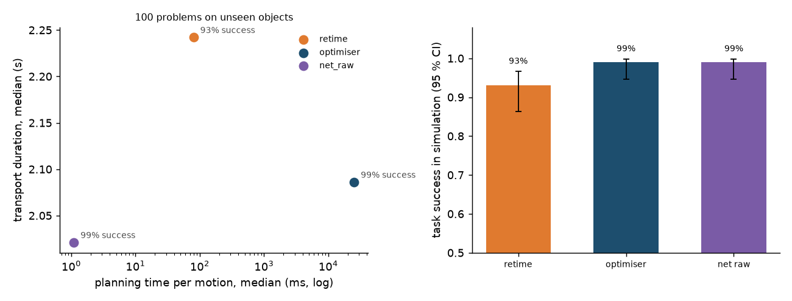
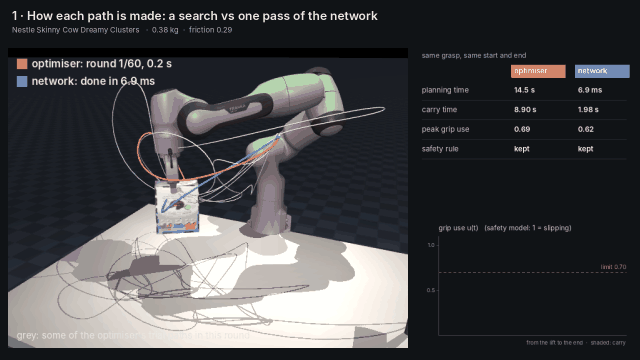
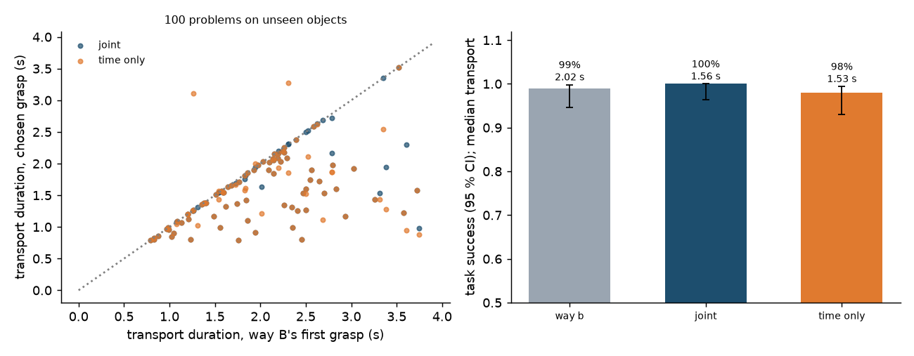
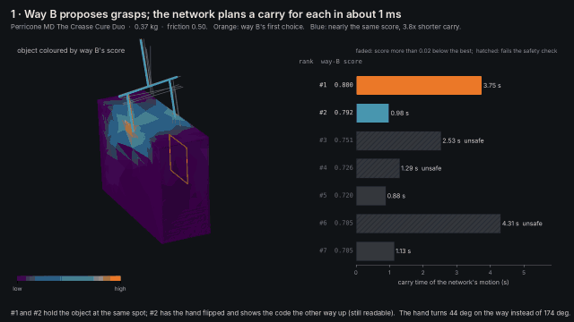

# Part 2: carrying the object so the grasp holds

*Scripts: `scripts/archive/part2_transport/`.*

Same grasp, same start, same presentation pose; only *how the arm moves in between* changes. A
two-finger grasp is anisotropic: a load along the finger axis is carried by the grip force itself
(up to 2F), a load across it only by friction (2μF), and a torque about the finger axis only by
torsional friction, the weakest of all. Leverage turns every load with a lever arm into torque.
So a motion that points the combined load of gravity and acceleration where the grasp is strong
can be faster without slipping (the tray version of this idea: [Heins & Schoellig, RA-L 2023](https://arxiv.org/pdf/2305.17484);
time-optimal retiming with grasp constraints: [Pham & Pham, ICRA 2019](https://arxiv.org/pdf/1809.03151);
learned constraints: [GOMP-ST](https://arxiv.org/pdf/2203.08359)).

**The load the motion asks of the grasp** (`grasp2show/transport.py`): from the object's
trajectory, the d'Alembert load m(g − a) and the inertial torque, fed to the soft-finger model,
give the friction utilisation u(t) at every instant. It is made *robust to leverage*: the grasp must
also hold with the centre of mass ±5 mm off along each gripper axis, because an object balanced on
the finger axis looks perfectly safe to the nominal model yet behaves like an inverted pendulum on
the lower finger. A hold test in simulation (`scripts/archive/part2_transport/hold_tilt_test.py`) also showed the simulated
hand carries much less along its finger axis than the ideal 2F (a 1.5 kg box tilted vertical held
with 9 mm slip, 2 kg was lost), so that load is capped at 14 N.

**Today's planner, measured** (`scripts/archive/part2_transport/transport_baseline.py`, 1,200 episodes: way B's grasp on
the 10 unseen objects × 8 start poses × 5 speeds × μ 0.2/0.3/0.5):

The model's peak utilisation predicts slip during the motion with **AUC 0.88** (the static end
pose alone: 0.77). Today's planner stops 2–3 times, and at 2× speed already reaches the Franka
joint-acceleration limit (1.9× at 3×); at μ = 0.2 its success falls from 95 % to 75 % as it speeds up.

**The optimiser** (`grasp2show/transport_opt.py`): one smooth joint trajectory from the lifted
pose to the presentation pose (minimum-jerk plus Chebyshev bumps that leave the ends at rest), its
shape and duration chosen together to minimise time and needless jerk, subject to: robust
utilisation ≤ 0.7, ≤ 60 % of the Franka velocity and acceleration limits, joint limits, no
collision. Baseline: *retime only*, the straight path made as fast as the same constraints allow.

**Result** (`scripts/archive/part2_transport/transport_compare.py`, 160 problems: 80 unseen-object scenarios × μ 0.2/0.3):

| Method | Success [95 % CI] | Median duration | Slip > 5 mm / 5° |
|---|---|---|---|
| today's planner | 94 % [90, 97] | 5.0 s | 10 % |
| today's planner, 2× speed | 89 % [84, 93] | 2.5 s | 19 % |
| retime only (slow down to stay safe) | 95 % [90, 97] | 3.7 s | 18 % |
| **shape + time (move differently)** | **98 % [95, 99]** | **3.6 s** | 11 % |
| shape + time, run 25 % faster than planned | 95 % | 2.9 s | 9 % |

Paired, shape + time vs today's planner: 6 scenarios won, 0 lost (p = 0.03), 38 % faster; vs
today's planner at 2× speed: 15 won, 1 lost (p = 5e-4). **The effect the idea predicts shows
where the grasp is the bottleneck**: in the 43 problems where the slowed-down motion is limited by
the grasp (median object 0.38 kg, low friction), shaping the motion makes it **38 % shorter**
(median duration ratio 0.62, some cases 5× shorter) and lifts success from 86 % to 93 %; where
the robot's own limits bind (117 problems, light objects), the gain is 7 %.

Caveats: the optimiser is a sampling search (≈25 s per problem) and ends slightly outside the
constraints in 22 % of problems (they still ran in simulation); for 10 % of the problems even the
end poses at rest exceed the 0.7 limit under the robust model, and the limit is relaxed to that
need.

**A network that imitates the optimiser** (`grasp2show/learn/transport_net.py`, as
[DJ-GOMP](https://goldberg.berkeley.edu/pubs/SR-DJ-GOMP-Nov-2020.pdf) learns GOMP's solutions). Data
(`scripts/archive/part2_transport/generate_transport_data.py`): 400 optimised motions on training objects and 100 on the
unseen test objects, each with a random start place and rotation, friction μ ∈ [0.15, 0.6] and way B's
grasp; every motion was also run in simulation (94 % / 98 % success). An MLP maps start and end
joint configurations, μ, and the object's mass, centre of mass and inertia *in the gripper frame*
(the leverage) to the path coefficients and the duration (`scripts/archive/part2_transport/train_transport_net.py`,
73 s on the laptop).

| Held-out problems (no collision check yet) | 5 validation objects | 10 unseen objects |
|---|---|---|
| motion satisfies every constraint as predicted | 52 % | 46 % |
| usable after slowing it down | 100 % | 87 % |
| duration vs the optimiser (median, after slowing) | 1.08× | 1.07× |
| duration vs the slowed straight motion | 0.99× | 0.99× |
| time per motion | 0.01 ms (vs ≈25 s) | 0.01 ms |

Imitation alone is not good enough: the network recovers only a small part of the optimiser's
7–8 % gain, and in 13 % of the test problems its path turns the object through an orientation
where *the weight alone* already exceeds the grip, which no slowing down can fix. The labels are
the reason more than their number: the optimiser is a sampling search, and where several detours
are equally good it picks one at random, so the network learns their average, which can be worse
than any of them.

**Training on the constraints instead of on the optimiser's answers** (self-supervised). The
whole checker (forward kinematics, the d'Alembert load, the soft-finger model with the ±5 mm
leverage worst case, the axial cap, the robot limits) is rewritten in PyTorch
(`grasp2show/learn/transport_torch.py`): it agrees with the optimiser's checker to 1e-11 and is
differentiable (where the torque about the finger axis binds, the soft-finger utilisation is found
by bisection and differentiated with the implicit function theorem). The network is then trained
to do what the optimiser does, minimise log duration plus penalties on any violation (with a
margin, so that the raw output stays feasible on new problems), on any problem, without labels
(`scripts/archive/part2_transport/train_transport_selfsup.py`). So the friction is drawn fresh for every problem in every
batch, and problems are cheap: 3,281 more were generated without the optimiser
(`scripts/archive/part2_transport/generate_transport_problems.py`, 35 min). Starting from the imitation network, 500
epochs took 82 min on the laptop GPU.

Judged on the **raw** network output (no slowing down, no refinement, no fallback; collisions
checked later, in full episodes):

| | imitation | **self-supervised** |
|---|---|---|
| validation objects: feasible as predicted | 52 % | **100 %** |
| validation: duration vs the optimiser (median) | 1.11× | **0.99×** |
| validation: score (1 = always feasible and as fast as the optimiser) | 0.45 | **1.00** |
| unseen objects: feasible as predicted | 45 % | **84 %** |
| unseen: duration vs the optimiser (median) | 1.14× | **1.00×** |
| unseen: score | 0.41 | **0.96** |
| unseen: problems the straight motion cannot do at all (12; the optimiser finds 10) | 2 | 3 |
| time per motion | 0.01 ms | 0.01 ms |

Where it is feasible it is as fast as the optimiser, and on three of the hard problems it is 4–6×
faster than the optimiser's detour (right panel). Training also on heavier and lighter versions of
the same objects (mass and inertia × 0.6–2.5, `--mass-scale`, 300 more epochs) lifts the unseen
objects to 87 % feasible (92 % of the 92 problems whose end poses are not already overloaded at
rest; the optimiser: 98 %), 0.98× the optimiser's duration, and 5 of the 12 detour-only problems.

**In full episodes** (`scripts/archive/part2_transport/transport_net_episodes.py`: the 100 unseen-object problems rebuilt in
simulation, collisions, slip and the QR read all real; the network's motion executed exactly as
predicted, no check, no slowing down, no fallback):

| | success [95 % CI] | median duration | planning time |
|---|---|---|---|
| slow down only (retime) | 93 % [86, 97] | 2.24 s | 80 ms |
| optimiser | 99 % [95, 100] | 2.09 s | 25 s |
| **network, raw** | **99 % [95, 100]** | **2.02 s** | **1 ms** |

The raw network succeeds as often as the optimiser, with motions 3 % shorter, planned about
20,000× faster. Its 13 motions that the conservative model calls infeasible all succeeded in
simulation (the ±5 mm leverage margin and the axial cap leave room); its one failure is a QR read
with 3 mm slip. Every failure of the slowed-down straight motion is a heavy object slipping in the
hand (up to 47 cm): moving differently matters exactly where the grasp is the limit.

### The network and the optimiser, case by case

Same grasp, same start and end; each video shows how each path is made (the optimiser's search:
60 rounds of 32 trial paths, ~15–25 s; the network: one pass, ~3–7 ms) and then both carries in
full simulation with the grip use of each (`scripts/archive/part2_transport/demo_net_vs_optimiser.py`).

| case | object | carry: optimiser / network | video |
|---|---|---|---|
| about the same | Nestlé Nips box, 0.16 kg, μ 0.25 | 2.18 s / 2.14 s | [mp4](../media/net_vs_opt_00089_Nestle_Nips_Hard_Can.mp4) |
| the network wins (the straight path is impossible; the optimiser's detour is slow) | Skinny Cow box, 0.38 kg, μ 0.29 | 8.90 s / 1.98 s | [mp4](../media/net_vs_opt_00017_Nestle_Skinny_Cow_Dr.mp4) |
| the optimiser wins (grip far from its limit: the robot's limits bind, and the network keeps a margin) | Philips bulb box, 0.22 kg, μ 0.44 | 0.59 s / 0.83 s | [mp4](../media/net_vs_opt_00058_Philips_EcoVantage_4.mp4) |

### Choosing the grasp together with the motion

Way B ranks grasps by how likely they are to show the code; the robot used to take the first one it
could plan and only then work out the carry. But grasps that are nearly as good for the task can
need very different carries. Because the network plans a carry in about a millisecond, every
candidate can be tried (`scripts/archive/part2_transport/joint_grasp_motion.py`: way B's top 10, the plannable ones get a
network motion, the safety model and the collision check; 0.24 s in total per problem, against
~25 s per grasp with the optimiser). The joint choice takes, among the grasps whose way-B score is
at most 0.02 below the best, the one with the shortest safe carry.

| 100 unseen-object problems | success [95 % CI] | mean carry | median carry |
|---|---|---|---|
| way B's first grasp | 99 % [95, 100] | 2.03 s | 2.02 s |
| **grasp chosen with the motion** | **100 % [96, 100]** | **1.64 s (−19 %)** | **1.56 s** |
| shortest carry, way-B score ignored | 98 % [93, 99] | 1.57 s | 1.53 s |
| *at friction 0.2:* way B's first / joint / shortest | 93 % / 94 % / 92 % | 2.05 / 1.71 / 1.62 s | |

The joint choice picks another grasp in two problems out of three, and then the carry is 19 %
shorter (median), up to 3.8× shorter. Ignoring way B's score shortens it a little more but loses
successes (2 losses, 1 win; 3 losses at μ = 0.2): the score is what keeps the code readable.

The example in the video (a 0.37 kg jar): way B's #1 and #2 hold it at the same spot; #2 has the
hand flipped and shows the code the other way up, so the hand turns 44° on the way instead of 174°,
and the carry takes 0.98 s instead of 3.75 s (grip use stays far from the limit).

([mp4](../media/joint_choice_Perricone_MD_The_Crease_.mp4): `scripts/archive/part2_transport/demo_joint_choice.py`)

