# Part 3: many shapes, a scanner that moves, hooks, and choosing hook or pinch

*Current scripts: `scripts/` (the pipeline, evaluation, hook self-training); earlier studies: `scripts/archive/part3_early/`.*

**Objects** (`scripts/archive/part3_early/select_objects_v2.py`, written-down criteria): from all 1030 scanned
objects, those the hand can close on somewhere (antipodal pairs of 0.8–7.5 cm, so a mug
qualifies by its handle or rim), portable (≤ 30 cm), with a spot for a 3 cm QR sticker (flat, or
gently curved: a mug's side; `qr_placement.find_qr_patch`); a stratified draw by shape: box-like,
rounded, irregular. Then the simulation decides: objects with no grasp that lifts
(`generate_grasps.py --prune`: 25, mostly heavy) or no workable grasp from the table in any of 8
scenes (`generate_dense_labels.py --prune`: 27, flat consoles and DVDs, big shoes) are dropped.
**112 objects** remain: 58 box-like, 27 rounded, 27 irregular, 6 with a handle or rim; 81 train,
31 unseen test.

**The scanner moves** (`config.random_camera`): every scene draws a new look-at point (±10 cm,
±8 cm in height) and viewing direction (±60° around, −10° to +35° in elevation, 24–36 cm away),
with a new start place and rotation. Way B already takes the camera direction as an input; it is
retrained on 893 such scenes (`train_heatmap_net.py`, 30 min). The analytic lift check was
validated on boxes and rejects every mug grasp (a finger pressing a curved rim touches along a
line and holds far more torque than the point-contact model allows), so check 1 now comes from
the simulated shake test (`--sim-lift`).

**Result** (`scripts/archive/part3_early/eval_way_b_v2.py`, full episodes, 124 scenes: the 31 unseen objects × 4
unseen start and scanner poses):

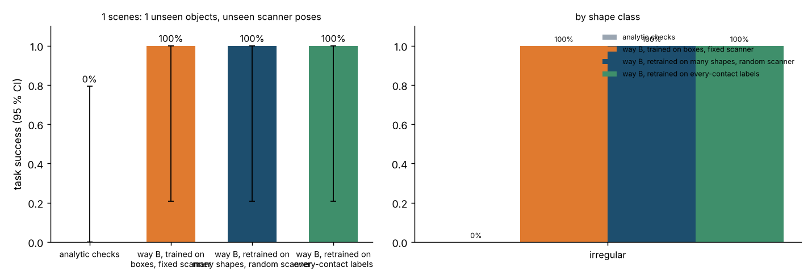

| | success [95 % CI] | box / rounded / irregular | of the 88 scenes any method solved |
|---|---|---|---|
| analytic checks | 47 % [38, 56] | 67 / 44 / 12 % | 58 |
| way B, trained on boxes, fixed scanner | 56 % [48, 65] | 78 / 47 / 25 % | 70 |
| **way B, retrained** | **61 % [53, 69]** | **87 / 53 / 22 %** | **76** |

The retrained way B beats the checks that labelled it (23 scenes won, 5 lost) and, less clearly,
its predecessor (16/10). Box-like objects shown to a moving scanner are nearly solved (87 %).
What is left is mostly not the choice but the absence of a working grasp: only 88 of the 124
scenes were solved by any method, and only 13 of the 32 irregular ones; a shoe or a toy rarely
offers a pinch that lifts it, survives the turn to the scanner and keeps the code visible. The
other weak link is the teacher: the stability check at the presentation pose is still the
point-contact model. Next: a grip model with every finger contact (pads, sides, tips, palm),
which also makes hooking a handle a strong grasp, then hanging grasps and swing-aware carries.

### A grip model with every contact

The point-contact model sees two finger pads touching at one point each. A finger closing on a
mug's rim touches along a line; an irregular object touches the side of a finger or the palm.
`grasp2show/grip_model.py` takes every contact the simulated gripper makes after closing
(`gripper_sim.close_contacts`: points, normals, MuJoCo's friction per contact) and solves a small
linear program: how many times the load (weight, or inertial loads during a carry) can contact
forces inside their friction cones hold, with the gripper's one motor pushing the two coupled
fingers with exactly 2 × 20 N along their closing directions, while the coupling, the finger
structure and the palm carry everything else for free. About 4 ms per grasp and load.

Validated against simulated hold tests (`scripts/archive/part3_early/validate_grip_model.py`: 1022 tests, 60 objects
evenly from the three shape classes, a random orientation per test, friction 0.15–0.6 and mass
× 0.5–4 to get both outcomes, no fitted parameters):

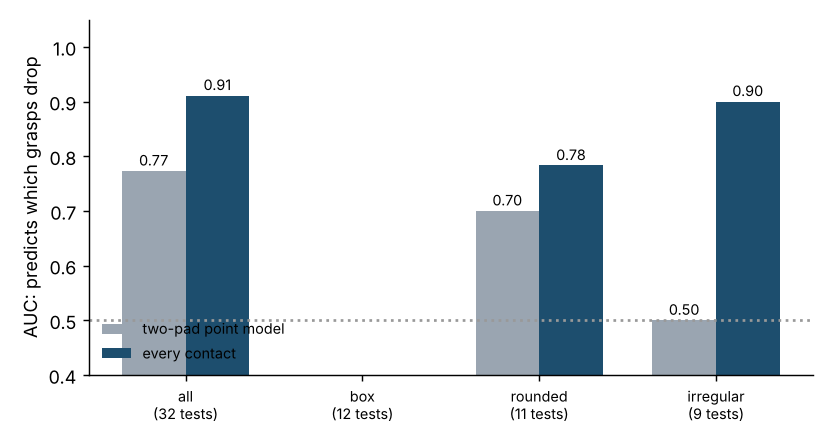

| AUC: which grasps drop | all | box | rounded | irregular |
|---|---|---|---|---|
| two-pad point model | 0.92 | 0.94 | 0.91 | 0.87 |
| **every contact** | **0.96** | **0.95** | **0.96** | **0.92** |

Calibration: of the grasps with u < 0.5, 99 % hold; 0.5–0.75: 77 %; 0.75–1: 47 %; above 1.5,
almost none. The model is somewhat optimistic near u = 1 (the simulator's soft contacts creep),
so the planning limit u ≤ 0.7 keeps its role. Only 1 % of the sampled grasps touched the palm:
the antipodal sampler proposes pinches.

**But it does not improve full episodes.** Labels from it (hold at the presentation pose if
u < 0.8) doubled the share of "workable" grasps and way B retrained on them got worse (51 % vs
62 %, twice the slips): near u = 1 the model is optimistic, and the episode adds the carry's
accelerations. With stricter thresholds the analytic checks policy is unchanged within noise
(u < 0.4: 45 %, < 0.55: 46 %, the point model: 47 %): in full episodes the hold check is not the
bottleneck; "no workable grasp at all" and collisions during the motion are. Way B keeps its
point-model labels (v2); the new model stays for what needs it (carrying curved objects).

**Hooking** (`grasp2show/hooks.py`): find the holes a fingertip can pass through (points the
object surrounds in a ring, with the line through them free on both sides, so not the inside of a
cup), cut each hole with a plane and place the fingertips' cross-section in it, from the
simulator's own finger geometry, turned for the most clearance. The fingers taper: 5 mm in front
of the TCP both closed fingertips are 1.8 × 3.1 cm (2.1 × 5.3 cm at the base); one finger alone
fits even a tight handle (the other stays outside, gripper open).

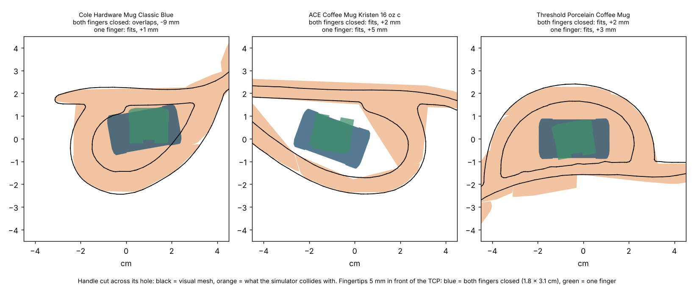

In simulation (`scripts/archive/part3_early/hook_strength.py`; same lift for every grasp: gravity on, lift 10 cm,
hold), hooks lift two of the three mugs (6 and 2 working hooks, mostly one finger through the
handle; the third mug's hole is too tight once the palm must also clear the body). The mug swings
until it hangs below the finger:

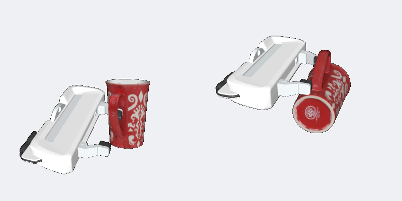

Then the mugs are made heavier (× 2 … × 16, up to 4 kg):

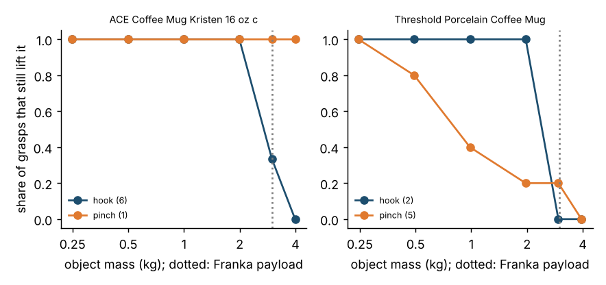

Every hook that lifts the mug as it is still lifts it at 2 kg (8 × its weight); pinches lose
their hold as the weight grows (on the porcelain mug 1 of 5 still holds at 2 kg). Not a clean
sweep: on the red mug the only pinch found held up to 4 kg, longer than the hooks, which let go
around the Franka's 3 kg payload.

**Showing a hooked object** (`grasp2show/hanging.py`). A pinched object moves with the hand, so
the planner picks the object's show pose and the hand follows. A hooked object hangs: gravity
decides how it sits on the finger, so the planner works the other way round.

1. *Where it hangs*: the hook lift in the floating-gripper simulator, held until the swing has
   died down, gives the hanging pose relative to the hand. It stays valid as long as the hand
   keeps its tilt, since turning about the vertical leaves the hanging unchanged.
2. *Show pose*: the hand turns about the vertical until the QR's horizontal direction points at
   the scanner; the QR's tilt is whatever the hanging gives. The QR centre goes to the scanner's
   look-at point, as for a pinch. Reach, collisions (with the object hanging, and swung ± 12°)
   and QR visibility are then checked, for three carry pitches (below) and both twins.
3. *Carry*: the Franka's fingertips taper, so a hook passes only a few millimetres of fingertip
   through the handle; carried level, the handle slid off the tip in the first trials. So the
   hand first lifts straight up until the mug hangs, then raises its fingers 15–40° (the planner
   picks the pitch that shows the QR best). The handle slides down the finger to where it
   thickens and wedges there. During the carry the fingers may not point lower than 15° below
   that pitch; the planner searches joint moves, via points and Cartesian turns about the
   vertical until one keeps them up.
4. *Threading the handle*: a hook has 1–3 mm to spare. The scanned mug settles 1 mm lower and
   0.6° tilted from its nominal start pose, which was enough for the fingertip to hit the handle
   and push the mug away. Planning against the settled pose (what a perception system would
   report) puts the fingertip within 0.1 mm.

A hook is judged by the same scanner as a pinch: QR decoded, object still held, no unexpected
contact. The swing is reported but not judged, since the object is meant to hang. Heavier
objects are made by scaling mass and inertia (× 8 = 2 kg; the Franka's payload is 3 kg). An input
shaper against the swing (crane control: the motion split into two halves, the second delayed by
half the swing period) changed neither the results nor the mug's pose at the scanner on 16
scenes: after a 2 s hold the swing has died down. It stays in the code, switched off.

**Hook vs pinch, full episodes, heavier and heavier** (`scripts/archive/part3_early/hook_episodes.py`; the red mug,
the only one of the three that can be hooked from the table; 16 random start + scanner poses per
weight; way B v2's pinch choice; the analytic-check pinch policy found no workable grasp on this
mug in any scene):

| Scanner | Policy | × 1 (0.25 kg) | × 2 | × 4 | × 8 (2 kg) |
|---|---|---|---|---|---|
| 640 × 480 | way B pinch | 25 % | 6 % | 0 % | 0 % |
| 640 × 480 | hook | 25 % | 25 % | 19 % | 12 % |
| 1280 × 960 | way B pinch | 44 % | 44 % | 12 % | 6 % |
| 1280 × 960 | hook | **56 %** | **56 %** | **44 %** | **31 %** |

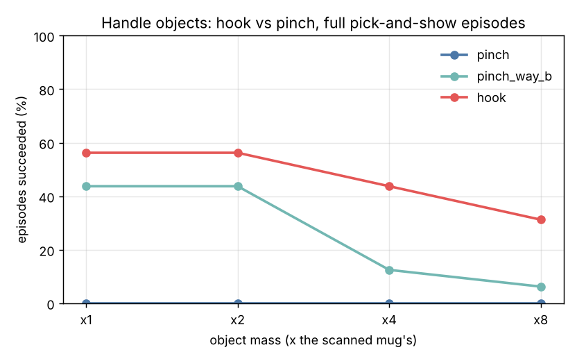

- **The hook copes with the weight much better than the pinch.** At 2 kg the pinch drops the
  mug in 10 of 16 scenes and slips in 4 more. The hook loses some too: the heavier mug swings
  and sags further on the finger, and in 5 scenes it touches the arm on the way (the collision
  check allows ± 12° of swing).
- **The 640 × 480 scanner limits both policies.** A 3 cm code hanging at a tilt is about 50–55 px
  across, and OpenCV decodes it on some frames and not others: re-running the same episode with
  a tiny change flipped the result both ways, and the unread images I checked all decoded once
  upscaled 2 ×. With
  a 1280 × 960 scanner no failure is a QR failure.
- **What the hook still misses**: in 3 of 16 scenes no hook passes the checks (the handle can
  only be threaded from two directions, and the hanging tilt can turn the code away from a high
  or low scanner), and in 2–5 no carry keeps the fingers up and the swinging mug clear.
- The other two mugs cannot be hooked from the table: the blue one's handle hole is too tight
  (no fit lifts it), and on the porcelain one every fitting finger pose puts the 20 cm-wide hand
  through the table (its handle sits low).

**All six handle objects, with the pinch at its best** (run on the laptop: grasps generated with
`--min-width 0.002` so mug rims are included, way B v4, both scanners; success in %, at
× 1 / × 2 / × 4 / × 8 the object's mass):

| 1280 × 960 scanner | red mug (ACE) | fruit basket | all 6 objects |
|---|---|---|---|
| pinch, analytic checks | 75 / 19 / 0 / 0 | 100 / 94 / 69 / 25 | 33 / 23 / 11 / 4 |
| pinch, way B v4 | 44 / 25 / 19 / 25 | 94 / 94 / 88 / 88 | 40 / 33 / 18 / 19 |
| hook | 50 / 62 / 25 / 31 | — (no hook fits) | 8 / 10 / 4 / 5 |
| best of the three per scene | 88 / 81 / 44 / 50 | | 52 / 48 / 23 / 23 |

(640 × 480: red mug 25 / 25 / 12 / 25 for the hook, 19 / 12 / 6 / 0 for way B's pinch.)

- Only the red mug can be hooked from the table; the other five either have no hole the
  fingertips fit through with the palm clear, or (porcelain mug) the hand would go through the
  table. So hooking is a niche grasp, not a replacement.
- With rims allowed, the analytic checks find a good light-weight pinch on the red mug (75 %),
  but it fails as soon as the mug is heavier. From × 2 on, the hook is the best single policy on
  that mug.
- The bottom row is what a perfect per-scene chooser between hook and pinch would reach: on the
  red mug it nearly doubles the best single policy. That chooser is the next step.

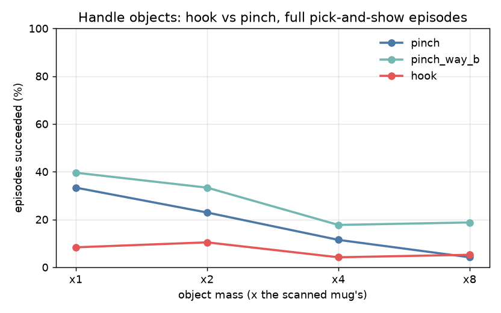

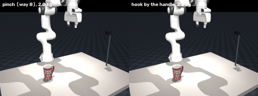

**The handle objects that cannot be hooked** (`scripts/archive/part3_early/figure_unhookable.py`; the hand drawn
where the hook pipeline came closest; grey plane: the table top):

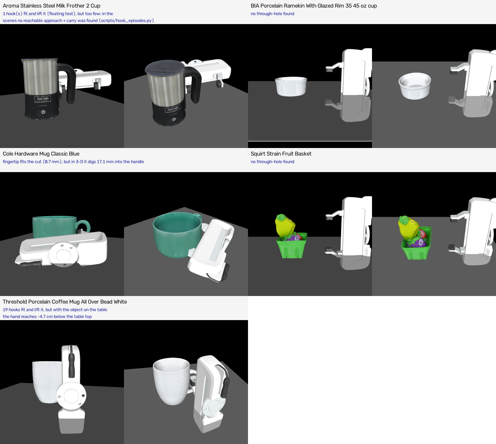

Two are not handle objects at all (a ramekin and a berry basket matched the name filter). The
blue mug's handle hole is too small once the 3-D finger is placed, not just its tip's cut. The
porcelain mug hooks well in the air, but its handle is so low that the hand would reach 4.7 cm
below the table. The milk frother is hookable (once the lift test stopped judging a hook by its
frame's height: a tall jug tips 75° as it hangs, so its frame drops while it hangs fine) but
with a single fitting hook no approach and carry were found in its 16 scenes.

**Speed.** Planning a hook took ~13 s per scene, 94 % of it simulating where the object hangs
for every hook, twin and carry pitch. Those poses do not depend on the scene, so they are now
computed once per object with the hooks (`hanging.hang_table`, cached in `data/hooks/`): ~0.7 s
for the hook options, plus 0–2 s for the carry search. (A way B pinch plans in ~1 s.)

### Generated handled objects and a hook network

Only one of the 112 scanned objects can be hooked from the table, too few to learn from, and a
scan's convex decomposition can partly fill a handle's hole. So handled objects are generated
(`grasp2show/shapegen.py`), from convex pieces only, so the simulator's collision geometry is
exactly the object:

- bodies: superellipsoids, prisms and pyramids, faceted pebbles, stacks and clusters of them,
  twisted stacks of slabs, sometimes spiky; and (from seed 700) open containers: cups, mugs,
  bowls, flared pots, buckets with thin walls;
- handles: arcs, rectangles, triangles, random polygons, superellipses, pointed arches, each
  plain or with squiggles, zigzags, random doodles or a 3-D twist; round, strap, square or
  triangular cross-section, sometimes swelling; sometimes spiky; on the side, over the top, as a
  ring on a stem, or rim to rim on a bucket; sometimes two;
- the opening is drawn around what the Franka's fingertips need (75 % big enough, 25 % a little
  too tight, so the network also sees near misses); every part must touch the rest.

`scripts/generate_hookable.py` runs each object through the same hook pipeline as the scans
(hole finding, fingertip fit, simulated lift) and keeps the hooks that lift it as labels; an
object counts as hookable if a hook also keeps the hand above the table. Making this work on
generated shapes fixed three blind spots of the hole finder (it now estimates each hole's axis
from the hits around it, so 6 mm handles are found; tilted handles need the line through the
hole free only on the side the fingers come from; and a cup's inside is not a hole), and Embree
ray casting made it ~100 × faster. 800 objects, 549 hookable from the table:

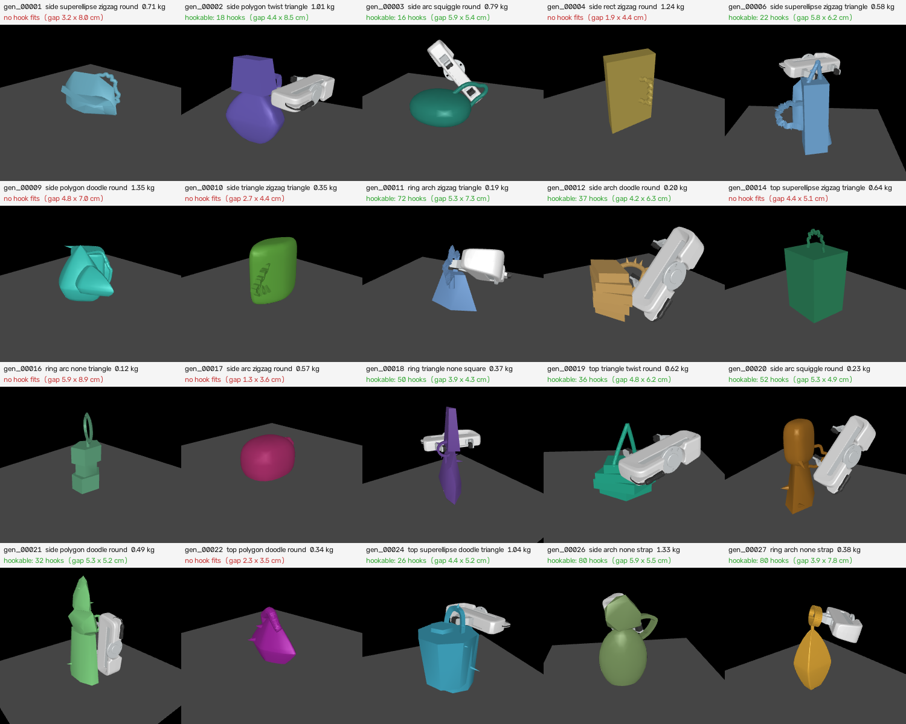

The hook network (`grasp2show/learn/hooknet.py`, `scripts/archive/part3_early/train_hook_net.py`) works on the point
cloud alone, in the style of Contact-GraspNet: per point, the probability that a hook is
anchored there (the fingertip that is in the hole) and that hook's pose (the axis through the
hole, without a sign: holes are threaded from either side; the closing axis; the offset; one
finger or both). Only the simulated lift test of its top candidates remains.

| 160 unseen generated objects | point AUC | objects with a hook where a prediction lifts | predictions that lift | time per object |
|---|---|---|---|---|
| analytic pipeline | | (the labels) | | ~18 s |
| network | 0.96 | 82 % | 36 % | 0.3 s + 0.9 s lift checks |
| network + analytic fit around its holes | | 88 % | 36 % | 28 s + 1.6 s |

On the six real scanned handle objects, never seen in training, it is weaker: the red mug gets
6 lifting hooks out of 10 candidates, the frother 1 of 10, the porcelain mug none (its best hook
point ranks 17th), and the three objects with no hook get only candidates that the lift test
rejects. Two fixes got it this far: the generated objects' point clouds were sampled from every
convex piece, so 10–33 % of the points lay on faces hidden inside the solid (a signature no
camera sees); and on scans the probabilities come out lower, so candidates are ranked rather
than thresholded. Next: self-training (the network proposes hooks on new shapes, the simulator
checks them, confirmed ones become labels), candidates ranked rather than filtered by the
hole finder's rules, so pockets and J-shaped hooks can be found too.

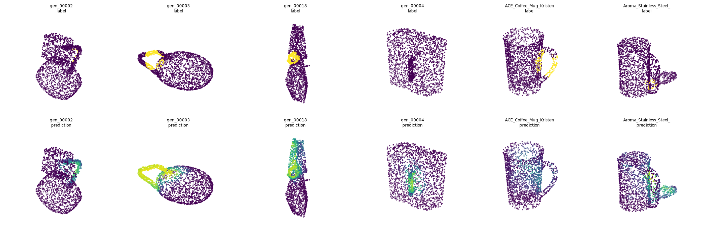

*The mug at 8 × its weight (2 kg), same scene. Left: way B's pinch. Right: the hook, carried
with the fingers raised, shown hanging; insets: the scanner's view at the end.*

### Self-training: the simulator teaches the hook network

The first hook network learned the hole finder's hooks, so it learned the hole finder's blind
spots too: a closed pocket with a lip, a J-hook, a knob's cap, a basket's bail wider than its
6 cm reach were "not hookable" without ever being tried. Now the rules only propose and rank;
every label is a lift test (`grasp2show/hookteach.py`, `scripts/self_train_hooks.py`):

- **Teacher (once per object, ~100 tests):** the hole finder in ranking mode (no hard
  "opens on both sides" rule; a second pass with a 13 cm reach for carrying handles; the
  fingertip also under the top bar of each hole), fingertips under any downward-facing surface
  (lips, rims, knob caps, J-hooks) with up to 12 hand orientations each until one is clear,
  and random placements. Each outcome is kept: lifted, tried and fell, or could not be placed.
- **Labels (`hooknet.labels3`):** positive near a hook that lifted; a full-weight negative where
  tries fell and nothing lifted close by; untested points count 0.15 (most of a surface cannot
  be hooked, but no test said so); collisions say nothing.
- **Rounds:** train (random yaw, 1 mm noise, 30 % single-camera partial views by hidden point
  removal; a third edge convolution with neighbours in feature space), then the network proposes
  on the training objects (its best points, points drawn by its probability with jittered
  poses, random exploration), the simulator tests them, and they join the labels: its false
  positives become hard negatives, hooks it finds that the teacher missed become positives.
- **Objects:** 800 generated + new families (mugs, J-hooks, knobs, lips, crates with slot
  handholds), 34 real scans with something to hook (26 train / 8 held out:
  `object_set_hookreal.json`), and the v2 scans (mostly no handle).
- **Reported each round** on held-out generated objects and held-out real scans: point AUC,
  hit rate, coverage of the teacher's distinct hooks, precision, and hooks found that the
  teacher missed (`media/self_train_hooks.png`).

**Result** (the network used now, `data/models/hook_net_table.pt`: judged by the robot's real lift
from the table, round 3 of 4; `scripts/self_train_hooks.py --judge table`). Hit: one of the network's
top proposals lifts the object in simulation.

| held out | objects | point AUC | hit |
|---|---|---|---|
| generated shapes | 191 | 0.96 | 90 % |
| real scans with a handle | 7 | 0.91 | 6 of 7 |

### Hook or pinch: the chooser

A pinch holds by friction (two fingers at 20 N carry about 4 mu kg when centred, less with
torque or motion); a hook carries the weight as a normal force on the finger, nearly
independent of friction. So the scenes vary both, as real objects do: friction mu log-uniform
0.15-1.0 (wet glazed porcelain or glass to rubber) and the object's weight x0.5-8 (empty to
filled), at most 3 kg. In each scene both strategies are planned with their own checks and
both are executed; the chooser (`grasp2show/chooser.py`) predicts each one's success from what
the checks found and picks one before anything moves. Cross-validated by object against
always-pinch, always-hook, a rule (pinch if its checks pass with a positive lift margin, else
hook) and the oracle (`scripts/evaluate.py`, `media/chooser.png`).

Found on the way: the fingers' MuJoCo friction is 1.0 and MuJoCo takes the larger of the two
surfaces' coefficients, so an object's own friction changes nothing unless the episode sets
both (`PickAndShow.execute(mu=...)`, now passed by `Scenario(mu=...)`). The pinch grasps are
sampled more densely for this study (300 contact pairs: with 60, a mug kept 10 lifting grasps,
since its body is too wide and only its rim and handle fit).

First run (1,410 scenes, 235 held-out objects): the learned chooser was within a point of the
oracle (28 % vs 29 %), and the robust ranking beat the score ranking for the pinch (58 % vs 54 %;
76 % vs 67 % where they picked differently), not for the hook (too few hooks got that far). The
hook got that far rarely, for three reasons found and fixed:
- generated objects' QR stickers were often under the handle (the spot was chosen on the body,
  rays cast 3 cm out); now a spot must be clear of the whole object within 25 deg of its normal
  (`qr_placement.qr_clear`, `scripts/fix_generated_qr.py`: about 1 in 5 moved);
- the hanging object's swing check turned it about the TCP, not about the finger it hangs from
  (4 cm off for a one-finger hook: the handle went 15 mm into the palm, every carry "collided");
- the carry's collision check counted the object leaning on the hand, which only stops its swing.
The carry planner also got a last resort: RRT-Connect in joint space with the fingers kept up.

Second run: the chooser beat always-pinch (33 % vs 28 %; generated objects 23 % vs 12 %), and the
robust ranking won for both strategies (pinch 75 % vs 68 %, hook 51 % vs 43 % where they
differed). Half the hooks that ran still dropped the object, more often when heavy or slippery.
Filmed and measured: 10 of 12 drops were in the lift, the handle loading a level finger that
passed only millimetres through it; and every hook had been tested at friction 1.0 (the
fingers' default), while half of them fail at 0.25. Now (physics, not learning): each hook goes
as deep through the handle as fits (`hanging.deepen`), the fingers turn up about the hooking
fingertip before the weight comes on (`hanging.tilt_then_lift`), the closed two-finger version
is tried first, and each hook carries the lowest friction it holds at (`hanging.hook_mu_min`); a
scene uses only the hooks that hold at its friction.

Third run, the remaining drops: the hand's deceleration along the finger was far within the
limit in 15 of 17 (so not a carry-speed problem); filmed, they are weak hooks (one finger in a
narrow gap at the top of a slim handle, beside a knob with no lip) that drag the standing object
as the fingers turn up and slip out. The floating lift test passes them (no table) and their
robustness to small shifts is as high as the good ones'. So each hook's lift is now rehearsed as
the robot does it, from a table (`hanging.table_lift_test`), and options that held go first (as a
filter it removed as many working hooks as weak ones). The network itself learned from the
floating test; `scripts/self_train_hooks.py --judge table` retrains it with the rehearsal as the
judge (the 1,340 objects' tests relabelled: on one object 42 of 88 lifting hooks held).

`media/hook_net_choices_real.png`, `media/hook_net_choices_generated.png`: what the hook network
chooses on held-out objects (`scripts/figure_hook_net.py`).

### Robustness for way B (no gain: the network already prefers robust grasps)

`scripts/way_b_robust.py`: the frozen way B network (`heatmap_net_v4.pt`) on the 31 unseen objects
of set v2 x 8 scenes (248 scenes, 1280 x 960 scanner, an unknown 2 mm / 1.5 deg error in the
object's pose), its grasps ranked three ways, each running its first plannable grasp:

| ranking | success | boxes | rounded | irregular | vs score (won / lost) |
|---|---|---|---|---|---|
| score (as always) | 62 % | 88 % | 44 % | 30 % | |
| cluster (score averaged over 1.5 cm) | 59 % | 83 % | 42 % | 31 % | 14 / 20 (p = 0.39) |
| robust (score x simulated robustness) | 63 % | 92 % | 44 % | 28 % | 12 / 9 (p = 0.66) |

Unlike the analytic pinch (75 % vs 68 %), way B gains nothing measurable: the grasps it already
picks are robust (0.78 of their shifts hold; the robust ranking's 0.88), because it learned from
labels spread over the surface and prefers regions where many grasps work (part 1), so averaging
its scores again only blurs them. Its failures are elsewhere: collisions with the table or the
scanner (35), no plannable grasp (29), slip (17), the QR (14).

