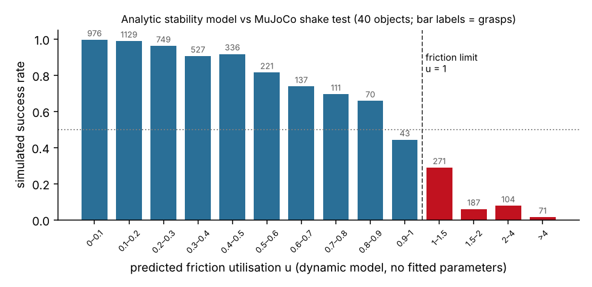

# The physics of checks 1 and 2: will the grasp hold?

Checks 1 and 2 ask the same question at two orientations of the object:

- **check 1**: at the start pose (lifting it off the table);
- **check 2**: at the target pose, where the QR faces the camera.

A grasp that holds when the object is upright can fail at the target: the gripper holds the
object at the same points, but gravity now pulls in a different direction *in the object frame*.
The code is `grasp2show/stability.py`; this page derives it.

## 1. Setup

A grasp is the transform `T_obj_tcp`. In the TCP frame:
**y** is the finger closing axis, **z** the approach direction. The fingers touch the object at

- `c1`: the finger pushing towards **+y**, with normal force `n1`,
- `c2`: the finger pushing towards **−y**, with normal force `n2`,

found by casting rays along the finger axis (`finger_contacts`). Let `c = (c1 + c2)/2` and
`w = |c2 − c1|` (the grasp width). All vectors below are in the **object frame**.

**Gravity in the object frame.** If the object has orientation `R` (object → world), gravity in
the object frame is

    g_obj = Rᵀ g,      g = (0, 0, −9.81) m/s²

and the weight `W = m · g_obj` acts at the centre of mass `com`. This single line is the
difference between check 1 (`R` = start orientation) and check 2 (`R` = target orientation).

## 2. What the contacts must do

For the object to stay still in the hand (statics), the contact forces must cancel the weight:

    total contact force                 f   = −W
    total contact torque about c        τ   = −(com − c) × W

Split both along the finger axis **y** (subscript ⊥ = component perpendicular to y):

| Load | Carried by |
|---|---|
| `f_y` (force along the finger axis) | the difference of the two normal forces |
| `f_⊥` (force across the finger axis) | the tangential friction forces `t1 + t2` |
| `τ_⊥` (torque perpendicular to y) | a **couple** of tangential forces, lever arm `w` |
| `τ_y` (torque about the finger axis) | **torsional friction only** |

The last row is why grasps fail by spinning: the tangential forces act at points *on* the
finger axis, so they have no lever arm about it.

**Normal forces.** The gripper is force-limited: each finger pushes with `F` (20 N), and the
Franka Hand's coupled fingers take any load along y, so

    n1 = F + f_y / 2,     n2 = F − f_y / 2          (both must stay > 0)

**Tangential forces.** With contacts at `c ∓ (w/2) y`,

    t1 + t2 = f_⊥
    τ_⊥ = (w/2) · y × (t2 − t1)   ⇒   t2 − t1 = (2/w) · τ_⊥ × y

(using `y × (v × y) = v` for `v ⊥ y`), so both tangential forces are fully determined:

    t1 = (f_⊥ − d)/2,    t2 = (f_⊥ + d)/2,    d = (2/w) τ_⊥ × y

**Torsional moments.** Only their sum is fixed: `m1 + m2 = τ_y`.

## 3. Friction limits: the soft-finger contact

A finger pad is not a point; it touches over a small patch, so it can resist a small twist
about its normal. MuJoCo models this (`condim = 4`) with an **elliptic** friction cone:

    (|t_i| / μ)² + (m_i / μ_t)² ≤ n_i²

- `μ = 0.5`: sliding friction (plastic fingertips on cardboard),
- `μ_t = 5 mm`: torsional coefficient, a *length*: roughly the radius of the contact patch.

Twisting and sliding share one budget: a contact already using its friction to hold the weight
has less left to resist a twist.

## 4. The utilisation u and the margin

Define the **utilisation** `u` as the smallest scale such that every contact satisfies

    (|t_i| / μ)² + (m_i / μ_t)² ≤ (u · n_i)²

for some split `m1 + m2 = τ_y`. For a given `u`, contact *i* can take at most

    |m_i| ≤ r_i(u) = μ_t · √( (u n_i)² − (|t_i|/μ)² )

so a valid split exists if and only if `r_1(u) + r_2(u) ≥ |τ_y|`. The left side grows with
`u`, so the smallest `u` is found by bisection.

- `u ≤ 1`: the contacts can hold the object;
- **margin** `= 1 − u`: how much load is left (margin 0.3 = the load could grow by ~43 %).

**Sanity check (closed form).** Upright box, top grasp through its centre: `τ = 0`, `f_y = 0`,
the weight is shared by two tangential forces, so `u = mg / (2μF)`. For 150 g:
`u = 1.47 / 20 = 0.074`, margin 0.926. The code reproduces this exactly (a unit test).

**How weak is the finger axis?** For a 4.5 cm wide grasp at 20 N per finger, the largest
torque *perpendicular* to the finger axis is `w·μ·F = 0.45 N·m`, but *about* the finger axis
only `2·μ_t·F = 0.20 N·m`, independent of the grasp width. A 0.8 kg object held 2.5 cm from
its centre of mass already reaches that limit (0.8 × 9.81 × 0.025 = 0.20 N·m).

## 5. Checking against the simulator

**Controlled test** (0.8 kg bar, finger axis horizontal, grasp offset d from the centre):

| d | gravity torque about finger axis | analytic margin | MuJoCo |
|---|---|---|---|
| 0 cm | 0.00 N·m | +0.61 | holds |
| 2.5 cm | 0.20 N·m | −0.06 | holds, rotates 6° |
| 5 cm | 0.39 N·m | −1.00 | fails, rotates 40° |
| 10 cm | 0.78 N·m | −2.94 | fails, rotates 53° |

The model puts the threshold at the right place; at the boundary it is slightly conservative,
because MuJoCo's contacts are patches of several points.

**On the 40-object dataset** (5,225 simulated grasps, `scripts/validate_stability.py`):

The labels come from a *shake test* (lift, shake ±2 cm, rock ±0.25 rad about the finger axis
at 2 Hz), so the loads are dynamic. The **dynamic** model adds d'Alembert inertial loads at
each instant of the shake: the inertial force `−m·a_com` and the torque needed to spin the
object, `−(I α + ω × I ω)`, with `a_com = α × r + ω × (ω × r)` and `r = com − TCP`.

| Model (no fitted parameters) | AUC (unseen objects) | Balanced accuracy at u ≤ 1 |
|---|---|---|
| static (weight only) | 0.94 | 0.74 |
| dynamic (shake loads) | 0.92 | 0.85 |

What this shows:

1. **The threshold is right without tuning.** The simulated success rate is ~99 % when the
   contacts use less than 20 % of their friction, falls steadily as `u` grows, and crosses 50 %
   just below `u = 1`, where the theory puts the limit.
2. **The static model ranks grasps best (AUC 0.94); the dynamic one classifies best** (balanced
   accuracy 0.85), because it accounts for the inertial loads the shake test adds.
3. **The simulator had to be validated first.** With MuJoCo's default contact softness (time
   constant 20 ms) there was a floor of 6–11 % failures even at very low `u`, and the AUC was only
   0.79–0.82. Tracing those episodes showed *creep*: MuJoCo's friction is regularised, so a loaded
   contact slides slowly (13 mm in a 2.5 s transit at 0.12 g, inversely proportional to the
   motion time). With a 5 ms time constant on the finger and object contacts the creep fell
   about 5× and the floor disappeared. The "unexplained" failures were simulator artefacts.
4. **A first attempt to fix the static model with a fitted load factor was misleading**: the
   best factor was 3.0, far above anything the motion justifies. The cause was structural
   (inertial torque about the finger axis grows with the object's inertia, not its weight),
   which no constant factor captures.
5. **Remaining discrepancy:** some heavier packages (~0.35 kg and up) rotate slowly in the hand
   (about 1.5°/s) during long holds even at `u` ≈ 0.65, which the static model calls safe.
   Stiffer contacts, a larger `impratio`, MuJoCo's no-slip solver and computing the contacts on
   the collision geometry instead of the visual mesh all left it unchanged; it is reported as a
   limitation rather than tuned away.

## 6. Check 2 in the pipeline

At the target, the object is held still in front of the camera, after a slow min-jerk transit
(peak accelerations around 0.04 g). Check 2 is therefore the static model at the target
orientation with a modest load factor for the transit:

    margin_2 = 1 − u(c1, c2, y, com, m, R_target; load factor 1.2)

and a grasp passes if `margin_2 > 0`. Its ground truth is the same simulator, with the object
starting at the target orientation (`GripperSim.shake_test(..., R_world_obj=R_target)`).
